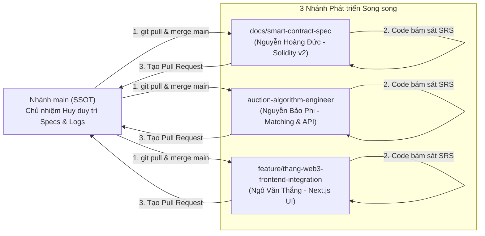

# CarbonChain: Hệ thống Giao dịch Tín chỉ Carbon Minh bạch trên nền tảng Blockchain

> **Đề tài Nghiên cứu Khoa học Sinh viên - ĐH Điện Lực (2026 - 2027)**  
> **Chủ nhiệm đề tài:** Đặng Xuân Huy  
> **Giảng viên hướng dẫn:** TS. Nguyễn Thị Hồng Khánh  
> **Thành viên nghiên cứu:** Đặng Xuân Huy, Ngô Văn Thắng, Nguyễn Hoàng Đức, Nguyễn Bảo Phi  
> **Khoa:** Điện toán và Công nghệ số năng lượng – Trường Đại học Điện Lực (EPU)  

---

## 📌 Tổng quan Dự án

Dự án kết hợp giữa **Công nghệ Blockchain (ERC-1155, Smart Contracts)**, **Lưu trữ phi tập trung (IPFS)**, và **Hệ Đa Tác Tử (Multi-Agent System - MAS)** nhằm giải quyết các bài toán lớn nhất của thị trường carbon tự nguyện (VCM):
1. **Thiếu minh bạch & Trùng lặp tín chỉ (Double Spending/Double Counting):** Giải quyết bằng hợp đồng thông minh chuẩn ERC-1155 và cơ chế đốt token bất biến (Burn on Retirement).
2. **Kém thanh khoản & Định giá thiếu hiệu quả:** Giải quyết bằng **Cơ chế Đấu giá kép định kỳ (Periodic Double Auction - PDA)** kết hợp thuật toán $k$-DA uniform price và thuật toán chia phần dư lớn nhất Hamilton (`age_prorata`).
3. **Chi phí Gas và nghẽn mạng:** Ứng dụng mô hình lai **Off-chain Intelligence, On-chain Trust** (Khớp lệnh ngoài chuỗi qua FastAPI MAS - Xác thực và thanh quyết toán theo lô Batch Settlement trên Polygon Amoy).

---

## 📅 Nhật ký Tiến độ & Quyết định Kỹ thuật Hàng ngày (Daily Progress Logs)

> **Kênh thông tin duy nhất (Single Source of Truth - SSOT):** Mọi thay đổi kỹ thuật, tài liệu đặc tả, quyết định kiến trúc và phân công nhiệm vụ dù là nhỏ nhất đều được Chủ nhiệm đề tài (**Đặng Xuân Huy**) cập nhật liên tục trực tiếp lên nhánh `main`.

- 📂 **Thư mục theo dõi tiến độ tổng thể:** [`docs/progress/`](docs/progress/README.md)
- 📝 **Nhật ký mới nhất [11/11/2026]:** [`docs/progress/2026-11-11/`](docs/progress/2026-11-11/README.md) *(Hợp nhất toàn diện 3 phân hệ vào main, giải quyết xung đột Git, kiểm thử tích hợp chéo thành công và khởi tạo hệ thống giao việc docs/tasks/)*.
- 📋 **Hồ sơ Đặc tả Yêu cầu Phần mềm SRS (IEEE 830):** [`docs/SRS_DOCUMENT.md`](docs/SRS_DOCUMENT.md)
- ⚖️ **Quyết định Kiến trúc Cốt lõi (ADR-001):** [`docs/ADR_001_AUCTION_ARCHITECTURE_DECISIONS.md`](docs/ADR_001_AUCTION_ARCHITECTURE_DECISIONS.md)

---

## 🎯 HỆ THỐNG GIAO VIỆC & BẢNG KANBAN THEO DÕI TASK (IN-REPO TASK MANAGEMENT)

Để tránh tình trạng quá tải thông tin và giúp từng thành viên tập trung tối đa vào phần việc chuyên trách của mình, toàn bộ nhiệm vụ của Sprint Tích hợp Hệ thống (12/11 – 20/11/2026) được quản trị trực tiếp tại thư mục **[`docs/tasks/`](docs/tasks/README.md)**:

- 📊 **Bảng điều khiển Kanban tổng thể:** [`docs/tasks/README.md`](docs/tasks/README.md)
- 📜 **Kế hoạch Sprint chi tiết toàn nhóm:** [`docs/KE_HOACH_PHAN_CONG_NHIEM_VU_CHI_TIET_SPRINT_TICH_HOP.md`](docs/KE_HOACH_PHAN_CONG_NHIEM_VU_CHI_TIET_SPRINT_TICH_HOP.md)

### 📌 File Giao việc Cá nhân theo Từng Thành viên:
Mỗi thành viên chỉ cần mở đúng tệp mang tên mình dưới đây để theo dõi các đầu việc chi tiết, câu lệnh kỹ thuật, tiêu chí nghiệm thu và tự tích dấu `[x]` khi hoàn thành:

| Thành viên | Phân hệ phụ trách | Tệp giao việc cá nhân | Hạn chót Sprint |
| :--- | :--- | :---: | :---: |
| **Nguyễn Hoàng Đức** | Smart Contract & On-chain Settlement (Polygon Amoy) | [`docs/tasks/TASK_DUC_SMART_CONTRACT.md`](docs/tasks/TASK_DUC_SMART_CONTRACT.md) | **16/11/2026** |
| **Nguyễn Bảo Phi** | Matching Engine, FastAPI Service & Game Theory | [`docs/tasks/TASK_PHI_AUCTION_ENGINE.md`](docs/tasks/TASK_PHI_AUCTION_ENGINE.md) | **20/11/2026** |
| **Ngô Văn Thắng** | Web3 Frontend DApp, Metadata Schema & UI/UX Figma | [`docs/tasks/TASK_THANG_FRONTEND_WEB3.md`](docs/tasks/TASK_THANG_FRONTEND_WEB3.md) | **20/11/2026** |
| **Đặng Xuân Huy** | Lead Architect, Kiểm thử E2E, Slide & Báo cáo GVHD | [`docs/tasks/TASK_HUY_LEAD_COORDINATION.md`](docs/tasks/TASK_HUY_LEAD_COORDINATION.md) | **20/11/2026** |

### 🛠️ Quy trình 5 bước thực hiện task:
1. **Mở file task cá nhân:** Đọc kỹ mô tả công việc, tiêu chí nghiệm thu và hạn chót.
2. **Tạo nhánh làm việc:** `git checkout -b feat/<ten-ban>-<ten-task>` từ nhánh `main` mới nhất.
3. **Thực hiện code & kiểm thử:** Đảm bảo toàn bộ unit test của phân hệ mình pass 100%.
4. **Cập nhật tiến độ:** Đổi dấu `- [ ]` thành `- [x]` trong file task cá nhân và ghi chú ngắn gọn ở mục nhật ký cuối file.
5. **Tạo Pull Request:** Đẩy nhánh lên GitHub và tạo PR vào `main` để Chủ nhiệm đề tài (Đặng Xuân Huy) review và merge.

---

## 🔄 QUY TRÌNH PHỐI HỢP KỸ THUẬT GIAI ĐOẠN 2 (ENGINEERING WORKFLOW)

Để đảm bảo toàn bộ 4 thành viên phối hợp nhịp nhàng, không bị lệch spec hay xung đột mã nguồn, toàn nhóm tuân thủ nghiêm ngặt quy trình làm việc sau:



### 1. Nguyên tắc "Bắt đầu ngày mới" cho 3 thành viên (Đức, Phi, Thắng)
Mỗi khi bắt đầu làm việc, thành viên bắt buộc thực hiện 3 bước:
1. **Kiểm tra Nhật ký Tiến độ:** Mở [`docs/progress/`](docs/progress/README.md) xem bản ghi ngày gần nhất để nắm rõ các quyết định kiến trúc hoặc thay đổi spec từ Lead Architect.
2. **Kéo cập nhật mới nhất từ `main` về nhánh của mình:**
   ```bash
   git checkout <ten-nhanh-cua-ban>
   git fetch origin
   git merge origin/main
   ```
3. **Đối soát tài liệu đặc tả chuẩn:** Mọi cấu trúc struct, tham số hàm, logic khớp lệnh bắt buộc đối soát trực tiếp với [`docs/SRS_DOCUMENT.md`](docs/SRS_DOCUMENT.md) (IEEE 830) và [`docs/ADR_001_AUCTION_ARCHITECTURE_DECISIONS.md`](docs/ADR_001_AUCTION_ARCHITECTURE_DECISIONS.md).

---

### 2. Phân công Trách nhiệm & Hạn chót Bàn giao (RACI Matrix)

| Thành viên | Nhánh Git làm việc | Nhiệm vụ trọng tâm cần hoàn thành | Spec đối soát chính | Hạn chót (Deadline) |
| :--- | :--- | :--- | :--- | :---: |
| **Đặng Xuân Huy**<br/>*(Lead Architect)* | `main` | • Duy trì tài liệu kiến trúc, hồ sơ SRS IEEE 830.<br/>• Điều phối, giải quyết xung đột tích hợp 3 bên.<br/>• Tự động ghi nhật ký tiến độ hàng ngày lên `main`. | `docs/SRS_DOCUMENT.md`<br/>`docs/progress/` | **Liên tục hàng ngày** |
| **Nguyễn Hoàng Đức**<br/>*(Smart Contract)* | `docs/smart-contract-spec` | • Viết code Solidity v2 cho `CarbonDoubleAuction.sol`.<br/>• Cài đặt đủ **7 chốt chặn bảo mật** và hàm `batchSettleTrades`.<br/>• Viết test Hardhat/Foundry đo gas thật ($< 100k$ gas/lệnh).<br/>• Deploy Polygon Amoy và xuất file ABI chuẩn cho Thắng. | **FR-11, FR-12**<br/>trong `SRS_DOCUMENT.md` | **20/11/2026** |
| **Nguyễn Bảo Phi**<br/>*(Auction Algorithm)* | `auction-algorithm-engineer` | • Thay thế `auction_agent.py` bằng `session_engine.py`.<br/>• Cài đặt quy tắc giá $k$-DA uniform price và chia Hamilton.<br/>• Dựng Mock API FastAPI (`POST /orders`, `GET /orderbook`, `POST /sessions/run`).<br/>• Mô phỏng thực nghiệm đo Surplus Split & BNE Deadweight Loss. | **FR-06, FR-07, FR-08, FR-15**<br/>trong `SRS_DOCUMENT.md` | **25/11/2026** |
| **Ngô Văn Thắng**<br/>*(Web3 Frontend)* | `feature/thang-web3-frontend-integration` | • Chuẩn hóa schema `docs/METADATA_SCHEMA.json`.<br/>• Hoàn thiện Wireframe Figma 4 phân hệ Web3 DApp.<br/>• Tích hợp luồng ký EIP-712 Gasless và gọi API FastAPI của Phi.<br/>• Bổ sung đồng hồ đếm ngược phiên (5p/15p) và order status. | **FR-04, FR-09**<br/>trong `SRS_DOCUMENT.md` | **30/11/2026** |

---

### 3. Quy chuẩn Dữ liệu & Quy ước Kỹ thuật Toàn dự án
Để tránh hoàn toàn lỗi sai lệch giá trị hoặc không tương thích giữa các phân hệ:
- **Tiền tệ thanh toán:** `MockUSDC` chuẩn ERC-20 với đúng **6 chữ số thập phân (`decimals = 6`)**. Đơn vị tính trong struct là **Micro-USDC** ($1 \text{ USD} = 10^6 \text{ micro-USDC}$). **Nghiêm cấm tuyệt đối sử dụng thuật ngữ `wei USDC`**.
- **Tín chỉ Carbon:** Hợp đồng `CarbonCredit1155.sol` với đơn vị $1 \text{ token} = 1 \text{ tCO}_2\text{e}$ (`decimals = 0`). Khối lượng lưu bằng kiểu số nguyên `uint128 amount`.
- **Chu kỳ phiên đấu giá:** **5 phút** cho bản Testnet Demo (Call Phase: 4m30s, Match: 15s, Settle: 15s) và **15 phút** cho môi trường thực tế.
- **Quy tắc giá:** Giá khớp đồng nhất toàn phiên $P^* = \lfloor (b_M + s_M) / 2 \rfloor$ theo $k$-DA ($k=0.5$).
- **Giới hạn Rollover:** Lệnh GTC tự động hết hạn (`EXPIRED`) sau tối đa **3 phiên liên tiếp**.

---

### 4. Quy trình Tạo Pull Request (PR) về `main`
Khi một thành viên hoàn thành một mốc công việc:
1. Đảm bảo nhánh của mình đã merge code mới nhất từ `main` và chạy test thành công:
   ```bash
   git merge origin/main
   # Chạy test suite tương ứng (hardhat test, pytest, npm run build)
   ```
2. Đẩy nhánh lên GitHub: `git push origin <ten-nhanh>`
3. Mở Pull Request vào `main` trên GitHub, gán reviewer là **Đặng Xuân Huy** (`@HuyDangXuan`).
4. Chủ nhiệm đề tài rà soát, kiểm tra đối soát 7 chốt chặn bảo mật và merge vào `main`.

---

## 🤖 HỆ THỐNG 7 AI SUB-AGENTS TRỢ LỰC TRONG DỰ ÁN

Hệ sinh thái AI ảo được thiết lập trong trợ lý Antigravity để ghép cặp hỗ trợ từng thành viên:

| Tên Sub-Agent | Thành viên ghép cặp | Chuyên môn & Nhiệm vụ hỗ trợ | Lệnh gọi mẫu trong Chat |
| :--- | :--- | :--- | :--- |
| **`lead-architect-progress-logger`** | **Đặng Xuân Huy** *(Độc quyền)* | Tự động quét Git diff, phát hiện mọi thay đổi từ nhỏ nhất, lập nhật ký ngày vào `docs/progress/` và push lên `main`. | *"Gọi agent `lead-architect-progress-logger` quét thay đổi hôm nay và push lên main giúp tôi."* |
| **`scientific-research-writer`** | **Đặng Xuân Huy** | Soạn thảo báo cáo NCKH chuẩn IMRaD, trích dẫn BibTeX, hoàn thiện hồ sơ IEEE 830. | *"Nhờ agent `scientific-research-writer` hoàn thiện Mục 4 SRS."* |
| **`smart-contract-auditor`** | **Nguyễn Hoàng Đức** | Viết code Solidity v2, tối ưu gas, audit 7 chốt chặn bảo mật và cấu trúc EIP-712. | *"Nhờ agent `smart-contract-auditor` cài đặt 7 chốt chặn bảo mật trong hàm batchSettleTrades."* |
| **`auction-algorithm-specialist`** | **Nguyễn Bảo Phi** | Cài đặt giải thuật $k$-DA uniform price, chia Hamilton `age_prorata`, mô phỏng BNE Deadweight Loss. | *"Nhờ agent `auction-algorithm-specialist` viết hàm chia pro-rata Hamilton trong session_engine.py."* |
| **`fullstack-web3-engineer`** | **Ngô Văn Thắng** | Lập trình giao diện Next.js, ký EIP-712 trên MetaMask, kết nối API FastAPI của Phi. | *"Nhờ agent `fullstack-web3-engineer` viết hook ký EIP-712 và kết nối POST /api/v1/orders."* |
| **`benchmark-evaluation-specialist`** | **Cả nhóm** | Viết script đo gas on-chain, đo TPS, độ trễ và trực quan hóa biểu đồ khoa học. | *"Nhờ agent `benchmark-evaluation-specialist` viết test Hardhat đo gas cho hàm batchSettleTrades."* |
| **`git-commit-agent`** | **Cả nhóm** | Tự động soát file thay đổi, soạn commit message chuẩn Conventional Commits và đồng bộ Git an toàn. | *"Nhờ agent `git-commit-agent` commit và push các thay đổi lên nhánh của tôi."* |

> 📖 *Xem hướng dẫn chi tiết từng agent tại:* [`docs/HUONG_DAN_SU_DUNG_SUB_AGENTS.md`](docs/HUONG_DAN_SU_DUNG_SUB_AGENTS.md)

---

## 📂 Cấu trúc Thư mục Dự án

```text
Blockchain/
├── .gemini/skills/             # Cấu hình AI Sub-Agents vĩnh viễn (Lead Architect Logger...)
├── contracts/                  # Smart Contracts (Solidity v2: ERC-1155 & Double Auction)
│   ├── CarbonCredit1155.sol    # Quản lý Lô tín chỉ & Buffer Pool Vault
│   └── CarbonDoubleAuction.sol # Thanh quyết toán theo lô (Batch Settlement)
├── system_agents/              # Hệ Đa Tác Tử ngoài chuỗi (Python FastAPI MAS)
│   ├── matching_engine/        # Auction Matching Engine (k-DA & Hamilton Session Engine)
│   ├── simulation_agent/       # Bot mô phỏng thị trường (Zero-Intelligence / Adaptive)
│   ├── mrv_agent/              # Thẩm tra hồ sơ & cấp mã băm IPFS
│   ├── oracle_agent/           # Giám sát dải giá an toàn & chống thao túng
│   └── retirement_agent/       # Tiêu hủy bù đắp & cấp chứng nhận ESG
├── docs/                       # Hồ sơ Thiết kế Kỹ thuật & Báo cáo NCKH
│   ├── progress/               # Nhật ký tiến độ & quyết định kỹ thuật hàng ngày (SSOT trên main)
│   │   ├── README.md           # Dashboard tổng thể & Template nhật ký
│   │   └── 2026-11-10/         # Nhật ký chi tiết ngày 10/11/2026
│   ├── SRS_DOCUMENT.md         # Đặc tả yêu cầu phần mềm IEEE 830-1998 & 4 biểu đồ UML Mermaid
│   ├── ADR_001_AUCTION_ARCHITECTURE_DECISIONS.md # Quyết định kiến trúc khóa 4 thông số
│   ├── SYSTEM_ARCHITECTURE.md  # Bản vẽ kiến trúc tổng thể v2.0
│   ├── MATCHING_ENGINE_SPEC.md # Đặc tả kỹ thuật Matching Engine & API Service
│   ├── METADATA_SCHEMA.json    # Lược đồ siêu dữ liệu IPFS cho lô tín chỉ
│   └── HUONG_DAN_SU_DUNG_SUB_AGENTS.md # Cẩm nang vận hành 7 AI Sub-Agents
├── scripts/                    # Scripts tự động hóa (log_daily_progress.py, benchmark...)
├── tests/                      # Bộ kiểm thử hợp đồng và giải thuật toán
└── README.md                   # Tài liệu hướng dẫn trung tâm của dự án
```

---

## 🚀 Hướng dẫn Chạy Thử nghiệm Nhanh

### 1. Tự động ghi nhận tiến độ hàng ngày (Dành cho Lead Architect):
```bash
# Tự động quét thay đổi, cập nhật docs/progress/ và push thẳng lên main:
python scripts/log_daily_progress.py --push
```

### 2. Khởi chạy tác tử Khớp lệnh Đấu giá kép:
```bash
cd system_agents/matching_engine
python -m venv venv
.\venv\Scripts\Activate.ps1   # Trên Windows PowerShell
pip install -r requirements.txt
python auction_agent.py
```

### 3. Chạy giả lập tác tử thị trường (Simulation Bots):
```bash
cd system_agents/simulation_agent
python market_maker_agent.py
```

---
*Kho lưu trữ được duy trì và bảo trợ bởi Nhóm NCKH Sinh viên Trường Đại học Điện Lực (EPU) – 2026.*
