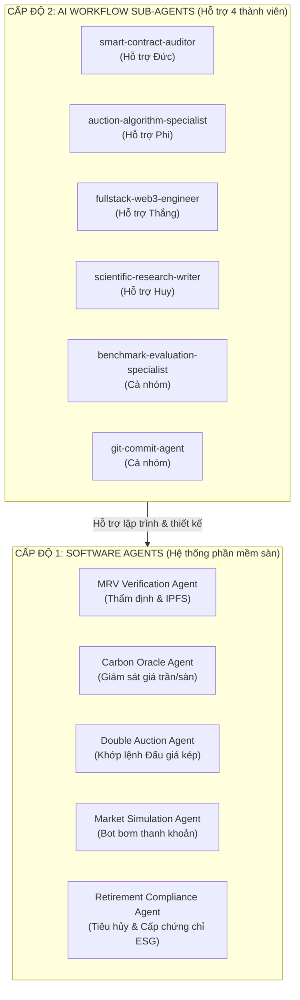

# CẨM NANG HƯỚNG DẪN SỬ DỤNG SUB-AGENTS TRONG DỰ ÁN

> **ĐỀ TÀI:** HỆ THỐNG GIAO DỊCH TÍN CHỈ CARBON MINH BẠCH VÀ HIỆU QUẢ TRÊN NỀN TẢNG BLOCKCHAIN  
> **Nhóm nghiên cứu:** Đặng Xuân Huy (Chủ nhiệm), Ngô Văn Thắng, Nguyễn Hoàng Đức, Nguyễn Bảo Phi  
> **Giảng viên hướng dẫn:** TS. Nguyễn Thị Hồng Khánh  
> **Khoa:** Điện toán và Công nghệ số năng lượng – Trường Đại học Điện Lực  

---

## 📌 TỔNG QUAN HỆ THỐNG SUB-AGENTS

Trong dự án nghiên cứu khoa học này, khái niệm **Sub-Agent** được triển khai đồng thời trên **2 cấp độ riêng biệt**:

1. **Cấp độ 1: Hệ Đa Tác Tử trong Kiến trúc Phần mềm (System Architecture Multi-Agent System - MAS):**
   * Là 5 tác tử phần mềm tự hành được viết bằng **Python** đặt trong thư mục `system_agents/`.
   * Đóng vai trò vận hành tự động các nghiệp vụ của sàn: Thẩm định hồ sơ (MRV), Đặt dải giá (Oracle), Khớp lệnh Đấu giá kép (Matching Engine), Tạo thanh khoản giả lập (Simulation) và Tiêu hủy tín chỉ (Retirement).
2. **Cấp độ 2: Các Trợ lý AI Hỗ trợ Nhóm Nghiên cứu (AI Workflow Sub-Agents):**
   * Là 6 chuyên gia AI ảo được thiết lập trực tiếp trong môi trường trợ lý **Antigravity**.
   * Đóng vai trò cố vấn chuyên môn, ghép cặp với 4 bạn sinh viên để viết code Solidity, tối ưu giải thuật, thiết kế DApp, viết báo cáo NCKH chuẩn IEEE và quản lý Git.



---

## PHẦN 1: HƯỚNG DẪN CÁC TÁC TỬ PHẦN MỀM HỆ THỐNG (SYSTEM AGENTS)
*(Mã nguồn nằm trong thư mục [`system_agents/`](file:///e:/CODE/NCKH/Blockchain/system_agents/))*

### 1.1. Chuẩn bị môi trường chạy Python
Để chạy các tác tử hệ thống trên máy tính cá nhân, bạn mở PowerShell/Terminal tại thư mục dự án và thực hiện:
```bash
# Di chuyển vào thư mục dự án
cd e:\CODE\NCKH\Blockchain

# Khuyến nghị: Tạo môi trường ảo Python (nếu chưa có)
python -m venv venv
.\venv\Scripts\Activate.ps1
```

---

### 1.2. Chi tiết 5 Tác tử và Cách chạy

#### 1. Auction & Matching Agent (Tác tử Khớp lệnh Đấu giá kép)
* **Vị trí:** [`system_agents/matching_engine/auction_agent.py`](file:///e:/CODE/NCKH/Blockchain/system_agents/matching_engine/auction_agent.py)
* **Chức năng:** 
  * Quản lý Sổ lệnh (OrderBook: Lệnh mua `BID` và Lệnh bán `ASK`).
  * Thực thi thuật toán khớp lệnh tham lam hai con trỏ tối ưu $O(n \log n + m \log m)$.
  * Xác định mức giá cân bằng thị trường $P^*$ theo quy tắc $k$-Double Auction ($k=0.5$ Mid-price rule).
* **Lệnh chạy thử:**
  ```bash
  python system_agents\matching_engine\auction_agent.py
  ```
* **Kết quả mẫu:**
  ```text
  --- CHẠY THỬ NGHIỆM ĐẤU GIÁ KÉP (DOUBLE AUCTION AGENT) ---
  Khớp lệnh #1: Mua [BID_1] x Bán [ASK_1] -> Khối lượng: 100 tCO2e | Giá khớp: $11.0/tCO2e
  Khớp lệnh #2: Mua [BID_1] x Bán [ASK_2] -> Khối lượng: 50 tCO2e | Giá khớp: $11.75/tCO2e
  ```

---

#### 2. Market Simulation Agent (Tác tử Mô phỏng Thị trường)
* **Vị trí:** [`system_agents/simulation_agent/market_maker_agent.py`](file:///e:/CODE/NCKH/Blockchain/system_agents/simulation_agent/market_maker_agent.py)
* **Chức năng:** 
  * Đóng vai trò là các bot tự động đại diện cho hàng chục người mua (Doanh nghiệp xi măng, nhiệt điện, thép...) và người bán (Dự án trồng rừng, điện mặt trời...).
  * Tự động sinh hàng trăm lệnh mua/bán ngẫu nhiên dựa trên mức định giá nội tại (Valuation) và biên độ kỳ vọng lợi nhuận ($5\% - 20\%$). Phục vụ kiểm thử tải và đánh giá tính thanh khoản.
* **Lệnh chạy thử:**
  ```bash
  python system_agents\simulation_agent\market_maker_agent.py
  ```
* **Kết quả mẫu:**
  ```text
  === KHỞI CHẠY MÔ PHỎNG THỊ TRƯỜNG: 8 NGƯỜI MUA x 8 NGƯỜI BÁN ===
  [KẾT QUẢ KHỚP LỆNH THỰC NGHIỆM]
  - Số lượt khớp lệnh: 12
  - Tổng khối lượng giao dịch: 296 tCO2e
  - Tổng giá trị giao dịch: $3,457.93
  - Giá thanh toán trung bình: $11.68 / tCO2e
  ```

---

#### 3. MRV Verification Agent (Tác tử Thẩm định & Xác minh Hồ sơ)
* **Vị trí:** [`system_agents/mrv_agent/mrv_agent.py`](file:///e:/CODE/NCKH/Blockchain/system_agents/mrv_agent/mrv_agent.py)
* **Chức năng:**
  * Kiểm tra tính toàn vẹn của hồ sơ dự án PDD và số liệu đo đạc giảm phát thải $CO_2$.
  * Đóng gói Metadata chuẩn ERC-1155, tính toán mã băm SHA-256 bất biến và tạo mã IPFS CID đại diện.
  * Xuất bằng chứng phê duyệt cho Smart Contract để mở quyền đúc token (`mint`).
* **Lệnh chạy thử:**
  ```bash
  python system_agents\mrv_agent\mrv_agent.py
  ```

---

#### 4. Carbon Oracle Agent (Tác tử Giám sát Giá & Cảnh báo)
* **Vị trí:** [`system_agents/oracle_agent/oracle_agent.py`](file:///e:/CODE/NCKH/Blockchain/system_agents/oracle_agent/oracle_agent.py)
* **Chức năng:**
  * Cung cấp mức giá carbon tham chiếu quốc tế cho từng loại dự án (Rừng: $14.50, Năng lượng: $8.20...).
  * Thiết lập hành lang dải giá an toàn (Floor price & Ceiling price với biên độ $\pm 40\%$).
  * Quét các lệnh đặt mua/bán trước khi vào sổ lệnh để phát hiện và ngăn chặn hành vi rửa lệnh (*wash-trading*) hoặc thao túng thị trường.
* **Lệnh chạy thử:**
  ```bash
  python system_agents\oracle_agent\oracle_agent.py
  ```

---

#### 5. Retirement Compliance Agent (Tác tử Bù đắp & Cấp Chứng nhận ESG)
* **Vị trí:** [`system_agents/retirement_agent/retirement_agent.py`](file:///e:/CODE/NCKH/Blockchain/system_agents/retirement_agent/retirement_agent.py)
* **Chức năng:**
  * Tiếp nhận yêu cầu tiêu hủy tín chỉ của doanh nghiệp để bù đắp dấu chân carbon (Scope 1, 2, 3).
  * Gọi hàm đốt token on-chain (`_burn()`), đảm bảo tín chỉ bị loại bỏ vĩnh viễn khỏi lưu thông (chống trùng lặp - No Double Counting).
  * Sinh chứng chỉ bù đắp **ESG Offset Certificate** bất biến kèm mã băm SHA-256 để kiểm toán công khai.
* **Lệnh chạy thử:**
  ```bash
  python system_agents\retirement_agent\retirement_agent.py
  ```

---

## PHẦN 2: HƯỚNG DẪN CÁC AI SUB-AGENT HỖ TRỢ NHÓM (AI WORKFLOW)
*(Đã được kích hoạt sẵn trong hệ thống trợ lý Antigravity)*

Các AI Sub-Agent này là những chuyên gia ảo được tinh chỉnh chuyên sâu để hỗ trợ 4 bạn sinh viên trong suốt quá trình nghiên cứu và làm đồ án.

### 2.1. Danh mục 6 AI Sub-Agent và Phân công Hỗ trợ

| Tên AI Sub-Agent | Thành viên ghép cặp | Vai trò & Chuyên môn trọng tâm |
| :--- | :--- | :--- |
| **`smart-contract-auditor`** | **Nguyễn Hoàng Đức** | Chuyên sâu về **Solidity, ERC-1155, Polygon Amoy**. Tối ưu hóa gas (packed storage, custom errors), thiết kế cơ chế Quỹ dự phòng (Buffer Pool Vault) và audit các lỗ hổng Reentrancy, Front-running, Access Control. |
| **`auction-algorithm-specialist`** | **Nguyễn Bảo Phi** | Chuyên sâu về **Thuật toán Đấu giá kép & Kinh tế học vi mô**. Thiết kế quy tắc phá hòa (Tie-breaking rules), xử lý lệnh chuyển tiếp (Order Rollover), tối ưu hàm thặng dư xã hội và xuất mã giả (pseudocode). |
| **`fullstack-web3-engineer`** | **Ngô Văn Thắng** | Chuyên sâu về **Web3 DApp & Giao diện người dùng**. Hỗ trợ xây dựng giao diện Next.js, kết nối ví MetaMask qua Ethers.js/Viem, chuẩn hóa Metadata JSON Schema cho IPFS Pinata. |
| **`scientific-research-writer`** | **Đặng Xuân Huy** | Chuyên sâu về **Viết báo cáo NCKH & Học thuật**. Soạn thảo tài liệu đặc tả SRS chuẩn IEEE 830, viết báo cáo nghiên cứu cấu trúc IMRaD, chuẩn hóa trích dẫn BibTeX và hỗ trợ bài báo hội nghị. |
| **`benchmark-evaluation-specialist`** | **Cả nhóm** | Chuyên sâu về **Kiểm thử tải & Thực nghiệm**. Viết script đo lường chi phí Gas thực tế, thông lượng TPS, thời gian khớp lệnh và trực quan hóa số liệu thành biểu đồ khoa học (Matplotlib/Seaborn). |
| **`git-commit-agent`** | **Cả nhóm** | Chuyên gia **DevOps & Quản trị mã nguồn**. Tự động rà soát file thay đổi, soạn commit message chuẩn quốc tế **Conventional Commits** (`feat:`, `fix:`, `docs:`) và đồng bộ lên GitHub an toàn. |

---

### 2.2. Cách sử dụng AI Sub-Agents trong Chat (Prompt Templates)

Khi bạn hoặc thành viên trong nhóm cần thực hiện một công việc cụ thể, **chỉ cần chat trực tiếp yêu cầu kèm theo tên Agent** vào cửa sổ chat. Trợ lý sẽ tự động điều phối agent chuyên trách xử lý:

#### 📌 Mẫu 1: Dành cho bạn Đức (Smart Contract)
```text
"Hãy triệu hồi agent `smart-contract-auditor` để thiết kế interface `ICarbonCredit1155` và cấu trúc struct cho lô tín chỉ (vintage, projectID, totalMinted, bufferAmount)."
```

#### 📌 Mẫu 2: Dành cho bạn Phi (Thuật toán Đấu giá)
```text
"Nhờ agent `auction-algorithm-specialist` viết mã giả (pseudocode) chi tiết cho thuật toán phá hòa (Tie-breaking rule) ưu tiên theo thời gian nộp lệnh (FIFO) khi hai lệnh mua có cùng mức giá."
```

#### 📌 Mẫu 3: Dành cho bạn Thắng (Metadata & DApp)
```text
"Dùng agent `fullstack-web3-engineer` tạo tệp mẫu `docs/METADATA_SCHEMA.json` chứa đầy đủ các trường thông tin thẩm định theo chuẩn Verra VCS và Gold Standard."
```

#### 📌 Mẫu 4: Dành cho bạn Huy (Viết báo cáo SRS)
```text
"Gọi agent `scientific-research-writer` soạn thảo Mục 3: 'Yêu cầu chức năng chi tiết (Functional Requirements)' cho tài liệu đặc tả `docs/SRS_DOCUMENT.md` theo chuẩn IEEE 830."
```

#### 📌 Mẫu 5: Dành cho cả nhóm khi kiểm thử thực nghiệm
```text
"Nhờ agent `benchmark-evaluation-specialist` viết một script Python đo lường mức tiêu hao Gas trung bình cho từng hàm (mint, submitBid, settleAuction, retire) và vẽ biểu đồ so sánh."
```

#### 📌 Mẫu 6: Dành cho cả nhóm khi đẩy mã nguồn lên Git
```text
"Nhờ agent `git-commit-agent` kiểm tra các file vừa thay đổi trong dự án và thực hiện commit, push lên GitHub giúp tôi."
```

---

## PHẦN 3: NGUYÊN TẮC PHỐI HỢP TRONG GIAI ĐOẠN 2

1. **Rà soát tính tương thích chéo:**
   * Cấu trúc dữ liệu trong `METADATA_SCHEMA.json` (do bạn Thắng làm) phải khớp hoàn toàn với cấu trúc metadata của `MRVVerificationAgent` và hàm `uri()` trên Smart Contract (do bạn Đức làm).
   * Định dạng dữ liệu đầu ra từ `Auction & Matching Agent` (do bạn Phi làm) phải tương thích với tham số của hàm `settleMatchedTrade` trên hợp đồng `CarbonDoubleAuction.sol`.
2. **Quy chuẩn mã nguồn:**
   * Mọi Smart Contract viết bằng Solidity `^0.8.20`.
   * Mọi script Python tuân thủ chuẩn PEP 8 và tương thích Python 3.10+.
   * Mọi tài liệu kỹ thuật lưu trong thư mục `docs/` định dạng Markdown UTF-8.
3. **Commit định kỳ:** Sau mỗi ngày làm việc hoặc sau khi hoàn thành một đầu việc, hãy sử dụng `git-commit-agent` để đẩy toàn bộ thay đổi lên GitHub để đảm bảo an toàn dữ liệu.

---
*Tài liệu được lưu trữ trực tiếp tại: [`docs/HUONG_DAN_SU_DUNG_SUB_AGENTS.md`](file:///e:/CODE/NCKH/Blockchain/docs/HUONG_DAN_SU_DUNG_SUB_AGENTS.md)*
