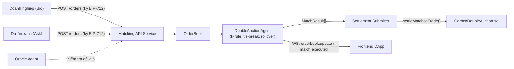
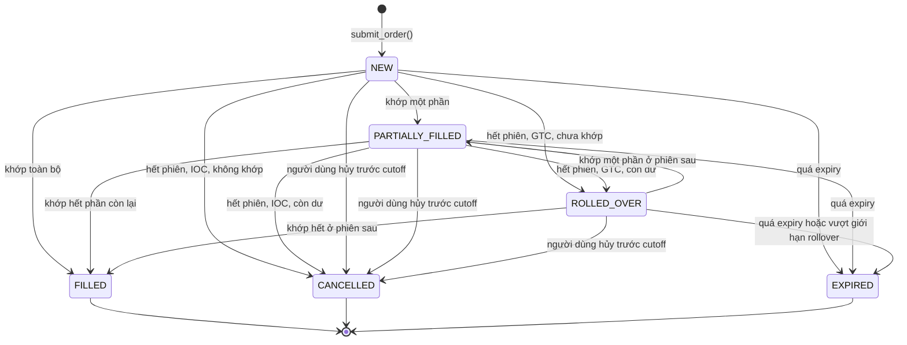
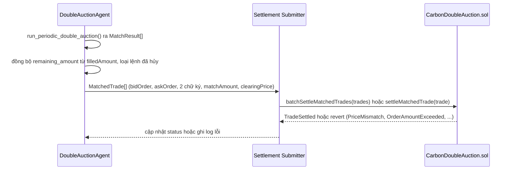

# Đặc tả Kỹ thuật: Matching Engine & API Service (Giai đoạn 2)

**Đề tài:** Hệ thống giao dịch tín chỉ carbon minh bạch và hiệu quả trên nền tảng Blockchain
**Giai đoạn:** Giai đoạn 2 — Phân tích Yêu cầu và Thiết kế Chi tiết Hệ thống (11/2026 – 01/2027)
**Người phụ trách:** Nguyễn Bảo Phi (Auction Algorithm Engineer)
**Phối hợp:** Đặng Xuân Huy (SRS/UML), Nguyễn Hoàng Đức (CarbonDoubleAuction.sol/EIP-712)
**Trạng thái:** Bản thiết kế (design spec) — chưa triển khai đầy đủ, chưa có kết quả thực nghiệm. Phần nào đã có code tham chiếu tới `system_agents/matching_engine/`; phần còn lại là đề xuất cần nhóm/GVHD chốt trước khi code hóa ở Giai đoạn 3.

---

## 1. Mục tiêu và Phạm vi

Tài liệu đặc tả ba nội dung thuộc phần việc của Giai đoạn 2:

1. **Logic Matching Engine chi tiết**: quy tắc phá hòa (tie-breaking) khi nhiều lệnh cùng mức giá và cơ chế chuyển tiếp lệnh chưa khớp giữa các phiên (Order Rollover).
2. **Đặc tả API Service** cho bộ khớp lệnh: RESTful/WebSocket giữa Matching Agent (Python), Frontend DApp và Smart Contract.
3. **Kế hoạch mô phỏng thực nghiệm toán học** về ảnh hưởng của tham số *k* (viết là *alpha* trong bảng phân công trên Google Doc; cùng một đại lượng).

**Ngoài phạm vi:** thiết kế `CarbonDoubleAuction.sol` (phần của Đức), UI/UX DApp (phần của Thắng), thẩm định MRV.

---

## 2. Vai trò trong Kiến trúc Hệ thống

Matching Engine là tác tử `matching_engine`, vận hành theo mô hình **Off-chain Matching, On-chain Settlement** ([`SYSTEM_ARCHITECTURE.md`](SYSTEM_ARCHITECTURE.md)):



Mã nguồn liên quan:
- [`order_book.py`](../system_agents/matching_engine/order_book.py) — `Order`, `MatchResult`.
- [`auction_agent.py`](../system_agents/matching_engine/auction_agent.py) — `DoubleAuctionAgent`: sắp bid giảm dần/ask tăng dần, ghép hai con trỏ khi `bid >= ask`, giá khớp từng cặp `p = k·bid + (1−k)·ask`.
- [`CarbonDoubleAuction.sol`](../contracts/CarbonDoubleAuction.sol) — `settleMatchedTrade(tradeHash, buyer, seller, tokenId, amount, pricePerUnit)`, chống replay qua `executedTrades[tradeHash]`.

**Hiện trạng cần lưu ý của baseline (đã kiểm tra bằng cách chạy code):**
- `run_periodic_double_auction()` **trừ trực tiếp vào `Order.amount`** của đối tượng đầu vào (một phiên 50 lệnh: tổng amount 1260 → 662). Mô phỏng phải `deepcopy` lệnh trước mỗi lần chạy; bản triển khai chính thức nên dùng `remaining_amount` riêng.
- Giá khớp bị `round(…, 2)`; với giá lệnh có nhiều hơn 2 chữ số thập phân, giá khớp có thể vượt ngoài khoảng [ask, bid] (ví dụ ask=10.001, bid=10.004, k=0 → 10.0). Xem §3.3 (tick giá).
- Tie-break hiện là FIFO theo `timestamp` chính xác — khác với đề xuất ở §5.

---

## 3. Mô hình dữ liệu

### 3.1. Hiện có (`order_book.py`)

`Order(order_id, trader_id, order_type, token_id, amount, price, timestamp, signature)` và `MatchResult(bid_order_id, ask_order_id, token_id, amount, clearing_price, timestamp)`.

### 3.2. Ánh xạ sang `Order` của hợp đồng và trường nội bộ của engine

Spec hợp đồng của Đức [D] (`docs/SMART_CONTRACT_SPEC.md`, §3.2 và §3.4) quy định struct `Order` được ký EIP-712. Engine phải nhận và chuyển tiếp **đúng struct đó**; các trường chỉ có ở engine không được ký.

| Trường engine | Nguồn / ánh xạ | Ghi chú |
|---|---|---|
| `order_id` (code hiện tại: `str`) | `Order.orderId` (`bytes32`) | Đổi sang `bytes32` (hex 0x…) khi code hóa GĐ3. |
| `trader_address` | `Order.trader` (`address`) | `trader_id` nghiệp vụ chỉ còn là nhãn nội bộ. |
| `order_type` | `Order.orderType` (`uint8`: 0 = BID, 1 = ASK) | Khớp `OrderType` hiện có. |
| `token_id` | `Order.tokenId` | |
| `amount` | `Order.amount` (`uint128`) | **Chưa thống nhất đơn vị**, xem §3.3. |
| `price` | `Order.pricePerUnit` (`uint128`, wei của token thanh toán) | Số nguyên, không dùng `float` (§3.3). |
| `nonce` | `Order.nonce` | Chống phát lại; xem §8.1 về `incrementNonce`. |
| `deadline` | `Order.deadline` (epoch giây) | Thay trường `expiry` đề xuất trước đây. |
| `signature` | `bidSignature` / `askSignature` của `MatchedTrade` | |
| `status` | chỉ engine: `NEW \| PARTIALLY_FILLED \| FILLED \| CANCELLED \| EXPIRED \| ROLLED_OVER` | Vòng đời lệnh qua nhiều phiên. |
| `time_in_force` | chỉ engine: `GTC \| IOC` | **Không nằm trong struct được ký**; xem §6.1. |
| `remaining_amount` | chỉ engine, **suy ra từ `filledAmount[orderId]` on-chain** | Hợp đồng là nguồn sự thật về khối lượng đã khớp [D, §3.3, bước 3]; engine đồng bộ đầu mỗi phiên, giữ `amount` gốc bất biến. |
| `first_session_id` / `sessions_alive` | chỉ engine | Ưu tiên theo tuổi (§5.2). |

`MatchResult` bổ sung `session_id` và ánh xạ sang `MatchedTrade` của [D]: `{bidOrder, askOrder, bidSignature, askSignature, matchAmount, clearingPrice}`.

**`trade_hash`:** `MatchedTrade` trong [D] **không có** trường `tradeHash`; sự kiện `TradeSettled` mang `tradeHash` do hợp đồng sinh, và chống phát lại dựa vào `filledAmount` theo từng lệnh cùng `nonce`. Vì vậy `trade_hash` ở phía engine chỉ là **khóa idempotency nội bộ** (tránh gửi hai lần cùng một khớp khi retry), không gửi on-chain. Công thức đề xuất: `keccak256(abi.encode(session_id, bid_order_id, ask_order_id, fill_index))`; dùng `abi.encode` thay `encodePacked` để tránh va chạm giữa các giá trị độ dài biến thiên (tài liệu Solidity cảnh báo `encodePacked("a","bc") == encodePacked("ab","c")` [S1]); `fill_index` cần có vì một cặp lệnh có thể khớp nhiều lần qua các phiên.

### 3.3. Đơn vị, tick giá và giả định

- `amount`: số nguyên (`uint128` on-chain). **Đơn vị đang mâu thuẫn giữa các tài liệu:** [D] §3.2 ghi `kg CO2e`; báo cáo Giai đoạn 1 và các phiên bản trước của spec này ghi 1 token = 1 tCO2e; `CarbonCredit1155.sol` trên `main` không nêu đơn vị. Engine không phụ thuộc đơn vị (chỉ cộng/trừ số nguyên) nhưng phải chốt một đơn vị duy nhất với Đức trước khi code hóa, vì nó đổi cả `max_amount` trong mô phỏng lẫn cách quy đổi tổng thanh toán `matchAmount × clearingPrice`.
- **Tick giá:** hợp đồng kiểm `askOrder.pricePerUnit ≤ clearingPrice ≤ bidOrder.pricePerUnit` và revert `PriceMismatch` nếu vi phạm [D, §3.3, bước 2], nên điều kiện này là **ràng buộc cứng**, không chỉ là bất biến kiểm thử. Giá tính bằng số nguyên theo đơn vị nhỏ nhất của token thanh toán, không dùng `float`. Công thức `k·bid + (1−k)·ask` với số nguyên phải làm tròn sao cho kết quả luôn nằm trong [ask, bid] (ví dụ làm tròn xuống rồi kẹp vào [ask, bid]); hướng làm tròn là quyết định cần chốt. Baseline hiện tại `round(…, 2)` không bảo đảm điều này (ask=10.001, bid=10.004, k=0 → 10.0).
- `token_id` đại diện một lớp tín chỉ đủ điều kiện thay thế (project + vintage); engine chỉ khớp lệnh cùng `token_id` và **không** tự đánh giá tính đồng nhất.

---

## 4. Vòng đời lệnh



`ROLLED_OVER` là trạng thái ổn định giữa hai phiên và được đưa vào snapshot của phiên sau như lệnh còn hiệu lực.

---

## 5. Khớp lệnh theo phiên và Quy tắc phá hòa

### 5.1. Chu kỳ phiên (cutoff)

- Đấu giá chạy theo chu kỳ cố định (độ dài phiên là tham số cấu hình, **chưa chốt** — xem §11).
- Tại cutoff, chụp snapshot các lệnh `NEW | PARTIALLY_FILLED | ROLLED_OVER` chưa hết hạn và chạy `run_periodic_double_auction()`. Lệnh đến sau cutoff thuộc phiên kế tiếp.
- Allocation (ai khớp, bao nhiêu) giữ như baseline: bid giảm dần, ask tăng dần, khớp khi `bid ≥ ask`, hỗ trợ partial fill.

### 5.2. Quy tắc ưu tiên và phá hòa (đề xuất)

Bài Budish, Cramton & Shim (2015) [R3, mục VII.A] mô tả batch auction rời rạc hóa thời gian: lệnh tồn tại qua nhiều batch interval hơn có ưu tiên cao hơn; hai lệnh gửi **trong cùng một batch** có cùng mức ưu tiên bất kể thời điểm chính xác, và khi cần phá hòa thì chia ngẫu nhiên/pro-rata. Spec áp dụng cách này:

1. **Ưu tiên theo giá:** bid cao hơn / ask thấp hơn trước.
2. **Cùng giá → ưu tiên theo tuổi:** lệnh còn lại từ phiên trước (`sessions_alive` lớn hơn) được phân bổ trước. Điều này đồng thời làm rollover không bị phạt (§6).
3. **Cùng giá, cùng tuổi → pro-rata** theo khối lượng còn lại:
   ```
   alloc(o) = floor(available * o.remaining / sum_remaining_cùng_nhóm)
   phần dư do làm tròn xuống: chia lần lượt theo thứ tự (order_id tăng dần)
   ```
   Thứ tự `order_id` là quy tắc tất định, công bố trước, để cùng snapshot luôn cho cùng kết quả.

**Phương án thay thế — FIFO theo timestamp trong phiên** (hành vi baseline hiện tại): đơn giản, tất định, nhưng thưởng cho lệnh đến sớm trong cùng phiên và dễ gây cuộc đua tốc độ — chính vấn đề batch auction nhằm loại bỏ. Giữ làm tùy chọn cấu hình `tie_break_mode: "age_prorata" | "fifo"`.

**Mức độ chứng cứ:** ngoài [R3], một đề xuất cộng đồng cho batch auction đa tài sản cũng nêu quy tắc tương tự (ưu tiên lệnh từ batch cũ hơn, pro-rata chỉ ở batch phải chia phần) [S3]. Đó là đề xuất, không phải tiêu chuẩn. Chưa tìm được tài liệu công khai nào mô tả quy tắc chia phần ở giá hòa của CoW Protocol, nên spec không dựa vào CoW cho điểm này.

**Trạng thái triển khai:** `age_prorata` chưa được code; baseline chỉ có FIFO. Việc code hóa và so sánh hai chế độ thuộc Giai đoạn 3.

### 5.3. Bất biến cần kiểm tra

- Tổng phân bổ cho nhóm cùng ưu tiên không vượt khối lượng đối ứng khả dụng.
- Cùng snapshot → cùng kết quả (tất định).
- Không lệnh nào bị bỏ sót khi vẫn còn khối lượng đối ứng.

---

## 6. Cơ chế Rollover lệnh chưa khớp

| TIF | Hành vi khi hết phiên còn dư |
|---|---|
| **GTC** | `status = ROLLED_OVER`, giữ `price` và `order_id`, tăng `sessions_alive`; được ưu tiên theo tuổi ở phiên sau (§5.2). |
| **IOC** | Phần dư chuyển `CANCELLED` ngay khi phiên kết thúc. |

```mermaid
sequenceDiagram
    participant S as Session Scheduler
    participant E as DoubleAuctionAgent
    participant OB as OrderBook

    S->>E: cutoff(session_id)
    E->>OB: snapshot(NEW, PARTIALLY_FILLED, ROLLED_OVER; chưa hết hạn)
    E->>E: run_periodic_double_auction()
    loop mỗi lệnh còn dư
        alt GTC và chưa vượt giới hạn rollover
            E->>OB: status=ROLLED_OVER, sessions_alive += 1
        else IOC
            E->>OB: status=CANCELLED
        else GTC vượt giới hạn
            E->>OB: status=EXPIRED
        end
    end
    E-->>S: MatchResult[] + rollover_report
```

### 6.1. Ràng buộc từ hợp đồng

- `time_in_force` **không nằm trong struct `Order` được ký** [D, §3.2], nên hợp đồng không bảo đảm engine tôn trọng GTC/IOC mà người dùng chọn. Giới hạn cứng duy nhất do người dùng ký là `deadline`: lệnh hết hạn thì `settleMatchedTrade` revert `SignatureExpired`. Hai hướng cần chốt với Đức: (a) thêm `timeInForce` vào `ORDER_TYPEHASH` để ràng buộc được ký; (b) giữ ngoài chuỗi và coi là tùy chọn không tin cậy của engine, khi đó rollover GTC chỉ là hành vi mặc định trong khoảng `deadline`.
- Lệnh bị hủy trên chuỗi (`cancelOrder`, event `OrderCancelled`) hoặc vô hiệu do `incrementNonce` (event `UserNonceIncremented`) phải bị loại khỏi snapshot; engine lắng nghe các event này. Hủy ngoài chuỗi qua API (§8.2) chỉ là yêu cầu tới engine: nếu engine ngoại tuyến hoặc không tuân thủ, chữ ký cũ vẫn còn hiệu lực đến `deadline`; muốn bảo đảm cứng người dùng phải gọi `cancelOrder` on-chain.
- Khối lượng đã khớp lấy từ `filledAmount[orderId]` on-chain; nếu đệ trình khớp vượt phần còn lại, hợp đồng revert `OrderAmountExceeded`. Engine đồng bộ `remaining_amount` đầu phiên để không đề xuất khớp vô hiệu.

Giới hạn: rollover không bảo đảm khớp ở phiên sau; cần `max_rollover_count` hoặc TTL để orderbook không phình vô hạn (**giá trị chưa chốt**, §11). Cơ chế carry-over giữa các phiên đã được mô tả cho batch auction ở [R3]; mô tả rollover theo mô hình sequential của bài về VCM [R1] **chưa được kiểm chứng** vì chưa đọc toàn văn.

---

## 7. Quy tắc xác định giá (cần chốt)

Hai lựa chọn khác nhau về bản chất, spec **chưa chọn**:

| | Giá theo từng cặp (baseline hiện tại) | Giá chung của phiên |
|---|---|---|
| Công thức | `p_ij = k·b_i + (1−k)·a_j` cho từng cặp khớp | một `p*` cho mọi khớp trong phiên, ví dụ trung điểm cặp biên `(b_m + a_m)/2` |
| Ưu điểm | Dễ cài đặt, đúng như code | Cùng lệnh, cùng giá; gần mô hình uniform-price của [R3] |
| Nhược điểm | Các lệnh cùng phía nhận giá khác nhau; khó giải thích tính công bằng | Cần định nghĩa khi có nhiều nghiệm giá; phải kiểm tra `p*` thuộc [ask, bid] của mọi lệnh được khớp |

Cả hai đều **không** bảo đảm khai giá trung thực (midpoint/k-rule không strategy-proof; xem phản ví dụ trong đề cương nội bộ). Phần mô phỏng §9 nên chạy được trên cả hai quy tắc để so sánh.

---

## 8. Đặc tả API Service

### 8.1. Nguyên tắc

- REST cho đặt/hủy/truy vấn; WebSocket cho cập nhật thời gian thực.
- Lệnh ghi phải kèm chữ ký **EIP-712** với domain và struct `Order` theo [D, §3.2] (domain `EPU Carbon Double Auction`, version `2.0`, `chainId` 80002 trên Polygon Amoy). Engine xác minh chữ ký **ngoài chuỗi** để lọc sớm lệnh sai, không giữ private key người dùng; hợp đồng **xác minh lại on-chain** khi settlement [D, §3.3, bước 1], nên engine không phải điểm tin cậy duy nhất cho tính hợp lệ của lệnh.
- API không khóa tài sản khi đặt lệnh (mô hình non-custodial [D, §3.1]); người mua cần `approve` token thanh toán, người bán cần `setApprovalForAll`. Engine có thể kiểm tra `balanceOf`/`allowance` khi nhận lệnh để loại lệnh chắc chắn revert, nhưng kết quả chỉ có tính tham khảo vì số dư thay đổi sau đó.

### 8.2. REST

| Method | Path | Mô tả | Request (rút gọn) | Response |
|---|---|---|---|---|
| `POST` | `/v1/orders` | Đặt lệnh | `{order:{orderId, trader, orderType, tokenId, amount, pricePerUnit, nonce, deadline}, signature, time_in_force}` | `201 {orderId, status:"NEW"}` |
| `DELETE` | `/v1/orders/{orderId}` | Yêu cầu engine bỏ lệnh khỏi các phiên sau (xem §6.1: không thay thế `cancelOrder` on-chain) | `{signature}` (chữ ký của `trader`) | `200 {orderId, status:"CANCELLED"}` |
| `GET` | `/v1/orders/{order_id}` | Trạng thái lệnh | — | `200 {…Order, status, remaining_amount}` |
| `GET` | `/v1/orderbook/{token_id}` | Snapshot sổ lệnh | — | `200 {bids, asks}` |
| `GET` | `/v1/sessions/{session_id}/matches` | Kết quả khớp của phiên | — | `200 {matches}` |
| `GET` | `/v1/sessions/current` | Phiên hiện tại | — | `200 {session_id, cutoff_at}` |

Mã lỗi tối thiểu: `400` (sai cấu trúc/giá trị), `401` (chữ ký sai), `404`, `409` (lệnh đã khớp/hủy), `422` (giá ngoài dải Oracle).

### 8.3. WebSocket

| Kênh | Sự kiện | Payload |
|---|---|---|
| `orderbook.{token_id}` | `orderbook.update` | Delta top-of-book |
| `session.{session_id}` | `match.executed` | `MatchResult` kèm `trade_hash`, trước khi gửi on-chain |
| `session.{session_id}` | `settlement.confirmed` | Khi nhận event `TradeSettled` [D, §3.4] |
| `session.{session_id}` | `settlement.failed` | Khi giao dịch revert; retry có giới hạn, không lặp vô hạn |

### 8.4. Luồng settlement và giới hạn tin cậy



**Trạng thái đối chiếu với spec hợp đồng của Đức [D] (đã đọc bản v2, commit `3194bad`, branch `docs/smart-contract-spec`, chưa merge vào `main`):**
- *Thanh toán nguyên tử:* bản `CarbonDoubleAuction.sol` hiện trên `main` chỉ chuyển token carbon, không có bước trả tiền; [D, §3.1] thiết kế một giao dịch chuyển cả token thanh toán ERC-20 lẫn token carbon và hoàn tác toàn bộ nếu thiếu. Mô hình này phù hợp với DvP thông dụng [S2] (nguồn vendor/blog, không có nguồn riêng cho ERC-1155). **Mã trong `contracts/` chưa được cập nhật theo [D]**, nên đến lúc đó phần thiết kế mới là kế hoạch, không phải hành vi đã có.
- *Xác minh chữ ký và giá on-chain:* [D, §3.3] kiểm chữ ký EIP-712, `ask ≤ clearingPrice ≤ bid`, `filledAmount + matchAmount ≤ amount`. Điều này **giảm** giả định tin cậy vào engine: engine không thể gửi cặp khớp không có chữ ký, vượt giá hay vượt khối lượng. Phần còn lại engine có thể làm sai mà hợp đồng không phát hiện: bỏ sót hoặc ưu tiên sai lệnh hợp lệ (vi phạm công bằng thứ tự, không vi phạm điều kiện on-chain), chọn `clearingPrice` thiên lệch trong khoảng [ask, bid], và trì hoãn phiên.
- *Quyền gọi:* [D] cần quy định rõ ai được gọi `settleMatchedTrade` (code `main` dùng `onlyMatchingAgent`); quản lý khóa của Settlement Submitter thuộc thiết kế bảo mật GĐ2 (mục IV, tuần 5–8 của Google Doc).
- *MEV/front-running:* thứ tự giao dịch on-chain vẫn chịu rủi ro [R9]; chữ ký lệnh không loại bỏ rủi ro này.
- *Batch:* `batchSettleMatchedTrades` bọc từng cặp trong kiểm tra độc lập để một lệnh lỗi không chặn cả phiên [D, §4]; engine cần giới hạn kích thước batch theo gas (ước tính của [D, §5]: 10 cặp ≈ 920.000 gas — số liệu của Đức, chưa được kiểm chứng độc lập).

---

## 9. Kế hoạch mô phỏng thực nghiệm

> Đây là **kế hoạch**, chưa có kết quả chính thức.

### 9.1. Điều kiện để thí nghiệm có ý nghĩa

Kiểm tra sơ bộ bằng baseline hiện có (3 seed, 500 lệnh, giá khai = valuation thật, k ∈ {0, 0.5, 1}) cho thấy **thặng dư xã hội giống hệt nhau với mọi k** (ví dụ 14482.81); k chỉ đổi cách chia giữa bên mua và bên bán (buyer/seller surplus: 14482.81/0 khi k=0, ≈ một nửa mỗi bên khi k=0.5, 0/14482.81 khi k=1). Điều này đúng với lý thuyết: với allocation và valuation cố định, giá chỉ phân chia lợi ích. Vì vậy thiết kế thí nghiệm phải tách hai câu hỏi:

- **Thí nghiệm A — phân chia thặng dư khi khai giá trung thực.** Đo `buyer_surplus`, `seller_surplus`, `welfare` theo k. `welfare` bất biến theo k đóng vai trò **kiểm tra tính đúng (sanity check)**, không phải kết quả nghiên cứu.
- **Thí nghiệm B — tác tử khai giá chiến lược.** Cho tác tử shading giá (bid thấp hơn / ask cao hơn valuation) theo hàm phụ thuộc k (theo hướng mô hình [R4]) hoặc theo chiến lược thích nghi. Đo `welfare`, khối lượng khớp và tỷ lệ giao dịch bị mất so với benchmark khai trung thực. Chỉ ở thí nghiệm này k mới có thể ảnh hưởng đến welfare.

**Hướng thiết kế cho thí nghiệm B:**
- *Đối chứng giải tích (một mua – một bán, một đơn vị):* mô hình Chatterjee–Samuelson [R4] với valuation phân phối đều trên [0,1] và k = 1/2 có cân bằng Bayes tuyến tính; theo các nguồn thứ cấp [S4], bid = (2/3)v + 1/12, ask = (2/3)c + 1/4, nên giao dịch chỉ xảy ra khi v − c ≥ 1/4 và một phần giao dịch có lợi bị bỏ lỡ (hệ quả trực quan của bất khả thi Myerson–Satterthwaite [R7]). Đối chiếu đến nay: (i) hai bài arXiv độc lập nêu cùng hệ số (arXiv:1207.4171 và arXiv:1210.5541), (ii) tính lại bằng tìm kiếm phản ứng tối ưu số trên lưới (bid ≈ 0,09 + 0,66v, ask ≈ 0,25 + 0,66c, sai lệch trong phạm vi độ phân giải lưới) — kết quả tuyến tính này đúng trên miền v ≥ 1/4; bên dưới đó chiến lược là từng đoạn tuyến tính. **Chưa đối chiếu với bài gốc [R4]** (chưa có toàn văn); cần kiểm tra trước khi trích trong báo cáo. Cân bằng của k-double auction không duy nhất, nên đây chỉ là một lựa chọn cân bằng. Nếu hệ số khớp, kết quả dùng làm bài kiểm tra tính đúng của mô phỏng (mô phỏng 1v1 phải tái tạo ngưỡng này).
- *Nhiều lệnh, nhiều đơn vị (100–500 lệnh):* kết quả giải tích trên không áp dụng trực tiếp. Hướng dự kiến là tác tử học thích nghi kiểu Zero-Intelligence Plus (ZIP) [S5]; chưa tìm được nguồn về bid shading phụ thuộc k trong bối cảnh nhiều đơn vị, nên chiến lược cụ thể vẫn là câu hỏi mở (§11).

> **Cần trao đổi với Huy/GVHD:** mô tả nhiệm vụ trên Google Doc ("so sánh social welfare giữa k = 0, 0.5, 1 để tìm tham số tối ưu") chỉ có nghĩa nếu có thí nghiệm B. Nên chỉnh lại câu chữ nhiệm vụ cho khớp.

### 9.2. Biến số

| Biến | Giá trị dự kiến |
|---|---|
| Số lệnh | 100, 200, 500 |
| k | 0, 0.5, 1 |
| Quy tắc giá | theo cặp (baseline) và giá chung của phiên (§7) |
| Tie-break | `fifo` và `age_prorata` (§5.2) — chỉ khi đã code |
| Phân phối valuation | uniform làm điểm khởi đầu; **chưa chốt** |
| Số lần lặp | ≥ 30 seed mỗi cấu hình (đề xuất, chưa chốt) |
| `token_id` | một lớp tín chỉ cố định |

### 9.3. Chỉ số

- `welfare = Σ (valuation_bid − valuation_ask) · amount` trên các cặp khớp; so với **welfare tối đa khả thi** tính từ toàn bộ valuation (chỉ tính được trong mô phỏng).
- `buyer_surplus`, `seller_surplus`: phần chia theo giá khớp.
- `fill_rate` và khối lượng khớp so với benchmark tối ưu.
- Thuật ngữ "spread": dùng **bid-ask spread của sổ lệnh** (best_ask − best_bid trước phiên) khi cần; chênh lệch giữa giá khớp và valuation gọi là phần chia thặng dư, không gọi là spread để tránh nhầm.

### 9.4. Quy trình

```python
for k in (0, 0.5, 1):
    for n in (100, 200, 500):
        for seed in range(N_RUNS):
            base = generate_orders(n, seed, token_id=101)   # có valuation ẩn
            orders = copy.deepcopy(base)                     # tránh baseline sửa Order.amount
            agent = DoubleAuctionAgent(k_parameter=k)
            for o in apply_bidding_strategy(orders):         # trung thực (A) hoặc shading (B)
                agent.submit_order(o)
            matches = agent.run_periodic_double_auction(101)
            log(k, n, seed, welfare(matches, base), buyer_surplus(...), seller_surplus(...), fill_rate(...))
```

Đầu ra dự kiến: script trong `system_agents/matching_engine/simulation/` (chưa tồn tại) và bảng/biểu đồ chỉ đưa vào báo cáo sau khi đã chạy thật.

---

## 10. Bất biến và kế hoạch kiểm thử

Bất biến (theo mục 10.1 của đề cương nội bộ, tài liệu ngoài repo):

- Khối lượng mua khớp = khối lượng bán khớp; không lệnh nào khớp vượt `amount` gốc.
- `ask ≤ clearing_price ≤ bid` cho mọi cặp (kể cả sau làm tròn tick, §3.3).
- Lệnh `FILLED/CANCELLED/EXPIRED` không xuất hiện lại ở phiên sau.
- Không cặp khớp nào được gửi hai lần: engine dùng khóa idempotency `trade_hash` (§3.2) và đối chiếu `filledAmount` on-chain trước khi gửi, để tránh tốn gas cho giao dịch revert [R12].
- Mọi `clearingPrice` đưa lên chuỗi thỏa `ask ≤ clearingPrice ≤ bid` bằng số nguyên (nếu không, hợp đồng revert `PriceMismatch`).
- Cùng snapshot → cùng kết quả.

Kịch bản test tối thiểu (chưa viết): sổ trống; một phía trống; bid < ask toàn bộ; bid = ask; nhiều lệnh cùng giá và tuổi (pro-rata + phần dư); lệnh khác tuổi cùng giá; partial fill; hủy sát cutoff; hết hạn; rollover nhiều phiên; trùng `order_id`; giá nhiều chữ số thập phân.

---

## 11. Giới hạn và câu hỏi mở

1. Độ dài phiên (cutoff).
2. Tie-break mặc định: `age_prorata` hay `fifo`; có code pro-rata ở GĐ2 không.
3. Giá theo cặp hay giá chung của phiên (§7).
4. `max_rollover_count`/TTL cho lệnh GTC.
5. Thiết kế thí nghiệm B: chiến lược khai giá nào (ZIP hay hàm shading theo k), kiểm tra hệ số Chatterjee–Samuelson với bài gốc, và chỉnh lại câu chữ nhiệm vụ trên Google Doc.
6. **Đơn vị `amount`: kg CO2e hay tCO2e** (mâu thuẫn giữa [D] và báo cáo GĐ1; §3.3), cần chốt với Đức.
7. Hướng làm tròn giá khớp nguyên (§3.3) và đơn vị `pricePerUnit` (wei của token thanh toán nào, bao nhiêu chữ số thập phân).
8. `time_in_force` có đưa vào struct được ký không (§6.1).
9. Ngữ nghĩa `nonce`/`incrementNonce` của [D]: tăng nonce vô hiệu hóa mọi lệnh cũ hay từng lệnh; ảnh hưởng tới lệnh GTC đang nằm trong sổ.
10. Cập nhật `contracts/` theo [D] (hiện `main` chưa có bước thanh toán và xác minh chữ ký on-chain) và thứ tự merge branch của Đức.
11. Quản lý khóa của Settlement Submitter, quyền gọi `settleMatchedTrade`, và phương án khi tác tử ngừng hoạt động.

---

## 12. Tài liệu tham khảo

Đánh số [R*] theo đề cương nội bộ của người phụ trách (tài liệu ngoài repo, chứa DOI và trạng thái truy cập toàn văn đầy đủ):

- **[R3]** Budish, E., Cramton, P., & Shim, J. (2015). The High-Frequency Trading Arms Race: Frequent Batch Auctions as a Market Design Response. *Quarterly Journal of Economics*, 130(4), 1547–1621. — ưu tiên theo tuổi/pro-rata trong cùng batch (mục VII.A), carry-over giữa batch (§5, §6).
- **[R4]** Chatterjee, K., & Samuelson, W. (1983). Bargaining under Incomplete Information. *Operations Research*, 31(5), 835–851. — k-double auction; cơ sở cho thí nghiệm B.
- **[R1]** Liu, X., et al. (2026). Blockchain and double auction for credible and efficient voluntary carbon market. *Applied Energy*, 412, 127719. — bài trực tiếp về VCM; chi tiết rule và rollover **chưa đọc toàn văn**, không dùng làm căn cứ cho khẳng định cụ thể ở tài liệu này.
- **[R9]** Daian, P., et al. (2020). Flash Boys 2.0. *IEEE S&P*, 910–927. — MEV (§8.4).
- **[R12]** Ethereum.org, *Gas and fees* — chi phí giao dịch revert (§10).
- **[D]** Nguyễn Hoàng Đức, *Tài liệu đặc tả kỹ thuật Smart Contract*, `docs/SMART_CONTRACT_SPEC.md`, bản v2, commit `3194bad` (06/11/2026), branch `docs/smart-contract-spec` (chưa merge vào `main` tại thời điểm viết). Nguồn nội bộ của nhóm, chưa được kiểm toán độc lập; các số liệu gas trong đó chưa được kiểm chứng.
- **[R7]** Myerson, R. B., & Satterthwaite, M. A. (1983). Efficient Mechanisms for Bilateral Trading. *Journal of Economic Theory*, 29(2), 265–281.

Nguồn web bổ sung (truy cập 02/11/2026), đánh dấu mức độ tin cậy:
- **[S1]** Solidity documentation, *Contract ABI Specification* (mục non-standard packed mode): https://docs.soliditylang.org/en/latest/abi-spec.html — tài liệu chính thức; đã đọc.
- **[S2]** Chainlink, *How Atomic Settlement Enables Onchain DvP*: https://chain.link/article/atomic-settlement-onchain-dvp; Allium, *Atomic Settlement for Tokenized Securities Explained*: https://allium.so/blog/atomic-settlement-for-tokenized-securities-explained/ — tài liệu vendor/blog, chỉ dùng để mô tả khái niệm DvP; chỉ nắm qua kết quả tìm kiếm, chưa đọc toàn bài.
- **[S3]** ethresear.ch, *Matching strategy for multi-asset batch auctions*: https://ethresear.ch/t/matching-strategy-for-multi-asset-batch-auctions/6248 — đề xuất cộng đồng, không phản biện; chỉ nắm qua tóm tắt tìm kiếm.
- **[S4]** Hệ số cân bằng Chatterjee–Samuelson: nguồn thứ cấp (trang tổng hợp/máy tính trực tuyến); **chưa đối chiếu với [R4]**.
- **[S5]** Tesfatsion, tài liệu tổng hợp về double auction/ZIP: https://faculty.sites.iastate.edu/tesfatsi/archive/tesfatsi/aauction.htm — chỉ nắm qua kết quả tìm kiếm.
