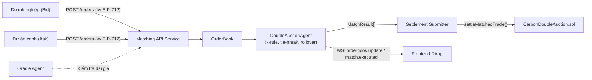
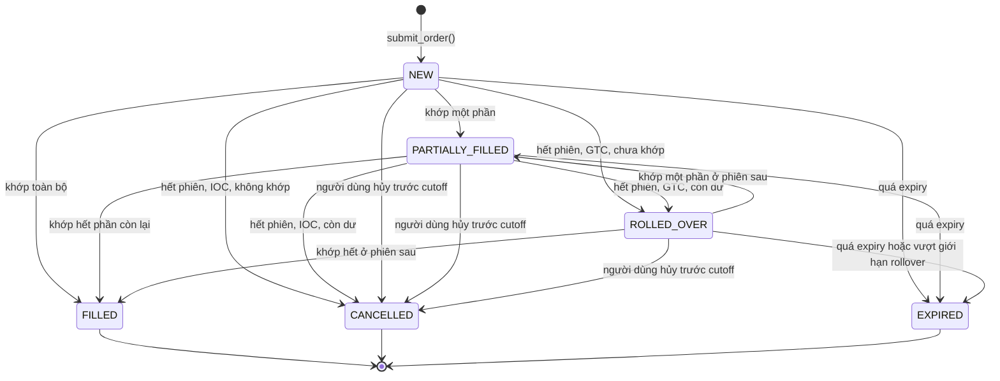
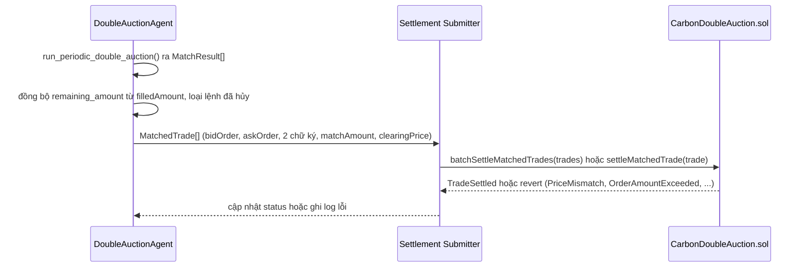

# Đặc tả Kỹ thuật: Matching Engine & API Service (Giai đoạn 2)

**Đề tài:** Hệ thống giao dịch tín chỉ carbon minh bạch và hiệu quả trên nền tảng Blockchain
**Giai đoạn:** Giai đoạn 2 — Phân tích Yêu cầu và Thiết kế Chi tiết Hệ thống (11/2026 – 01/2027)
**Người phụ trách:** Nguyễn Bảo Phi (Auction Algorithm Engineer)
**Phối hợp:** Đặng Xuân Huy (SRS/UML), Nguyễn Hoàng Đức (CarbonDoubleAuction.sol/EIP-712)
**Trạng thái:** Bản thiết kế (design spec), cập nhật 10/11/2026 — chưa triển khai đầy đủ. Đã có bộ mô phỏng và kết quả thực nghiệm sơ bộ trong `system_agents/matching_engine/simulation/` (mục 9.5, kèm giới hạn cách đọc); phần còn lại là đề xuất cần nhóm/GVHD chốt trước khi code hóa ở Giai đoạn 3.

---

## 1. Mục tiêu và Phạm vi

Tài liệu đặc tả ba nội dung thuộc phần việc của Giai đoạn 2:

1. **Logic Matching Engine chi tiết**: quy tắc phá hòa (tie-breaking) khi nhiều lệnh cùng mức giá và cơ chế chuyển tiếp lệnh chưa khớp giữa các phiên (Order Rollover).
2. **Đặc tả API Service** cho bộ khớp lệnh: RESTful/WebSocket giữa Matching Agent (Python), Frontend DApp và Smart Contract.
3. **Kế hoạch mô phỏng thực nghiệm toán học** về ảnh hưởng của tham số *k* (viết là *alpha* trong bảng phân công trên Google Doc; cùng một đại lượng).

**Ngoài phạm vi:** thiết kế `CarbonDoubleAuction.sol` (phần của Đức), UI/UX DApp (phần của Thắng), thẩm định MRV.

---

## 2. Vai trò trong Kiến trúc Hệ thống

Matching Engine là tác tử `matching_engine`, vận hành theo mô hình **Off-chain Matching, On-chain Settlement** ([`SYSTEM_ARCHITECTURE.md`](SYSTEM_ARCHITECTURE.md)):



Mã nguồn liên quan:
- [`order_book.py`](../system_agents/matching_engine/order_book.py) — `Order`, `MatchResult`.
- [`auction_agent.py`](../system_agents/matching_engine/auction_agent.py) — `DoubleAuctionAgent`: sắp bid giảm dần/ask tăng dần, ghép hai con trỏ khi `bid >= ask`, giá khớp từng cặp `p = k·bid + (1−k)·ask`.
- [`CarbonDoubleAuction.sol`](../contracts/CarbonDoubleAuction.sol) — **bản đang trên `main` (cũ):** `settleMatchedTrade(tradeHash, buyer, seller, tokenId, amount, pricePerUnit)`, chống replay qua `executedTrades[tradeHash]`, chỉ chuyển token carbon. Thiết kế mới của Đức [D] đổi hàm thành `settleMatchedTrade(MatchedTrade)`, chống replay bằng `filledAmount` và `nonce`, kèm thanh toán ERC-20; spec này bám theo [D] từ §3 trở đi.

**Hiện trạng cần lưu ý của baseline (đã kiểm tra bằng cách chạy code):**
- `run_periodic_double_auction()` **trừ trực tiếp vào `Order.amount`** của đối tượng đầu vào (một phiên 50 lệnh: tổng amount 1260 → 662). Mô phỏng phải `deepcopy` lệnh trước mỗi lần chạy; bản triển khai chính thức nên dùng `remaining_amount` riêng.
- Giá khớp bị `round(…, 2)`; với giá lệnh có nhiều hơn 2 chữ số thập phân, giá khớp có thể vượt ngoài khoảng [ask, bid] (ví dụ ask=10.001, bid=10.004, k=0 → 10.0). Xem §3.3 (tick giá).
- Tie-break hiện là FIFO theo `timestamp` chính xác — khác với đề xuất ở §5.

---

## 3. Mô hình dữ liệu

### 3.1. Hiện có (`order_book.py`)

`Order(order_id, trader_id, order_type, token_id, amount, price, timestamp, signature)` và `MatchResult(bid_order_id, ask_order_id, token_id, amount, clearing_price, timestamp)`.

### 3.2. Ánh xạ sang `Order` của hợp đồng và trường nội bộ của engine

Spec hợp đồng của Đức [D] (`docs/SMART_CONTRACT_SPEC.md`, §3.2 và §3.4) quy định struct `Order` được ký EIP-712. Engine phải nhận và chuyển tiếp **đúng struct đó**; các trường chỉ có ở engine không được ký.

| Trường engine | Nguồn / ánh xạ | Ghi chú |
|---|---|---|
| `order_id` (code hiện tại: `str`) | `Order.orderId` (`bytes32`) | Đổi sang `bytes32` (hex 0x…) khi code hóa GĐ3. |
| `trader_address` | `Order.trader` (`address`) | `trader_id` nghiệp vụ chỉ còn là nhãn nội bộ. |
| `order_type` | `Order.orderType` (`uint8`: 0 = BID, 1 = ASK) | Khớp `OrderType` hiện có. |
| `token_id` | `Order.tokenId` | |
| `amount` | `Order.amount` (`uint128`) | **Chưa thống nhất đơn vị**, xem §3.3. |
| `price` | `Order.pricePerUnit` (`uint128`, wei của token thanh toán) | Số nguyên, không dùng `float` (§3.3). |
| `nonce` | `Order.nonce` | Chống phát lại; xem §8.1 về `incrementNonce`. |
| `deadline` | `Order.deadline` (epoch giây) | Thay trường `expiry` đề xuất trước đây. |
| `signature` | `bidSignature` / `askSignature` của `MatchedTrade` | |
| `status` | chỉ engine: `NEW \| PARTIALLY_FILLED \| FILLED \| CANCELLED \| EXPIRED \| ROLLED_OVER` | Vòng đời lệnh qua nhiều phiên. |
| `time_in_force` | chỉ engine: `GTC \| IOC` | **Không nằm trong struct được ký**; xem §6.1. |
| `remaining_amount` | chỉ engine, **suy ra từ `filledAmount[orderId]` on-chain** | Hợp đồng là nguồn sự thật về khối lượng đã khớp [D, §3.3, bước 3]; engine đồng bộ đầu mỗi phiên, giữ `amount` gốc bất biến. |
| `first_session_id` / `sessions_alive` | chỉ engine | Ưu tiên theo tuổi (§5.2). |

`MatchResult` bổ sung `session_id` và ánh xạ sang `MatchedTrade` của [D]: `{bidOrder, askOrder, bidSignature, askSignature, matchAmount, clearingPrice}`.

**`trade_hash`:** `MatchedTrade` trong [D] **không có** trường `tradeHash`; sự kiện `TradeSettled` mang `tradeHash` do hợp đồng sinh, và chống phát lại dựa vào `filledAmount` theo từng lệnh cùng `nonce`. Vì vậy `trade_hash` ở phía engine chỉ là **khóa idempotency nội bộ** (tránh gửi hai lần cùng một khớp khi retry), không gửi on-chain. Công thức đề xuất: `keccak256(abi.encode(session_id, bid_order_id, ask_order_id, fill_index))`; dùng `abi.encode` thay `encodePacked` để tránh va chạm giữa các giá trị độ dài biến thiên (tài liệu Solidity cảnh báo `encodePacked("a","bc") == encodePacked("ab","c")` [S1]); `fill_index` cần có vì một cặp lệnh có thể khớp nhiều lần qua các phiên.

### 3.3. Đơn vị, tick giá và giả định

- `amount`: số nguyên (`uint128` on-chain). **Đơn vị đang mâu thuẫn giữa các tài liệu:** [D] §3.2 ghi `kg CO2e`; báo cáo Giai đoạn 1 và các phiên bản trước của spec này ghi 1 token = 1 tCO2e; `CarbonCredit1155.sol` trên `main` không nêu đơn vị. Engine không phụ thuộc đơn vị (chỉ cộng/trừ số nguyên) nhưng phải chốt một đơn vị duy nhất với Đức trước khi code hóa, vì nó đổi cả `max_amount` trong mô phỏng lẫn cách quy đổi tổng thanh toán `matchAmount × clearingPrice`.
- **Tick giá:** hợp đồng kiểm `askOrder.pricePerUnit ≤ clearingPrice ≤ bidOrder.pricePerUnit` và revert `PriceMismatch` nếu vi phạm [D, §3.3, bước 2], nên điều kiện này là **ràng buộc cứng**, không chỉ là bất biến kiểm thử. Giá tính bằng số nguyên theo đơn vị nhỏ nhất của token thanh toán, không dùng `float`. Công thức `k·bid + (1−k)·ask` với số nguyên phải làm tròn sao cho kết quả luôn nằm trong [ask, bid] (ví dụ làm tròn xuống rồi kẹp vào [ask, bid]); hướng làm tròn là quyết định cần chốt (đề xuất ở đoạn kế tiếp). Baseline hiện tại `round(…, 2)` không bảo đảm điều này (ask=10.001, bid=10.004, k=0 → 10.0).
- **Hướng làm tròn (đề xuất, chờ chốt với Đức):** tính bằng số nguyên `n = k_num·bid + (k_den−k_num)·ask`, `q, r = divmod(n, k_den)`. Mọi cách làm tròn về `q` hoặc `q+1` đều nằm trong `[ask, bid]` vì `n/k_den` nằm giữa hai số nguyên đó. Về thiên lệch: `floor` luôn có lợi bên mua, `ceil` luôn có lợi bên bán; `half_up` đối xứng trừ khi phần lẻ đúng bằng 0,5 (xảy ra với k = 1/2 khi `bid + ask` lẻ) và khi đó luôn đẩy giá lên; `half_even` (làm tròn về số chẵn khi đúng 0,5) triệt tiêu thiên lệch đó theo kỳ vọng và vẫn tất định. Đề xuất mặc định `half_even`; đây là lập luận số học, đã được tham vấn Argon cho cùng kết luận, không phải quy chuẩn của một sàn cụ thể.
- `token_id` đại diện một lớp tín chỉ đủ điều kiện thay thế (project + vintage); engine chỉ khớp lệnh cùng `token_id` và **không** tự đánh giá tính đồng nhất.

---

## 4. Vòng đời lệnh



`ROLLED_OVER` là trạng thái ổn định giữa hai phiên và được đưa vào snapshot của phiên sau như lệnh còn hiệu lực.

---

## 5. Khớp lệnh theo phiên và Quy tắc phá hòa

### 5.1. Chu kỳ phiên (cutoff)

- Đấu giá chạy theo chu kỳ cố định (độ dài phiên là tham số cấu hình, **chưa chốt** — xem §11).
- Tại cutoff, chụp snapshot các lệnh `NEW | PARTIALLY_FILLED | ROLLED_OVER` chưa hết hạn và chạy `run_periodic_double_auction()`. Lệnh đến sau cutoff thuộc phiên kế tiếp.
- Allocation (ai khớp, bao nhiêu) giữ như baseline: bid giảm dần, ask tăng dần, khớp khi `bid ≥ ask`, hỗ trợ partial fill.

### 5.2. Quy tắc ưu tiên và phá hòa (đề xuất)

Bài Budish, Cramton & Shim (2015) [R3, mục VII.A] mô tả batch auction rời rạc hóa thời gian: lệnh tồn tại qua nhiều batch interval hơn có ưu tiên cao hơn; hai lệnh gửi **trong cùng một batch** có cùng mức ưu tiên bất kể thời điểm chính xác, và khi cần phá hòa thì chia ngẫu nhiên/pro-rata. Spec áp dụng cách này:

1. **Ưu tiên theo giá:** bid cao hơn / ask thấp hơn trước.
2. **Cùng giá → ưu tiên theo tuổi:** lệnh còn lại từ phiên trước (`sessions_alive` lớn hơn) được phân bổ trước. Điều này đồng thời làm rollover không bị phạt (§6).
3. **Cùng giá, cùng tuổi → pro-rata** theo khối lượng còn lại:
   ```
   alloc(o) = floor(available * o.remaining / sum_remaining_cùng_nhóm)
   phần dư sau floor (nhỏ hơn số lệnh trong nhóm): largest remainder (Hamilton) — mỗi lệnh có phần dư
   thập phân (available * o.remaining mod sum_remaining) / sum_remaining; cộng 1 đơn vị cho các lệnh theo phần dư
   giảm dần, hòa thì ưu tiên lệnh có remaining lớn hơn, hòa nữa thì order_id tăng dần
   ```
   Quy tắc công bố trước và tất định để cùng snapshot luôn cho cùng kết quả. **Không** chia phần dư theo `order_id` tăng dần: quy tắc đó thiên lệch có hệ thống cho `order_id` nhỏ và bị khai thác bằng cách chọn `order_id` hoặc tách một lệnh thành nhiều lệnh nhỏ để nhận nhiều đơn vị dư hơn. Largest remainder bỏ được thiên lệch theo `order_id`, nhưng **chưa được chứng minh** là chống tách lệnh (chưa phân tích mức lợi tối đa của việc tách; cần kiểm bằng mô phỏng ở bước code hóa).

   **Giới hạn chống thao túng:** gộp lệnh theo tài khoản không có tác dụng trên chuỗi vì tạo địa chỉ ví không tốn chi phí (Sybil); phải giảm động cơ bằng chính sách ở lớp API/hợp đồng: khối lượng đặt lệnh tối thiểu, giới hạn số lệnh mở trên mỗi địa chỉ, kiểm số dư/số lượng token ký quỹ trước khi nhận lệnh. **Ưu tiên theo tuổi** cũng cần: mọi sửa giá hoặc tăng khối lượng là hủy lệnh cũ và gửi lệnh mới với tuổi 0 (tự nhiên với lệnh ký EIP-712 bất biến), để không thể nuôi tuổi bằng lệnh giá xa rồi sửa giá; và biên độ giá đặt lệnh quanh giá tham chiếu để hạn chế lệnh giữ chỗ.

**Phương án thay thế — FIFO theo timestamp trong phiên** (hành vi baseline hiện tại): đơn giản, tất định, nhưng thưởng cho lệnh đến sớm trong cùng phiên và dễ gây cuộc đua tốc độ — chính vấn đề batch auction nhằm loại bỏ. Giữ làm tùy chọn cấu hình `tie_break_mode: "age_prorata" | "fifo"`.

**Mức độ chứng cứ:** ngoài [R3], một đề xuất cộng đồng cho batch auction đa tài sản cũng nêu quy tắc tương tự (ưu tiên lệnh từ batch cũ hơn, pro-rata chỉ ở batch phải chia phần) [S3]. Đó là đề xuất, không phải tiêu chuẩn. Chưa tìm được tài liệu công khai nào mô tả quy tắc chia phần ở giá hòa của CoW Protocol, nên spec không dựa vào CoW cho điểm này.

**Trạng thái triển khai:** `age_prorata` chưa được code; baseline chỉ có FIFO. Việc code hóa và so sánh hai chế độ thuộc Giai đoạn 3.

### 5.3. Bất biến cần kiểm tra

- Tổng phân bổ cho nhóm cùng ưu tiên không vượt khối lượng đối ứng khả dụng.
- Cùng snapshot → cùng kết quả (tất định).
- Không lệnh nào bị bỏ sót khi vẫn còn khối lượng đối ứng.

---

## 6. Cơ chế Rollover lệnh chưa khớp

| TIF | Hành vi khi hết phiên còn dư |
|---|---|
| **GTC** | `status = ROLLED_OVER`, giữ `price` và `order_id`, tăng `sessions_alive`; được ưu tiên theo tuổi ở phiên sau (§5.2). |
| **IOC** | Phần dư chuyển `CANCELLED` ngay khi phiên kết thúc. |

```mermaid
sequenceDiagram
    participant S as Session Scheduler
    participant E as DoubleAuctionAgent
    participant OB as OrderBook

    S->>E: cutoff(session_id)
    E->>OB: snapshot(NEW, PARTIALLY_FILLED, ROLLED_OVER; chưa hết hạn)
    E->>E: run_periodic_double_auction()
    loop mỗi lệnh còn dư
        alt GTC và chưa vượt giới hạn rollover
            E->>OB: status=ROLLED_OVER, sessions_alive += 1
        else IOC
            E->>OB: status=CANCELLED
        else GTC vượt giới hạn
            E->>OB: status=EXPIRED
        end
    end
    E-->>S: MatchResult[] + rollover_report
```

### 6.1. Ràng buộc từ hợp đồng

- `time_in_force` **không nằm trong struct `Order` được ký** [D, §3.2], nên hợp đồng không bảo đảm engine tôn trọng GTC/IOC mà người dùng chọn. Giới hạn cứng duy nhất do người dùng ký là `deadline`: lệnh hết hạn thì `settleMatchedTrade` revert `SignatureExpired`. Hai hướng cần chốt với Đức: (a) thêm `timeInForce` vào `ORDER_TYPEHASH` để ràng buộc được ký; (b) giữ ngoài chuỗi và coi là tùy chọn không tin cậy của engine, khi đó rollover GTC chỉ là hành vi mặc định trong khoảng `deadline`.
- Lệnh bị hủy trên chuỗi (`cancelOrder`, event `OrderCancelled`) hoặc vô hiệu do `incrementNonce` (event `UserNonceIncremented`) phải bị loại khỏi snapshot; engine lắng nghe các event này. Hủy ngoài chuỗi qua API (§8.2) chỉ là yêu cầu tới engine: nếu engine ngoại tuyến hoặc không tuân thủ, chữ ký cũ vẫn còn hiệu lực đến `deadline`; muốn bảo đảm cứng người dùng phải gọi `cancelOrder` on-chain.
- **Kiểm tra trạng thái ngay trước khi gửi:** engine có thể đã ngoại tuyến khi người dùng gọi `incrementNonce` hoặc `cancelOrder`, nên lệnh `ROLLED_OVER` nằm trong sổ có thể đã vô hiệu mà engine chưa biết. Trước mỗi lần gửi settlement, engine đọc lại nonce hiện tại, trạng thái hủy và `filledAmount` của cả hai lệnh; lệnh không hợp lệ bị loại và đề xuất khớp tính lại.
- **Cuộc đua với `deadline`:** khớp ở cutoff không đảm bảo giao dịch on-chain nằm trong hạn; nếu block chứa giao dịch có timestamp sau `deadline` thì hợp đồng revert `SignatureExpired`. Engine loại lệnh có `deadline < cutoff + biên_an_toàn` (biên cần chốt, tối thiểu bằng thời gian xác nhận block ước tính cộng thời gian chờ batch).
- **Phân bổ bằng 0:** pro-rata sau `floor` có thể cho `matchAmount = 0` với lệnh nhỏ; engine bỏ qua các lần khớp bằng 0, không gửi lên chuỗi (hợp đồng của Đức yêu cầu số lượng dương hay không là điểm cần xác nhận).
- Khối lượng đã khớp lấy từ `filledAmount[orderId]` on-chain; nếu đệ trình khớp vượt phần còn lại, hợp đồng revert `OrderAmountExceeded`. Engine đồng bộ `remaining_amount` đầu phiên để không đề xuất khớp vô hiệu.

Giới hạn: rollover không bảo đảm khớp ở phiên sau; cần `max_rollover_count` hoặc TTL để orderbook không phình vô hạn (**giá trị chưa chốt**, §11). Cơ chế carry-over giữa các phiên đã được mô tả cho batch auction ở [R3]; mô tả rollover theo mô hình sequential của bài về VCM [R1] **chưa được kiểm chứng** vì chưa đọc toàn văn.

---

## 7. Quy tắc xác định giá (cần chốt)

Có **ba** quy tắc để so sánh. Ký hiệu cho thị trường nhiều lệnh một đơn vị (mở rộng nhiều đơn vị theo từng đơn vị): `b(j)` là bid thứ j giảm dần, `a(j)` là ask thứ j tăng dần, `m*` là số cặp khớp (`b(j) ≥ a(j)`), `b_m = b(m*)`, `a_m = a(m*)`, `b_next` là bid cao nhất chưa khớp, `a_next` là ask thấp nhất chưa khớp.

| | Giá theo từng cặp (`pair`, baseline hiện tại) | Giá chung "cặp biên" (`marginal`) | Giá chung k-double auction (`kda`) |
|---|---|---|---|
| Công thức | `p_j = k·b(j) + (1−k)·a(j)` cho từng cặp | mọi cặp: `k·b_m + (1−k)·a_m` | mọi cặp: `p = k·hi + (1−k)·lo`, `hi = min(b_m, a_next)`, `lo = max(a_m, b_next)` |
| Tương đương | — | — | `p = (1−k)·s(m) + k·s(m+1)` với `s(i)` là báo giá thứ i (tăng dần) trong 2m báo giá gộp khi có đúng m bid và m ask |
| `ask ≤ p ≤ bid` cho mọi cặp được khớp | có | có | có (`[lo, hi] ⊂ [a_m, b_m]`) |
| Làm sạch thị trường | không áp dụng | **không**: có thể còn ask chưa khớp sẵn lòng bán ở `p`. Ví dụ BID 10, ASK 1, ASK 2, `k = 1/2`: `p = 5,5` nhưng ASK 2 không được khớp | có: `p` nằm trong khoảng giá cân bằng cung–cầu đã khai |
| Kết quả lý thuyết | chưa có (xem dưới) | không có | có, xem dưới |
| Nhược điểm | các lệnh cùng phía nhận giá khác nhau; khó giải thích công bằng | không dùng làm ứng viên | giá phụ thuộc cả lệnh không khớp (`a_next`, `b_next`); cần cài đặt cẩn thận khi thiếu một trong hai |

**Quy tắc `marginal` là ví dụ trong bản spec trước ("trung điểm cặp biên") và bị loại khỏi danh sách ứng viên** vì không làm sạch thị trường (phản ví dụ ở bảng trên); giữ lại chỉ để đối chứng thực nghiệm.

**Căn cứ cho `kda`.** Satterthwaite & Williams (1989) [SW89] (đã đọc toàn văn): trong "buyer's bid double auction" (tương ứng `k = 1`) giá đặt tại `s(m+1)` của 2m báo giá gộp; người bán khai đúng giá trị là chiến lược trội; ở mọi cân bằng người mua khai thấp hơn giá trị thật tối đa O(1/m) bất kể phân phối; với các cách chọn giá khác thì **cả hai phía** đều khai lệch. Cân bằng của người mua **không tuyến tính** (nghiệm một phương trình vi phân). Rustichini, Satterthwaite & Williams (1994) [RSW94] (mới đọc tóm tắt): với giá "đặt để cân bằng cung–cầu đã khai", ở mọi cân bằng mức khai lệch là O(1/m) và mất hiệu quả là O(1/m²). Việc kết quả này **đúng cho mọi `k ∈ [0,1]`** chưa được kiểm chứng từ nguồn gốc (tóm tắt không nêu `k`); một tham vấn Argon cho là đúng nhưng chưa có đối chiếu độc lập. Quy tắc `kda` ở bảng trên là khái quát hóa của nhóm từ `k = 1` sang `k` bất kỳ theo hướng "giá nằm trong khoảng cân bằng cung–cầu", nhất quán với [SW89] ở `k = 1`.

**Với giá theo từng cặp không có định lý công bố** về tốc độ hội tụ (tham vấn Argon cũng không biết kết quả nào; chưa tìm được nguồn). Dự đoán "hội tụ chậm hơn" là giả thuyết và được đo ở mục 9.5 (thí nghiệm C), chỉ trích khi thí nghiệm hoàn tất.

**Đề xuất (chờ nhóm chốt):** chọn `kda` làm quy tắc giá mặc định vì (i) có cơ sở lý thuyết ở tài liệu gốc, (ii) mọi lệnh khớp cùng giá, dễ giải thích, (iii) giữ ràng buộc cứng `ask ≤ p ≤ bid` mà hợp đồng kiểm (§3.3). Cả ba quy tắc **không** bảo đảm khai giá trung thực (k-rule không strategy-proof; ngay cả `k = 1` người bán trung thực nhưng người mua vẫn khai thấp). Phần mô phỏng §9 chạy trên cả ba để so sánh.

---

## 8. Đặc tả API Service

### 8.1. Nguyên tắc

- REST cho đặt/hủy/truy vấn; WebSocket cho cập nhật thời gian thực.
- Lệnh ghi phải kèm chữ ký **EIP-712** với domain và struct `Order` theo [D, §3.2] (domain `EPU Carbon Double Auction`, version `2.0`, `chainId` 80002 trên Polygon Amoy). Engine xác minh chữ ký **ngoài chuỗi** để lọc sớm lệnh sai, không giữ private key người dùng; hợp đồng **xác minh lại on-chain** khi settlement [D, §3.3, bước 1], nên engine không phải điểm tin cậy duy nhất cho tính hợp lệ của lệnh.
- API không khóa tài sản khi đặt lệnh (mô hình non-custodial [D, §3.1]); người mua cần `approve` token thanh toán, người bán cần `setApprovalForAll`. Engine có thể kiểm tra `balanceOf`/`allowance` khi nhận lệnh để loại lệnh chắc chắn revert, nhưng kết quả chỉ có tính tham khảo vì số dư thay đổi sau đó.

### 8.2. REST

| Method | Path | Mô tả | Request (rút gọn) | Response |
|---|---|---|---|---|
| `POST` | `/v1/orders` | Đặt lệnh | `{order:{orderId, trader, orderType, tokenId, amount, pricePerUnit, nonce, deadline}, signature, time_in_force}` | `201 {orderId, status:"NEW"}` |
| `DELETE` | `/v1/orders/{orderId}` | Yêu cầu engine bỏ lệnh khỏi các phiên sau (xem §6.1: không thay thế `cancelOrder` on-chain) | `{signature}` (chữ ký của `trader`) | `200 {orderId, status:"CANCELLED"}` |
| `GET` | `/v1/orders/{order_id}` | Trạng thái lệnh | — | `200 {…Order, status, remaining_amount}` |
| `GET` | `/v1/orderbook/{token_id}` | Snapshot sổ lệnh | — | `200 {bids, asks}` |
| `GET` | `/v1/sessions/{session_id}/matches` | Kết quả khớp của phiên | — | `200 {matches}` |
| `GET` | `/v1/sessions/current` | Phiên hiện tại | — | `200 {session_id, cutoff_at}` |

Mã lỗi tối thiểu: `400` (sai cấu trúc/giá trị), `401` (chữ ký sai), `404`, `409` (lệnh đã khớp/hủy), `422` (giá ngoài dải Oracle).

### 8.3. WebSocket

| Kênh | Sự kiện | Payload |
|---|---|---|
| `orderbook.{token_id}` | `orderbook.update` | Delta top-of-book |
| `session.{session_id}` | `match.executed` | `MatchResult` kèm `trade_hash`, trước khi gửi on-chain |
| `session.{session_id}` | `settlement.confirmed` | Khi nhận event `TradeSettled` [D, §3.4] |
| `session.{session_id}` | `settlement.failed` | Khi giao dịch revert; retry có giới hạn, không lặp vô hạn |

### 8.4. Luồng settlement và giới hạn tin cậy



**Trạng thái đối chiếu với spec hợp đồng của Đức [D] (đã đọc bản v2, commit `3194bad`, branch `docs/smart-contract-spec`, chưa merge vào `main`):**
- *Thanh toán nguyên tử:* bản `CarbonDoubleAuction.sol` hiện trên `main` chỉ chuyển token carbon, không có bước trả tiền; [D, §3.1] thiết kế một giao dịch chuyển cả token thanh toán ERC-20 lẫn token carbon và hoàn tác toàn bộ nếu thiếu. Mô hình này phù hợp với DvP thông dụng [S2] (nguồn vendor/blog, không có nguồn riêng cho ERC-1155). **Mã trong `contracts/` chưa được cập nhật theo [D]**, nên đến lúc đó phần thiết kế mới là kế hoạch, không phải hành vi đã có.
- *Xác minh chữ ký và giá on-chain:* [D, §3.3] kiểm chữ ký EIP-712, `ask ≤ clearingPrice ≤ bid`, `filledAmount + matchAmount ≤ amount`. Điều này **giảm** giả định tin cậy vào engine: engine không thể gửi cặp khớp không có chữ ký, vượt giá hay vượt khối lượng. Phần còn lại engine có thể làm sai mà hợp đồng không phát hiện: bỏ sót hoặc ưu tiên sai lệnh hợp lệ (vi phạm công bằng thứ tự, không vi phạm điều kiện on-chain), chọn `clearingPrice` thiên lệch trong khoảng [ask, bid], và trì hoãn phiên.
- *Vận hành engine:* người vận hành thấy toàn bộ luồng lệnh trước cutoff nên về nguyên tắc có thể giao dịch ngoài chuỗi trước (front-run off-chain) hoặc ưu tiên lệnh của mình; hợp đồng không phát hiện được. Cần ràng buộc vận hành (engine không tham gia thị trường, công bố băm snapshot lệnh trước cutoff để kiểm tra sau) — chưa có thiết kế cụ thể.
- *Quyền gọi:* [D] cần quy định rõ ai được gọi `settleMatchedTrade` (code `main` dùng `onlyMatchingAgent`); quản lý khóa của Settlement Submitter thuộc thiết kế bảo mật GĐ2 (mục IV, tuần 5–8 của Google Doc).
- *MEV/front-running:* thứ tự giao dịch on-chain vẫn chịu rủi ro [R9]; chữ ký lệnh không loại bỏ rủi ro này.
- *Batch:* `batchSettleMatchedTrades` bọc từng cặp trong kiểm tra độc lập để một lệnh lỗi không chặn cả phiên [D, §4]; engine cần giới hạn kích thước batch theo gas (ước tính của [D, §5]: 10 cặp ≈ 920.000 gas — số liệu của Đức, chưa được kiểm chứng độc lập).

---

## 9. Kế hoạch mô phỏng thực nghiệm

> Đây là **kế hoạch**, chưa có kết quả chính thức.

### 9.1. Điều kiện để thí nghiệm có ý nghĩa

Kiểm tra sơ bộ bằng baseline hiện có (3 seed, 500 lệnh, giá khai = valuation thật, k ∈ {0, 0.5, 1}) cho thấy **thặng dư xã hội giống hệt nhau với mọi k** (ví dụ 14482.81); k chỉ đổi cách chia giữa bên mua và bên bán (buyer/seller surplus: 14482.81/0 khi k=0, ≈ một nửa mỗi bên khi k=0.5, 0/14482.81 khi k=1). Điều này đúng với lý thuyết: với allocation và valuation cố định, giá chỉ phân chia lợi ích. Vì vậy thiết kế thí nghiệm phải tách hai câu hỏi:

- **Thí nghiệm A — phân chia thặng dư khi khai giá trung thực.** Đo `buyer_surplus`, `seller_surplus`, `welfare` theo k. `welfare` bất biến theo k đóng vai trò **kiểm tra tính đúng (sanity check)**, không phải kết quả nghiên cứu. Bất biến này mới được kiểm chứng bằng code cho quy tắc giá theo từng cặp; với giá chung của phiên (§7) phân bổ vẫn như cũ nên welfare lẽ ra không đổi, nhưng điều kiện `ask ≤ p* ≤ bid` của mọi cặp được khớp phải kiểm riêng khi cài đặt quy tắc đó.
- **Thí nghiệm B — tác tử khai giá chiến lược.** Cho tác tử shading giá (bid thấp hơn / ask cao hơn valuation) theo hàm phụ thuộc k (theo hướng mô hình [R4]) hoặc theo chiến lược thích nghi. Đo `welfare`, khối lượng khớp và tỷ lệ giao dịch bị mất so với benchmark khai trung thực. Chỉ ở thí nghiệm này k mới có thể ảnh hưởng đến welfare.

**Hướng thiết kế cho thí nghiệm B:**
- *Đối chứng giải tích (một mua – một bán, một đơn vị):* mô hình Chatterjee–Samuelson [R4] với valuation phân phối đều trên [0,1] và k = 1/2 có cân bằng Bayes tuyến tính; theo các nguồn thứ cấp [S4], bid = (2/3)v + 1/12, ask = (2/3)c + 1/4, nên giao dịch chỉ xảy ra khi v − c ≥ 1/4 và một phần giao dịch có lợi bị bỏ lỡ (hệ quả trực quan của bất khả thi Myerson–Satterthwaite [R7]). Đối chiếu đến nay: (i) hai bài arXiv độc lập nêu cùng hệ số (arXiv:1207.4171 và arXiv:1210.5541), (ii) tính lại bằng tìm kiếm phản ứng tối ưu số trên lưới (k = 0,5: bid ≈ 0,09 + 0,66v, ask ≈ 0,25 + 0,66c) — kết quả tuyến tính này đúng trên miền v ≥ 1/4; bên dưới đó chiến lược là từng đoạn tuyến tính, (iii) **suy ra dạng đóng cho mọi k** từ điều kiện bậc nhất (Claude và một model reviewer độc lập cùng ra kết quả): `bid = (v + k·g)/(1 + k)`, `ask = (c + (1 − k)(a + b))/(2 − k)`, với k = 0,25 → bid = 0,075 + 0,8v, ask = 0,375 + (4/7)c; k = 0,5 → như trên; k = 0,75 → bid = 3/56 + (4/7)v, ask = 0,125 + 0,8c. Phép tìm lưới ở (ii) cho k ≠ 0,5 từng sai tới 0,04 ở độ dốc, nên **không dùng xấp xỉ lưới**. **Chưa đối chiếu dạng đóng với bài gốc [R4]** (chưa có toàn văn); cần kiểm tra trước khi trích trong báo cáo. Cân bằng của k-double auction không duy nhất, nên đây chỉ là một lựa chọn cân bằng. Kết quả dùng làm bài kiểm tra tính đúng của mô phỏng (mô phỏng 1v1 phải tái tạo ngưỡng này).
- *Giá trị lý thuyết 1 mua – 1 bán với chiến lược trên (k = 0,5):* giao dịch xảy ra khi và chỉ khi v − c ≥ 1/4, nên xác suất giao dịch = 9/32 ≈ 0,281 và efficiency = 27/32 ≈ 0,844 (suy ra hai lần độc lập, kiểm bằng Monte Carlo 2·10⁶ mẫu). Một nguồn thứ cấp nêu "xác suất bỏ lỡ giao dịch 1/6": con số này không khớp với 7/32 (xác suất bỏ lỡ so với mọi cặp) hay 7/16 (so với các cặp có v > c) tính ở đây; reviewer cho rằng 1/6 có thể là thặng dư kỳ vọng tối đa E[(v − c)⁺] = 1/6 hoặc mức mất tương đối 5/32 ≈ 0,156 bị làm tròn. **Chưa kiểm chứng** vì chưa đọc nguồn đó; không trích 1/6 vào báo cáo.
- *Nhiều lệnh, nhiều đơn vị (100–500 lệnh):* kết quả giải tích trên không áp dụng trực tiếp. Hướng dự kiến là tác tử học thích nghi kiểu Zero-Intelligence Plus (ZIP) [S5]; chưa tìm được nguồn về bid shading phụ thuộc k trong bối cảnh nhiều đơn vị, nên chiến lược cụ thể vẫn là câu hỏi mở (§11).

> **Cần trao đổi với Huy/GVHD:** mô tả nhiệm vụ trên Google Doc ("so sánh social welfare giữa k = 0, 0.5, 1 để tìm tham số tối ưu") chỉ có nghĩa nếu có thí nghiệm B. Nên chỉnh lại câu chữ nhiệm vụ cho khớp.

### 9.2. Biến số

| Biến | Giá trị dự kiến |
|---|---|
| Số lệnh | 100, 200, 500 |
| k | 0, 0.5, 1 |
| Quy tắc giá | theo cặp `pair` (baseline), giá chung `kda` (ứng viên mặc định) và `marginal` (chỉ đối chứng), xem §7 |
| Tie-break | `fifo` và `age_prorata` (§5.2) — chỉ khi đã code |
| Phân phối valuation | uniform làm điểm khởi đầu; **chưa chốt** |
| Số lần lặp | ≥ 30 seed mỗi cấu hình (đề xuất, chưa chốt) |
| `token_id` | một lớp tín chỉ cố định |

### 9.3. Chỉ số

- `welfare = Σ (valuation_bid − valuation_ask) · amount` trên các cặp khớp; so với **welfare tối đa khả thi** tính từ toàn bộ valuation (chỉ tính được trong mô phỏng).
- `buyer_surplus`, `seller_surplus`: phần chia theo giá khớp.
- `fill_rate` và khối lượng khớp so với benchmark tối ưu.
- Thuật ngữ "spread": dùng **bid-ask spread của sổ lệnh** (best_ask − best_bid trước phiên) khi cần; chênh lệch giữa giá khớp và valuation gọi là phần chia thặng dư, không gọi là spread để tránh nhầm.

### 9.4. Quy trình

```python
for k in (0, 0.5, 1):
    for n in (100, 200, 500):
        for seed in range(N_RUNS):
            base = generate_orders(n, seed, token_id=101)   # có valuation ẩn
            orders = copy.deepcopy(base)                     # tránh baseline sửa Order.amount
            agent = DoubleAuctionAgent(k_parameter=k)
            for o in apply_bidding_strategy(orders):         # trung thực (A) hoặc shading (B)
                agent.submit_order(o)
            matches = agent.run_periodic_double_auction(101)
            log(k, n, seed, welfare(matches, base), buyer_surplus(...), seller_surplus(...), fill_rate(...))
```

### 9.5. Kết quả đã chạy (08/11/2026, `system_agents/matching_engine/simulation/`)

Mã: `generator.py`, `metrics.py`, `strategies.py`, `run_experiment.py` (A), `run_experiment_b.py` (B1, B2); 27 test pass. Kết quả: `results/exp_a_*`, `results/exp_b2_*`. Mỗi thí nghiệm do một agent viết, được kiểm lại bằng cài đặt độc lập và một reviewer model khác; hợp đồng (`CONTRACT.md`) do người phụ trách giữ.

| Thí nghiệm | Kết quả | Cách đọc đúng |
|---|---|---|
| A (khai trung thực; k ∈ {0, 0,5, 1}; n ∈ {100, 200, 500}; 30 seed) | welfare **bằng nhau** với mọi k ở 90 cặp (n, seed); `buyer_share` = 1,000 / 0,500 / 0,000; efficiency = 1 | **Kiểm tra đúng đắn của bộ mô phỏng**, không phải phát hiện: với khai trung thực `buyer_share = 1 − k` là hệ quả đại số của `p = k·bid + (1−k)·ask`, và quyết định khớp không phụ thuộc k. Độ lệch ~1e-4 ở k = 0,5 do làm tròn giá về 0,01. |
| B1 (1 mua – 1 bán, k = 0,5) | tần suất giao dịch 0,283 (lý thuyết 0,281); efficiency 0,847 (0,844) | Khớp mỏ neo giải tích; test còn kiểm k = 0,25 và 0,75 với tích phân số. |
| B2 (nhiều lệnh, λ ∈ {0 … 1}, k ∈ {0,25; 0,5; 0,75}) | efficiency ≈ 1,000 → 0,92–0,94 khi λ tăng 0 → 1; không tăng theo n; `buyer_share` ở λ = 1 lệch khỏi 1 − k (k = 0,25 và 0,75 cho ≈ 0,44 và ≈ 0,57) | **Độ nhạy với cường độ khai giá ngoại sinh**, không phải cân bằng thị trường. Mất phúc lợi chỉ đến từ hụt khối lượng giao dịch (chiến lược đơn điệu giữ thứ tự ưu tiên). |

**Giới hạn bắt buộc khi trích dẫn:**
- Mẫu giữa các n **lồng nhau** (cùng seed, mẫu n nhỏ là tiền tố của mẫu n lớn): đây là common random numbers, không phải mẫu độc lập.
- Engine định giá **theo từng cặp**; các kết quả cân bằng trong tài liệu (Chatterjee–Samuelson, Rustichini–Satterthwaite–Williams) nói về cơ chế giá đồng nhất. Không gọi kết quả này là "giá cân bằng đồng nhất".
- Hệ số tuyến tính là cân bằng của thị trường 1 mua – 1 bán một đơn vị; chuyển sang nhiều lệnh nhiều đơn vị chỉ là heuristic, nên **không** được kết luận "thị trường chiến lược đạt ~93% hiệu quả", "hiệu quả không cải thiện khi n tăng" (efficiency thực ra hội tụ lên một giới hạn < 1 vì λ cố định; giới hạn giải tích ở §9.6) hay xếp hạng các k theo efficiency (chênh lệch nằm trong độ lệch chuẩn, và dưới λ = 1 chưa phải cân bằng).
- Chưa làm: tìm phản ứng tối ưu ngay trong thị trường nhiều lệnh (ε-equilibrium) và kiểm định dự đoán mất hiệu quả O(1/m²) [Rustichini–Satterthwaite–Williams 1994, nêu theo kết quả tìm kiếm, chưa đọc bài gốc].

### 9.6. Đối chiếu với tham vấn Argon (mức suy nghĩ "Cao", 08/11/2026)

Câu trả lời do người phụ trách chuyển lại bằng văn bản; mỗi ý dưới đây ghi trạng thái kiểm chứng của nhóm, không chuyển nguyên văn thành kết luận.

| Ý của Argon | Trạng thái | Cách kiểm |
|---|---|---|
| Xác suất giao dịch 9/32, efficiency 27/32, xác suất bỏ lỡ 7/32 (7/16 có điều kiện) | **Đã xác minh** (3 nguồn: Claude, reviewer model khác, Argon; Monte Carlo) | Tích phân giải tích + mô phỏng 20.000 lần |
| Công thức đóng cho mọi k: `bid = k(1−k)/(2(1+k)) + v/(1+k)`, `ask = (1−k)/2 + c/(2−k)` | **Đã xác minh**: trùng `cs_linear_coeffs` ở k ∈ {0,1; 0,25; 0,5; 0,75; 0,9}; đây là suy ra độc lập lần thứ ba | `simulation/verify_closed_forms.py` (so với code) + test vét cạn phản ứng tối ưu |
| Hệ số xấp xỉ lưới cũ (k = 0,25 và 0,75) lệch 0,015–0,04 | **Đã xác minh** (và đã sửa, commit `bc1ac42`) | So với dạng đóng |
| Hiệu quả tiệm cận khi mọi người dùng cùng λ, k = 0,5: `1 − λ²/(4(3−λ)²)` = 1; 0,9979; 0,9900; 0,9722; 0,9375 theo λ = 0 … 1; tổng quát λ = 1: `1 − (1−k+k²)²/9` | **Đã xác minh bằng mô phỏng lớn**: n = 4000 cho 0,9981; 0,9901; 0,9720; 0,9355 (k = 0,5) và 0,9244 / 0,9254 so với dự đoán 0,9266 (k = 0,25 / 0,75); hội tụ từ dưới khi n tăng | Hiệu số < 0,003 ở n = 4000; phần hụt ở n nhỏ phù hợp với lập luận mất cân bằng khối lượng hai phía nhưng **chưa tách riêng nguyên nhân** |
| Lập luận: chiến lược đơn điệu chung ⇒ thứ tự khớp không đổi, welfare chỉ phụ thuộc điểm cắt | Phù hợp reviewer model khác và số liệu B2 | Hai nguồn độc lập |
| Định lý O(1/m²) của Rustichini–Satterthwaite–Williams áp dụng cho **giá chung**, không phải giá theo từng cặp | Phù hợp kết quả tìm kiếm (mô hình "price set to equate revealed demand and supply"); chưa đọc bài gốc | Cần đọc bài |
| "Trong giá theo từng cặp, động cơ khai giá không suy giảm như O(1/m)" | **Giả thuyết**, chưa có chứng minh hay nguồn | Phải đo bằng thí nghiệm (ε-equilibrium); không trích như sự thật |
| Cỡ mẫu hiệu dụng `m_eff = (Σq)²/Σq²`, `E[q²] = 858,5`, `m_eff ≈ 0,379·n`; độ lệch chuẩn chênh lệch khối lượng mua–bán ≈ 293 đơn vị ở n = 100 | Phần số học **đã kiểm** (phép tính trực tiếp) | Tính tay |
| Khuyến nghị thiết kế: mẫu độc lập giữa các n, ≥ 5 mức n, 200–500 seed; số lệnh mua = số lệnh bán (stratified); bỏ làm tròn 0,01 khi đo tốc độ hội tụ; quy trình lặp phản ứng tối ưu có làm trơn và đo ε trên seed kiểm định riêng; kiểm tra lớp chiến lược phụ thuộc khối lượng | **Đề xuất hợp lý, chưa làm**; trùng một phần với reviewer (mẫu lồng nhau) | Thực hiện ở bước tiếp theo |
| Nguồn: Ausubel và cs. (2014, *Review of Economic Studies* 81(4)); Bosshard và cs. (2020) "Management Science"; Chatterjee–Samuelson "Mục 3 và 4" | Ausubel: **đúng**. Bosshard: **sai nơi đăng**, bài thực là *Journal of Artificial Intelligence Research* 69 (2020). Số mục trong Chatterjee–Samuelson: **không kiểm chứng được** | Tìm kiếm web |
| Các cách giải thích con số "1/6" của nguồn kia (thặng dư tối đa, thâm hụt Myerson–Satterthwaite, khoảng cách hệ số chặn, mức mất làm tròn) | **Suy đoán**, chưa kiểm chứng nguồn đó | Không trích 1/6 |

Hệ quả cho thí nghiệm tiếp theo (chưa thực hiện): (i) dùng stratified 50/50 số lệnh và seed độc lập giữa các n, (ii) chạy song song nhánh giá chung của phiên (§7) để đối chứng với giá theo cặp, (iii) tìm ε-equilibrium trong lớp chiến lược bốn tham số trước khi kết luận về hiệu quả theo n, (iv) báo cáo `ε` chuẩn hóa; kiểm quy trình trên n = 2 phải tái tạo dạng đóng ở §9.1.

---

## 10. Bất biến và kế hoạch kiểm thử

Bất biến (theo mục 10.1 của đề cương nội bộ, tài liệu ngoài repo):

- Khối lượng mua khớp = khối lượng bán khớp; không lệnh nào khớp vượt `amount` gốc.
- `ask ≤ clearing_price ≤ bid` cho mọi cặp (kể cả sau làm tròn tick, §3.3).
- Lệnh `FILLED/CANCELLED/EXPIRED` không xuất hiện lại ở phiên sau.
- Không cặp khớp nào được gửi hai lần: engine dùng khóa idempotency `trade_hash` (§3.2) và đối chiếu `filledAmount` on-chain trước khi gửi, để tránh tốn gas cho giao dịch revert [R12].
- Mọi `clearingPrice` đưa lên chuỗi thỏa `ask ≤ clearingPrice ≤ bid` bằng số nguyên (nếu không, hợp đồng revert `PriceMismatch`).
- Cùng snapshot → cùng kết quả.

Kịch bản test tối thiểu (chưa viết): sổ trống; một phía trống; bid < ask toàn bộ; bid = ask; nhiều lệnh cùng giá và tuổi (pro-rata + phần dư); lệnh khác tuổi cùng giá; partial fill; hủy sát cutoff; hết hạn; rollover nhiều phiên; trùng `order_id`; giá nhiều chữ số thập phân.

---

## 11. Giới hạn và câu hỏi mở

1. Độ dài phiên (cutoff).
2. Tie-break mặc định: `age_prorata` (phần dư theo largest remainder, §5.2) hay `fifo`; có code pro-rata ở GĐ2 không. Đề xuất: `age_prorata`.
3. Giá theo cặp hay giá chung `kda` của phiên (§7). Đề xuất: `kda`; quyết định sau khi có kết quả thí nghiệm C (§9.5).
4. `max_rollover_count`/TTL cho lệnh GTC.
5. Thiết kế thí nghiệm B: chiến lược khai giá nào (ZIP hay hàm shading theo k), kiểm tra hệ số Chatterjee–Samuelson với bài gốc, và chỉnh lại câu chữ nhiệm vụ trên Google Doc.
6. **Đơn vị `amount`: kg CO2e hay tCO2e** (mâu thuẫn giữa [D] và báo cáo GĐ1; §3.3), cần chốt với Đức.
7. Hướng làm tròn giá khớp nguyên (đề xuất `half_even`, §3.3) và đơn vị `pricePerUnit` (wei của token thanh toán nào, bao nhiêu chữ số thập phân).
8. `time_in_force` có đưa vào struct được ký không (§6.1).
9. Ngữ nghĩa `nonce`/`incrementNonce` của [D]: tăng nonce vô hiệu hóa mọi lệnh cũ hay từng lệnh; ảnh hưởng tới lệnh GTC đang nằm trong sổ.
10. Cập nhật `contracts/` theo [D] (hiện `main` chưa có bước thanh toán và xác minh chữ ký on-chain) và thứ tự merge branch của Đức.
11. Điểm cần Đức xác nhận trong [D] (xem `docs/VAN_DE_CAN_TRAO_DOI_MATCHING_ENGINE.md`): kiểm `filledAmount` chỉ nêu cho phía bid ở [D, §3.3, bước 3] (cần cả phía ask); ai được gọi `cancelOrder`; `matchAmount = 0` có bị từ chối không.
12. Quản lý khóa của Settlement Submitter, quyền gọi `settleMatchedTrade`, và phương án khi tác tử ngừng hoạt động.
13. Chống thao túng phần dư pro-rata và ưu tiên theo tuổi (§5.2): khối lượng đặt lệnh tối thiểu, giới hạn số lệnh mở trên mỗi địa chỉ, kiểm số dư ký quỹ trước khi nhận lệnh, biên độ giá quanh giá tham chiếu; giá trị cụ thể chưa chốt và phần kiểm bằng mô phỏng chống tách lệnh chưa làm.
14. Phạm vi kết quả O(1/m²) của [RSW94] theo `k` và đối với giá theo từng cặp: chưa có nguồn gốc (§7); cần đọc toàn văn [RSW94] trước khi trích vào báo cáo chung.

---

## 12. Tài liệu tham khảo

Đánh số [R*] theo đề cương nội bộ của người phụ trách (tài liệu ngoài repo, chứa DOI và trạng thái truy cập toàn văn đầy đủ):

- **[R3]** Budish, E., Cramton, P., & Shim, J. (2015). The High-Frequency Trading Arms Race: Frequent Batch Auctions as a Market Design Response. *Quarterly Journal of Economics*, 130(4), 1547–1621. — ưu tiên theo tuổi/pro-rata trong cùng batch (mục VII.A), carry-over giữa batch (§5, §6).
- **[R4]** Chatterjee, K., & Samuelson, W. (1983). Bargaining under Incomplete Information. *Operations Research*, 31(5), 835–851. — k-double auction; cơ sở cho thí nghiệm B.
- **[R1]** Liu, X., et al. (2026). Blockchain and double auction for credible and efficient voluntary carbon market. *Applied Energy*, 412, 127719. — bài trực tiếp về VCM; chi tiết rule và rollover **chưa đọc toàn văn**, không dùng làm căn cứ cho khẳng định cụ thể ở tài liệu này.
- **[R9]** Daian, P., et al. (2020). Flash Boys 2.0. *IEEE S&P*, 910–927. — MEV (§8.4).
- **[R12]** Ethereum.org, *Gas and fees* — chi phí giao dịch revert (§10).
- **[D]** Nguyễn Hoàng Đức, *Tài liệu đặc tả kỹ thuật Smart Contract*, `docs/SMART_CONTRACT_SPEC.md`, bản v2, commit `3194bad` (06/11/2026), branch `docs/smart-contract-spec` (chưa merge vào `main` tại thời điểm viết). Nguồn nội bộ của nhóm, chưa được kiểm toán độc lập; các số liệu gas trong đó chưa được kiểm chứng.
- **[SW89]** Satterthwaite, M. A., & Williams, S. R. (1989). The Rate of Convergence to Efficiency in the Buyer's Bid Double Auction as the Market Becomes Large. *Review of Economic Studies*, 56(4), 477–498. — **đã đọc toàn văn**: định nghĩa giá tại `s(m+1)`, người bán trung thực là chiến lược trội, khai lệch của người mua O(1/m), Bảng 6.1 (mất hiệu quả tương đối theo m) dùng để đối chiếu mô phỏng (§9.5).
- **[RSW94]** Rustichini, A., Satterthwaite, M. A., & Williams, S. R. (1994). Convergence to Efficiency in a Simple Market with Incomplete Information. *Econometrica*, 62(5), 1041–1063. — **chỉ đọc tóm tắt** trên trang tạp chí (giá đặt để cân bằng cung–cầu đã khai; khai lệch O(1/m), mất hiệu quả O(1/m²) ở mọi cân bằng); phạm vi theo `k` chưa kiểm chứng.
- **[W85]** Wilson, R. (1985). Incentive Efficiency of Double Auctions. *Econometrica*, 53(5), 1101–1115. — chưa đọc (sau paywall); chưa kiểm chứng quy tắc giá cụ thể.
- **[CS06]** Cripps, M. W., & Swinkels, J. M. (2006). Efficiency of Large Double Auctions. *Econometrica*, 74(1), 47–92. — chỉ đọc tóm tắt; các nguồn tóm tắt ghi tốc độ không thống nhất (1/n hoặc n^(−2α)), **không trích số mũ**.
- **[R7]** Myerson, R. B., & Satterthwaite, M. A. (1983). Efficient Mechanisms for Bilateral Trading. *Journal of Economic Theory*, 29(2), 265–281.

Nguồn web bổ sung (truy cập 02/11/2026), đánh dấu mức độ tin cậy:
- **[S1]** Solidity documentation, *Contract ABI Specification* (mục non-standard packed mode): https://docs.soliditylang.org/en/latest/abi-spec.html — tài liệu chính thức; đã đọc.
- **[S2]** Chainlink, *How Atomic Settlement Enables Onchain DvP*: https://chain.link/article/atomic-settlement-onchain-dvp; Allium, *Atomic Settlement for Tokenized Securities Explained*: https://allium.so/blog/atomic-settlement-for-tokenized-securities-explained/ — tài liệu vendor/blog, chỉ dùng để mô tả khái niệm DvP; chỉ nắm qua kết quả tìm kiếm, chưa đọc toàn bài.
- **[S3]** ethresear.ch, *Matching strategy for multi-asset batch auctions*: https://ethresear.ch/t/matching-strategy-for-multi-asset-batch-auctions/6248 — đề xuất cộng đồng, không phản biện; chỉ nắm qua tóm tắt tìm kiếm.
- **[S4]** Hệ số cân bằng Chatterjee–Samuelson: nguồn thứ cấp (trang tổng hợp/máy tính trực tuyến); **chưa đối chiếu với [R4]**.
- **[S5]** Tesfatsion, tài liệu tổng hợp về double auction/ZIP: https://faculty.sites.iastate.edu/tesfatsi/archive/tesfatsi/aauction.htm — chỉ nắm qua kết quả tìm kiếm.
