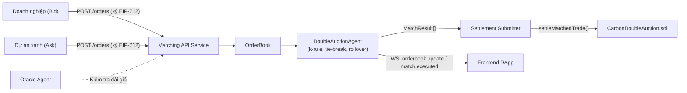
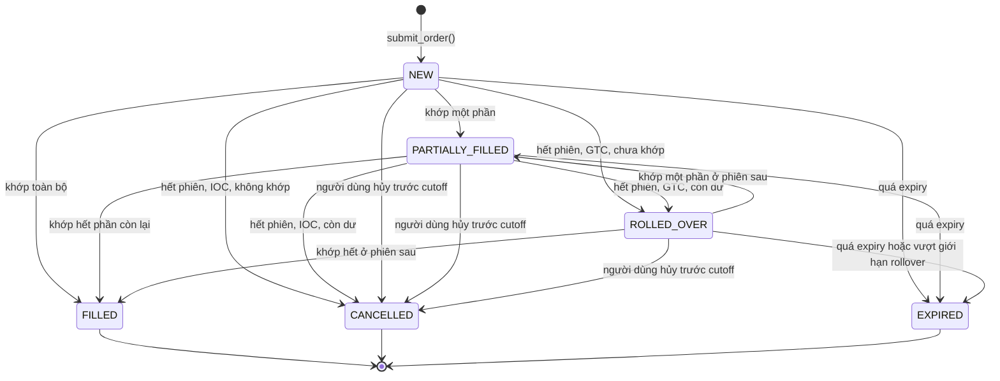
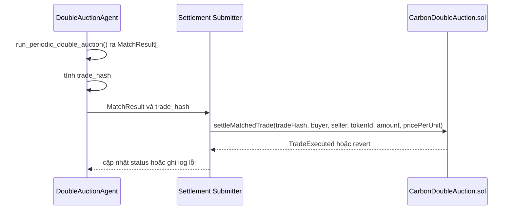

# Đặc tả Kỹ thuật: Matching Engine & API Service (Giai đoạn 2)

**Đề tài:** Hệ thống giao dịch tín chỉ carbon minh bạch và hiệu quả trên nền tảng Blockchain
**Giai đoạn:** Giai đoạn 2 — Phân tích Yêu cầu và Thiết kế Chi tiết Hệ thống (11/2026 – 01/2027)
**Người phụ trách:** Nguyễn Bảo Phi (Auction Algorithm Engineer)
**Phối hợp:** Đặng Xuân Huy (SRS/UML), Nguyễn Hoàng Đức (CarbonDoubleAuction.sol/EIP-712)
**Trạng thái:** Bản thiết kế (design spec) — chưa triển khai đầy đủ, chưa có kết quả thực nghiệm. Phần nào đã có code tham chiếu tới `system_agents/matching_engine/`; phần còn lại là đề xuất cần nhóm/GVHD chốt trước khi code hóa ở Giai đoạn 3.

---

## 1. Mục tiêu và Phạm vi

Tài liệu đặc tả ba nội dung thuộc phần việc của Giai đoạn 2:

1. **Logic Matching Engine chi tiết**: quy tắc phá hòa (tie-breaking) khi nhiều lệnh cùng mức giá và cơ chế chuyển tiếp lệnh chưa khớp giữa các phiên (Order Rollover).
2. **Đặc tả API Service** cho bộ khớp lệnh: RESTful/WebSocket giữa Matching Agent (Python), Frontend DApp và Smart Contract.
3. **Kế hoạch mô phỏng thực nghiệm toán học** về ảnh hưởng của tham số *k* (viết là *alpha* trong bảng phân công trên Google Doc; cùng một đại lượng).

**Ngoài phạm vi:** thiết kế `CarbonDoubleAuction.sol` (phần của Đức), UI/UX DApp (phần của Thắng), thẩm định MRV.

---

## 2. Vai trò trong Kiến trúc Hệ thống

Matching Engine là tác tử `matching_engine`, vận hành theo mô hình **Off-chain Matching, On-chain Settlement** ([`SYSTEM_ARCHITECTURE.md`](SYSTEM_ARCHITECTURE.md)):



Mã nguồn liên quan:
- [`order_book.py`](../system_agents/matching_engine/order_book.py) — `Order`, `MatchResult`.
- [`auction_agent.py`](../system_agents/matching_engine/auction_agent.py) — `DoubleAuctionAgent`: sắp bid giảm dần/ask tăng dần, ghép hai con trỏ khi `bid >= ask`, giá khớp từng cặp `p = k·bid + (1−k)·ask`.
- [`CarbonDoubleAuction.sol`](../contracts/CarbonDoubleAuction.sol) — `settleMatchedTrade(tradeHash, buyer, seller, tokenId, amount, pricePerUnit)`, chống replay qua `executedTrades[tradeHash]`.

**Hiện trạng cần lưu ý của baseline (đã kiểm tra bằng cách chạy code):**
- `run_periodic_double_auction()` **trừ trực tiếp vào `Order.amount`** của đối tượng đầu vào (một phiên 50 lệnh: tổng amount 1260 → 662). Mô phỏng phải `deepcopy` lệnh trước mỗi lần chạy; bản triển khai chính thức nên dùng `remaining_amount` riêng.
- Giá khớp bị `round(…, 2)`; với giá lệnh có nhiều hơn 2 chữ số thập phân, giá khớp có thể vượt ngoài khoảng [ask, bid] (ví dụ ask=10.001, bid=10.004, k=0 → 10.0). Xem §3.3 (tick giá).
- Tie-break hiện là FIFO theo `timestamp` chính xác — khác với đề xuất ở §5.

---

## 3. Mô hình dữ liệu

### 3.1. Hiện có (`order_book.py`)

`Order(order_id, trader_id, order_type, token_id, amount, price, timestamp, signature)` và `MatchResult(bid_order_id, ask_order_id, token_id, amount, clearing_price, timestamp)`.

### 3.2. Trường đề xuất bổ sung (chưa có trong code, cần nhóm xác nhận)

| Trường | Kiểu | Mục đích |
|---|---|---|
| `trader_address` | `str` (ví 0x…) | Địa chỉ ví dùng cho `buyer`/`seller` của `settleMatchedTrade`; tách khỏi `trader_id` nghiệp vụ. |
| `status` | `NEW \| PARTIALLY_FILLED \| FILLED \| CANCELLED \| EXPIRED \| ROLLED_OVER` | Vòng đời lệnh qua nhiều phiên. |
| `time_in_force` | `GTC \| IOC` | Rollover hay hủy phần dư (§6). |
| `expiry` | `float` (epoch) | Hạn hiệu lực do người dùng đặt. |
| `remaining_amount` | `int` | Khối lượng chưa khớp; giữ `amount` gốc bất biến. |
| `first_session_id` / `sessions_alive` | `str` / `int` | Số phiên lệnh đã tồn tại, dùng cho ưu tiên theo tuổi (§5). |

`MatchResult` bổ sung `session_id` và `trade_hash`.

**Cách tính `trade_hash`:** `keccak256(abi.encode(session_id, bid_order_id, ask_order_id, fill_index))`. Dùng `abi.encode` (không dùng `encodePacked`) để tránh va chạm giữa các chuỗi có độ dài biến thiên (tài liệu Solidity cảnh báo `encodePacked("a","bc") == encodePacked("ab","c")` và khuyến nghị ưu tiên `abi.encode` [S1]); `fill_index` cần có vì một cặp lệnh có thể khớp nhiều lần qua các phiên khi partial fill.

### 3.3. Đơn vị, tick giá và giả định

- `amount`: số nguyên tCO2e (1 token = 1 tCO2e, khớp `CarbonCredit1155.sol`).
- **Tick giá:** để bảo đảm `ask ≤ p ≤ bid`, giá tính bằng số nguyên theo đơn vị nhỏ nhất (ví dụ cent hoặc đơn vị stablecoin test), không dùng `float`. Quy tắc làm tròn của giá khớp (về phía có lợi cho bên nào) là **quyết định cần chốt**; tối thiểu phải đảm bảo kết quả không rời khoảng [ask, bid]. Đây cũng là biểu diễn cần để khớp với `uint256 pricePerUnit` on-chain.
- `token_id` đại diện một lớp tín chỉ đủ điều kiện thay thế (project + vintage); engine chỉ khớp lệnh cùng `token_id` và **không** tự đánh giá tính đồng nhất.

---

## 4. Vòng đời lệnh



`ROLLED_OVER` là trạng thái ổn định giữa hai phiên và được đưa vào snapshot của phiên sau như lệnh còn hiệu lực.

---

## 5. Khớp lệnh theo phiên và Quy tắc phá hòa

### 5.1. Chu kỳ phiên (cutoff)

- Đấu giá chạy theo chu kỳ cố định (độ dài phiên là tham số cấu hình, **chưa chốt** — xem §11).
- Tại cutoff, chụp snapshot các lệnh `NEW | PARTIALLY_FILLED | ROLLED_OVER` chưa hết hạn và chạy `run_periodic_double_auction()`. Lệnh đến sau cutoff thuộc phiên kế tiếp.
- Allocation (ai khớp, bao nhiêu) giữ như baseline: bid giảm dần, ask tăng dần, khớp khi `bid ≥ ask`, hỗ trợ partial fill.

### 5.2. Quy tắc ưu tiên và phá hòa (đề xuất)

Bài Budish, Cramton & Shim (2015) [R3, mục VII.A] mô tả batch auction rời rạc hóa thời gian: lệnh tồn tại qua nhiều batch interval hơn có ưu tiên cao hơn; hai lệnh gửi **trong cùng một batch** có cùng mức ưu tiên bất kể thời điểm chính xác, và khi cần phá hòa thì chia ngẫu nhiên/pro-rata. Spec áp dụng cách này:

1. **Ưu tiên theo giá:** bid cao hơn / ask thấp hơn trước.
2. **Cùng giá → ưu tiên theo tuổi:** lệnh còn lại từ phiên trước (`sessions_alive` lớn hơn) được phân bổ trước. Điều này đồng thời làm rollover không bị phạt (§6).
3. **Cùng giá, cùng tuổi → pro-rata** theo khối lượng còn lại:
   ```
   alloc(o) = floor(available * o.remaining / sum_remaining_cùng_nhóm)
   phần dư do làm tròn xuống: chia lần lượt theo thứ tự (order_id tăng dần)
   ```
   Thứ tự `order_id` là quy tắc tất định, công bố trước, để cùng snapshot luôn cho cùng kết quả.

**Phương án thay thế — FIFO theo timestamp trong phiên** (hành vi baseline hiện tại): đơn giản, tất định, nhưng thưởng cho lệnh đến sớm trong cùng phiên và dễ gây cuộc đua tốc độ — chính vấn đề batch auction nhằm loại bỏ. Giữ làm tùy chọn cấu hình `tie_break_mode: "age_prorata" | "fifo"`.

**Mức độ chứng cứ:** ngoài [R3], một đề xuất cộng đồng cho batch auction đa tài sản cũng nêu quy tắc tương tự (ưu tiên lệnh từ batch cũ hơn, pro-rata chỉ ở batch phải chia phần) [S3]. Đó là đề xuất, không phải tiêu chuẩn. Chưa tìm được tài liệu công khai nào mô tả quy tắc chia phần ở giá hòa của CoW Protocol, nên spec không dựa vào CoW cho điểm này.

**Trạng thái triển khai:** `age_prorata` chưa được code; baseline chỉ có FIFO. Việc code hóa và so sánh hai chế độ thuộc Giai đoạn 3.

### 5.3. Bất biến cần kiểm tra

- Tổng phân bổ cho nhóm cùng ưu tiên không vượt khối lượng đối ứng khả dụng.
- Cùng snapshot → cùng kết quả (tất định).
- Không lệnh nào bị bỏ sót khi vẫn còn khối lượng đối ứng.

---

## 6. Cơ chế Rollover lệnh chưa khớp

| TIF | Hành vi khi hết phiên còn dư |
|---|---|
| **GTC** | `status = ROLLED_OVER`, giữ `price` và `order_id`, tăng `sessions_alive`; được ưu tiên theo tuổi ở phiên sau (§5.2). |
| **IOC** | Phần dư chuyển `CANCELLED` ngay khi phiên kết thúc. |

```mermaid
sequenceDiagram
    participant S as Session Scheduler
    participant E as DoubleAuctionAgent
    participant OB as OrderBook

    S->>E: cutoff(session_id)
    E->>OB: snapshot(NEW, PARTIALLY_FILLED, ROLLED_OVER; chưa hết hạn)
    E->>E: run_periodic_double_auction()
    loop mỗi lệnh còn dư
        alt GTC và chưa vượt giới hạn rollover
            E->>OB: status=ROLLED_OVER, sessions_alive += 1
        else IOC
            E->>OB: status=CANCELLED
        else GTC vượt giới hạn
            E->>OB: status=EXPIRED
        end
    end
    E-->>S: MatchResult[] + rollover_report
```

Giới hạn: rollover không bảo đảm khớp ở phiên sau; cần `max_rollover_count` hoặc TTL để orderbook không phình vô hạn (**giá trị chưa chốt**, §11). Cơ chế carry-over giữa các phiên đã được mô tả cho batch auction ở [R3]; mô tả rollover theo mô hình sequential của bài về VCM [R1] **chưa được kiểm chứng** vì chưa đọc toàn văn.

---

## 7. Quy tắc xác định giá (cần chốt)

Hai lựa chọn khác nhau về bản chất, spec **chưa chọn**:

| | Giá theo từng cặp (baseline hiện tại) | Giá chung của phiên |
|---|---|---|
| Công thức | `p_ij = k·b_i + (1−k)·a_j` cho từng cặp khớp | một `p*` cho mọi khớp trong phiên, ví dụ trung điểm cặp biên `(b_m + a_m)/2` |
| Ưu điểm | Dễ cài đặt, đúng như code | Cùng lệnh, cùng giá; gần mô hình uniform-price của [R3] |
| Nhược điểm | Các lệnh cùng phía nhận giá khác nhau; khó giải thích tính công bằng | Cần định nghĩa khi có nhiều nghiệm giá; phải kiểm tra `p*` thuộc [ask, bid] của mọi lệnh được khớp |

Cả hai đều **không** bảo đảm khai giá trung thực (midpoint/k-rule không strategy-proof; xem phản ví dụ trong đề cương nội bộ). Phần mô phỏng §9 nên chạy được trên cả hai quy tắc để so sánh.

---

## 8. Đặc tả API Service

### 8.1. Nguyên tắc

- REST cho đặt/hủy/truy vấn; WebSocket cho cập nhật thời gian thực.
- Lệnh ghi phải kèm chữ ký **EIP-712** (cấu trúc domain/struct do Đức quy định). Engine xác minh chữ ký **ngoài chuỗi** trước khi nhận lệnh và không giữ private key người dùng.
- API không khóa tài sản khi đặt lệnh; kiểm tra `balanceOf`/`isApprovedForAll` là trách nhiệm client. Tài sản chỉ chuyển ở bước settlement.

### 8.2. REST

| Method | Path | Mô tả | Request (rút gọn) | Response |
|---|---|---|---|---|
| `POST` | `/v1/orders` | Đặt lệnh | `{order_type, token_id, amount, price, time_in_force, expiry, trader_address, signature}` | `201 {order_id, status:"NEW"}` |
| `DELETE` | `/v1/orders/{order_id}` | Hủy lệnh trước cutoff | `{signature}` | `200 {order_id, status:"CANCELLED"}` |
| `GET` | `/v1/orders/{order_id}` | Trạng thái lệnh | — | `200 {…Order, status, remaining_amount}` |
| `GET` | `/v1/orderbook/{token_id}` | Snapshot sổ lệnh | — | `200 {bids, asks}` |
| `GET` | `/v1/sessions/{session_id}/matches` | Kết quả khớp của phiên | — | `200 {matches}` |
| `GET` | `/v1/sessions/current` | Phiên hiện tại | — | `200 {session_id, cutoff_at}` |

Mã lỗi tối thiểu: `400` (sai cấu trúc/giá trị), `401` (chữ ký sai), `404`, `409` (lệnh đã khớp/hủy), `422` (giá ngoài dải Oracle).

### 8.3. WebSocket

| Kênh | Sự kiện | Payload |
|---|---|---|
| `orderbook.{token_id}` | `orderbook.update` | Delta top-of-book |
| `session.{session_id}` | `match.executed` | `MatchResult` kèm `trade_hash`, trước khi gửi on-chain |
| `session.{session_id}` | `settlement.confirmed` | Khi nhận event `TradeExecuted` |
| `session.{session_id}` | `settlement.failed` | Khi giao dịch revert; retry có giới hạn, không lặp vô hạn |

### 8.4. Luồng settlement và giới hạn tin cậy



**Giới hạn của thiết kế hiện tại (phát hiện khi đối chiếu với contract, cần trao đổi với Đức):**
1. `settleMatchedTrade` **chỉ chuyển token carbon** từ seller sang buyer; không có bước thanh toán tiền. `pricePerUnit` chỉ được ghi lại. Vì vậy chưa có settlement nguyên tử (delivery-versus-payment, DvP) như mô tả ở báo cáo Giai đoạn 1. Mô hình DvP phổ biến chuyển tài sản và tiền trong cùng một giao dịch, thường dùng ERC-20 cho tiền và ERC-721/1155 cho tài sản, và hoàn tác toàn bộ nếu thiếu tiền [S2]. Cần bổ sung leg thanh toán (ví dụ ERC-20 test) trong cùng giao dịch. Lưu ý: các nguồn [S2] là tài liệu vendor/blog; chưa tìm thấy nguồn nào mô tả riêng một triển khai ERC-1155 DvP.
2. Chữ ký EIP-712 chỉ được xác minh ngoài chuỗi; contract không kiểm tra. Toàn bộ niềm tin dồn vào `matchingAgentAddress`: tác tử này có thể bỏ sót lệnh, ưu tiên sai hoặc gửi cặp khớp không có thật mà contract không phát hiện. Nếu muốn giảm giả định tin cậy, contract cần xác minh chữ ký của buyer/seller và ràng buộc giá (`ask ≤ p ≤ bid`) on-chain.
3. `settleMatchedTrade` là `onlyMatchingAgent`, nên Settlement Submitter chính là địa chỉ đó; quản lý khóa là việc của thiết kế bảo mật GĐ2 (mục IV, tuần 5–8 của Google Doc).
4. Thứ tự giao dịch on-chain vẫn chịu rủi ro MEV/front-running [R9]; chữ ký lệnh không loại bỏ rủi ro này.

---

## 9. Kế hoạch mô phỏng thực nghiệm

> Đây là **kế hoạch**, chưa có kết quả chính thức.

### 9.1. Điều kiện để thí nghiệm có ý nghĩa

Kiểm tra sơ bộ bằng baseline hiện có (3 seed, 500 lệnh, giá khai = valuation thật, k ∈ {0, 0.5, 1}) cho thấy **thặng dư xã hội giống hệt nhau với mọi k** (ví dụ 14482.81); k chỉ đổi cách chia giữa bên mua và bên bán (buyer/seller surplus: 14482.81/0 khi k=0, ≈ một nửa mỗi bên khi k=0.5, 0/14482.81 khi k=1). Điều này đúng với lý thuyết: với allocation và valuation cố định, giá chỉ phân chia lợi ích. Vì vậy thiết kế thí nghiệm phải tách hai câu hỏi:

- **Thí nghiệm A — phân chia thặng dư khi khai giá trung thực.** Đo `buyer_surplus`, `seller_surplus`, `welfare` theo k. `welfare` bất biến theo k đóng vai trò **kiểm tra tính đúng (sanity check)**, không phải kết quả nghiên cứu.
- **Thí nghiệm B — tác tử khai giá chiến lược.** Cho tác tử shading giá (bid thấp hơn / ask cao hơn valuation) theo hàm phụ thuộc k (theo hướng mô hình [R4]) hoặc theo chiến lược thích nghi. Đo `welfare`, khối lượng khớp và tỷ lệ giao dịch bị mất so với benchmark khai trung thực. Chỉ ở thí nghiệm này k mới có thể ảnh hưởng đến welfare.

**Hướng thiết kế cho thí nghiệm B:**
- *Đối chứng giải tích (một mua – một bán, một đơn vị):* mô hình Chatterjee–Samuelson [R4] với valuation phân phối đều trên [0,1] và k = 1/2 có cân bằng Bayes tuyến tính; theo các nguồn thứ cấp [S4], bid = (2/3)v + 1/12, ask = (2/3)c + 1/4, nên giao dịch chỉ xảy ra khi v − c ≥ 1/4 và một phần giao dịch có lợi bị bỏ lỡ (hệ quả trực quan của bất khả thi Myerson–Satterthwaite [R7]). **Các hệ số này chưa được đối chiếu với bài gốc [R4]**; phải kiểm tra trước khi đưa vào báo cáo. Cân bằng của k-double auction không duy nhất, nên đây chỉ là một lựa chọn cân bằng. Nếu hệ số khớp, kết quả dùng làm bài kiểm tra tính đúng của mô phỏng (mô phỏng 1v1 phải tái tạo ngưỡng này).
- *Nhiều lệnh, nhiều đơn vị (100–500 lệnh):* kết quả giải tích trên không áp dụng trực tiếp. Hướng dự kiến là tác tử học thích nghi kiểu Zero-Intelligence Plus (ZIP) [S5]; chưa tìm được nguồn về bid shading phụ thuộc k trong bối cảnh nhiều đơn vị, nên chiến lược cụ thể vẫn là câu hỏi mở (§11).

> **Cần trao đổi với Huy/GVHD:** mô tả nhiệm vụ trên Google Doc ("so sánh social welfare giữa k = 0, 0.5, 1 để tìm tham số tối ưu") chỉ có nghĩa nếu có thí nghiệm B. Nên chỉnh lại câu chữ nhiệm vụ cho khớp.

### 9.2. Biến số

| Biến | Giá trị dự kiến |
|---|---|
| Số lệnh | 100, 200, 500 |
| k | 0, 0.5, 1 |
| Quy tắc giá | theo cặp (baseline) và giá chung của phiên (§7) |
| Tie-break | `fifo` và `age_prorata` (§5.2) — chỉ khi đã code |
| Phân phối valuation | uniform làm điểm khởi đầu; **chưa chốt** |
| Số lần lặp | ≥ 30 seed mỗi cấu hình (đề xuất, chưa chốt) |
| `token_id` | một lớp tín chỉ cố định |

### 9.3. Chỉ số

- `welfare = Σ (valuation_bid − valuation_ask) · amount` trên các cặp khớp; so với **welfare tối đa khả thi** tính từ toàn bộ valuation (chỉ tính được trong mô phỏng).
- `buyer_surplus`, `seller_surplus`: phần chia theo giá khớp.
- `fill_rate` và khối lượng khớp so với benchmark tối ưu.
- Thuật ngữ "spread": dùng **bid-ask spread của sổ lệnh** (best_ask − best_bid trước phiên) khi cần; chênh lệch giữa giá khớp và valuation gọi là phần chia thặng dư, không gọi là spread để tránh nhầm.

### 9.4. Quy trình

```python
for k in (0, 0.5, 1):
    for n in (100, 200, 500):
        for seed in range(N_RUNS):
            base = generate_orders(n, seed, token_id=101)   # có valuation ẩn
            orders = copy.deepcopy(base)                     # tránh baseline sửa Order.amount
            agent = DoubleAuctionAgent(k_parameter=k)
            for o in apply_bidding_strategy(orders):         # trung thực (A) hoặc shading (B)
                agent.submit_order(o)
            matches = agent.run_periodic_double_auction(101)
            log(k, n, seed, welfare(matches, base), buyer_surplus(...), seller_surplus(...), fill_rate(...))
```

Đầu ra dự kiến: script trong `system_agents/matching_engine/simulation/` (chưa tồn tại) và bảng/biểu đồ chỉ đưa vào báo cáo sau khi đã chạy thật.

---

## 10. Bất biến và kế hoạch kiểm thử

Bất biến (theo mục 10.1 của đề cương nội bộ, tài liệu ngoài repo):

- Khối lượng mua khớp = khối lượng bán khớp; không lệnh nào khớp vượt `amount` gốc.
- `ask ≤ clearing_price ≤ bid` cho mọi cặp (kể cả sau làm tròn tick, §3.3).
- Lệnh `FILLED/CANCELLED/EXPIRED` không xuất hiện lại ở phiên sau.
- Không `trade_hash` nào được gửi hai lần; engine tự kiểm tra trước khi gửi để tránh tốn gas cho giao dịch revert [R12].
- Cùng snapshot → cùng kết quả.

Kịch bản test tối thiểu (chưa viết): sổ trống; một phía trống; bid < ask toàn bộ; bid = ask; nhiều lệnh cùng giá và tuổi (pro-rata + phần dư); lệnh khác tuổi cùng giá; partial fill; hủy sát cutoff; hết hạn; rollover nhiều phiên; trùng `order_id`; giá nhiều chữ số thập phân.

---

## 11. Giới hạn và câu hỏi mở

1. Độ dài phiên (cutoff).
2. Tie-break mặc định: `age_prorata` hay `fifo`; có code pro-rata ở GĐ2 không.
3. Giá theo cặp hay giá chung của phiên (§7).
4. `max_rollover_count`/TTL cho lệnh GTC.
5. Thiết kế thí nghiệm B: chiến lược khai giá nào (ZIP hay hàm shading theo k), kiểm tra hệ số Chatterjee–Samuelson với bài gốc, và chỉnh lại câu chữ nhiệm vụ trên Google Doc.
6. Tick giá và quy tắc làm tròn; quy đổi sang `uint256` on-chain (phối hợp với Đức).
7. Thanh toán tiền trong `settleMatchedTrade` (§8.4, ý 1) và xác minh chữ ký/giá on-chain (§8.4, ý 2).
8. Quản lý khóa của `matchingAgentAddress` và phương án khi tác tử ngừng hoạt động.

---

## 12. Tài liệu tham khảo

Đánh số [R*] theo đề cương nội bộ của người phụ trách (tài liệu ngoài repo, chứa DOI và trạng thái truy cập toàn văn đầy đủ):

- **[R3]** Budish, E., Cramton, P., & Shim, J. (2015). The High-Frequency Trading Arms Race: Frequent Batch Auctions as a Market Design Response. *Quarterly Journal of Economics*, 130(4), 1547–1621. — ưu tiên theo tuổi/pro-rata trong cùng batch (mục VII.A), carry-over giữa batch (§5, §6).
- **[R4]** Chatterjee, K., & Samuelson, W. (1983). Bargaining under Incomplete Information. *Operations Research*, 31(5), 835–851. — k-double auction; cơ sở cho thí nghiệm B.
- **[R1]** Liu, X., et al. (2026). Blockchain and double auction for credible and efficient voluntary carbon market. *Applied Energy*, 412, 127719. — bài trực tiếp về VCM; chi tiết rule và rollover **chưa đọc toàn văn**, không dùng làm căn cứ cho khẳng định cụ thể ở tài liệu này.
- **[R9]** Daian, P., et al. (2020). Flash Boys 2.0. *IEEE S&P*, 910–927. — MEV (§8.4).
- **[R12]** Ethereum.org, *Gas and fees* — chi phí giao dịch revert (§10).
- **[R7]** Myerson, R. B., & Satterthwaite, M. A. (1983). Efficient Mechanisms for Bilateral Trading. *Journal of Economic Theory*, 29(2), 265–281.

Nguồn web bổ sung (truy cập 02/11/2026), đánh dấu mức độ tin cậy:
- **[S1]** Solidity documentation, *Contract ABI Specification* (mục non-standard packed mode): https://docs.soliditylang.org/en/latest/abi-spec.html — tài liệu chính thức; đã đọc.
- **[S2]** Chainlink, *How Atomic Settlement Enables Onchain DvP*: https://chain.link/article/atomic-settlement-onchain-dvp; Allium, *Atomic Settlement for Tokenized Securities Explained*: https://allium.so/blog/atomic-settlement-for-tokenized-securities-explained/ — tài liệu vendor/blog, chỉ dùng để mô tả khái niệm DvP; chỉ nắm qua kết quả tìm kiếm, chưa đọc toàn bài.
- **[S3]** ethresear.ch, *Matching strategy for multi-asset batch auctions*: https://ethresear.ch/t/matching-strategy-for-multi-asset-batch-auctions/6248 — đề xuất cộng đồng, không phản biện; chỉ nắm qua tóm tắt tìm kiếm.
- **[S4]** Hệ số cân bằng Chatterjee–Samuelson: nguồn thứ cấp (trang tổng hợp/máy tính trực tuyến); **chưa đối chiếu với [R4]**.
- **[S5]** Tesfatsion, tài liệu tổng hợp về double auction/ZIP: https://faculty.sites.iastate.edu/tesfatsi/archive/tesfatsi/aauction.htm — chỉ nắm qua kết quả tìm kiếm.
