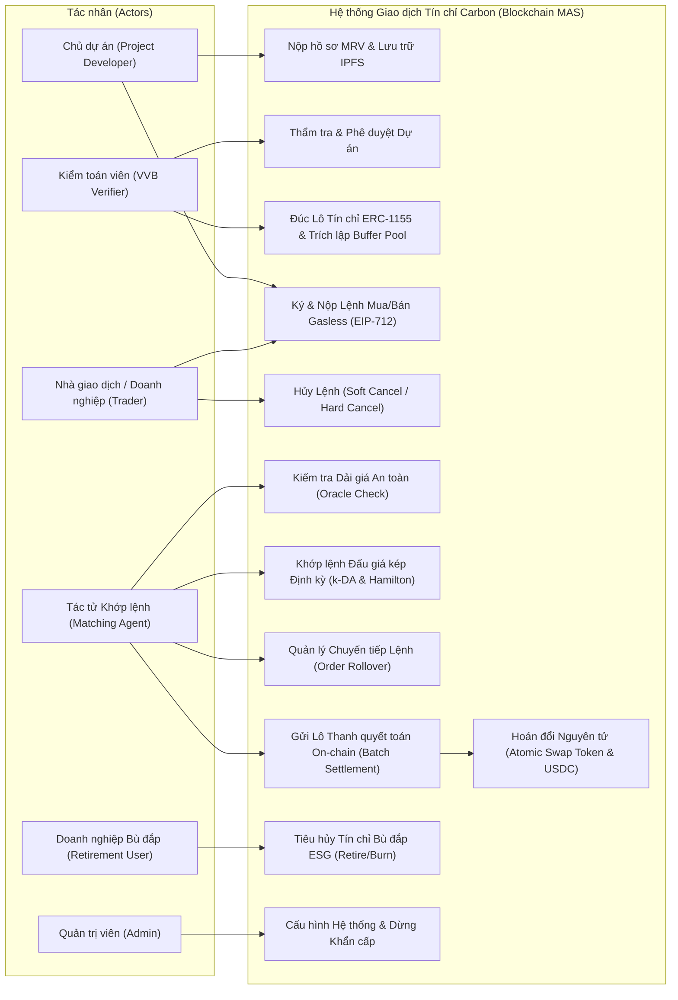
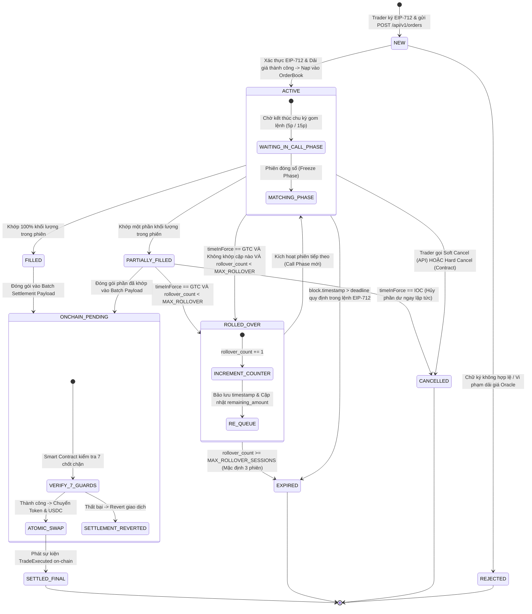

# ĐẶC TẢ YÊU CẦU PHẦN MỀM (SOFTWARE REQUIREMENTS SPECIFICATION - SRS)
## Hệ thống Giao dịch Tín chỉ Carbon Phi tập trung ứng dụng Hệ Đa Tác tử (Multi-Agent System) trên nền tảng Blockchain

- **Mã tài liệu:** EPU-SRS-2026-V2.0
- **Tiêu chuẩn tuân thủ:** IEEE Std 830-1998 (IEEE Recommended Practice for Software Requirements Specifications)
- **Cơ quan chủ trì:** Trường Đại học Điện Lực (EPU) – Khoa Công nghệ Thông tin
- **Đề tài NCKH Sinh viên:** Nghiên cứu xây dựng sàn giao dịch tín chỉ carbon phi tập trung ứng dụng công nghệ chuỗi khối (Blockchain) và hệ đa tác tử (Multi-Agent System)
- **Tác giả chính (Lead System Architect):** Đặng Xuân Huy – Lớp D18CNPM1 (MSV: 23810310007)
- **Thành viên nhóm nghiên cứu:** 
  - Ngô Văn Thắng (MSV: 23810310401) – Business Analyst & Frontend Web3 Engineer
  - Nguyễn Hoàng Đức (MSV: 23810310060) – Smart Contract & Protocol Engineer
  - Nguyễn Bảo Phi (MSV: 23810310017) – Auction Algorithm & Optimization Engineer
- **Giảng viên hướng dẫn:** TS. Nguyễn Thị Hồng Khánh
- **Phiên bản:** 2.0 (Cập nhật kiến trúc Khớp lệnh Đấu giá kép định kỳ & Batch Settlement On-chain)
- **Ngày ban hành:** 10/11/2026

---

## MỤC LỤC
1. [GIỚI THIỆU (INTRODUCTION)](#1-giới-thiệu-introduction)
   - 1.1 Mục đích tài liệu (Purpose)
   - 1.2 Phạm vi sản phẩm (Scope of Product)
   - 1.3 Định nghĩa, thuật ngữ và từ viết tắt (Definitions, Acronyms, and Abbreviations)
   - 1.4 Tài liệu tham khảo (References)
   - 1.5 Cấu trúc tài liệu (Overview)
2. [MÔ TẢ TỔNG QUAN (OVERALL DESCRIPTION)](#2-mô-tả-tổng-quan-overall-description)
   - 2.1 Góc nhìn sản phẩm (Product Perspective & Hybrid Architecture)
   - 2.2 Tóm tắt các chức năng chính (Product Functions)
   - 2.3 Phân loại và đặc điểm người dùng (User Classes and Characteristics)
   - 2.4 Môi trường vận hành (Operating Environment)
   - 2.5 Ràng buộc thiết kế và triển khai (Design and Implementation Constraints)
   - 2.6 Giả định và phụ thuộc (Assumptions and Dependencies)
3. [YÊU CẦU GIAO DIỆN BÊN NGOÀI (EXTERNAL INTERFACE REQUIREMENTS)](#3-yêu-cầu-giao-diện-bên-ngoài-external-interface-requirements)
   - 3.1 Giao diện người dùng (User Interfaces - Web3 DApp)
   - 3.2 Giao diện phần cứng / Ví Web3 (Hardware / Wallet Interfaces)
   - 3.3 Giao diện phần mềm (Software Interfaces: Blockchain RPC, IPFS)
   - 3.4 Giao diện truyền thông & Giao thức (Communications Interfaces: REST, WebSocket, EIP-712)
4. [CÁC TÍNH NĂNG HỆ THỐNG / YÊU CẦU CHỨC NĂNG (SYSTEM FEATURES / FUNCTIONAL REQUIREMENTS)](#4-các-tính-năng-hệ-thống--yêu-cầu-chức-năng-system-features--functional-requirements)
   - FR-01: Định danh phi tập trung & Phân quyền RBAC
   - FR-02: Đăng ký & Thẩm tra Dự án Tín chỉ Carbon (MRV & IPFS)
   - FR-03: Đúc (Minting) Lô tín chỉ ERC-1155 & Trích lập Buffer Pool Vault
   - FR-04: Đặt lệnh mua/bán ngoài chuỗi ký cấu trúc EIP-712 (Gasless Orders)
   - FR-05: Kiểm tra Dải giá an toàn & Chống thao túng (Carbon Oracle Agent)
   - FR-06: Quản lý Phiên đấu giá kép định kỳ (Periodic Double Auction Engine)
   - FR-07: Xác định Mức giá cân bằng đồng nhất ($k$-DA Uniform Price Rule)
   - FR-08: Thuật toán phá hòa đa tiêu chí `age_prorata` & Hamilton Largest Remainder
   - FR-09: Cơ chế Chuyển tiếp lệnh (Order Rollover & Expiration Policy)
   - FR-10: Hủy lệnh giao dịch linh hoạt (Soft Cancel API & Hard Cancel Nonce)
   - FR-11: Đóng gói Batch Settlement & Tạo bằng chứng mật mã (Trade Settlement Proofs)
   - FR-12: Thanh quyết toán nguyên tử On-chain (Atomic Swap với 7 chốt chặn bảo mật)
   - FR-13: Quản lý số dư & Chuẩn hóa đơn vị tiền tệ (Micro-USDC & Token Decimals)
   - FR-14: Tiêu hủy bù trừ phát thải vĩnh viễn (Carbon Retirement / Burning)
   - FR-15: Cung cấp API Service & WebSocket Orderbook thời gian thực
5. [YÊU CẦU PHI CHỨC NĂNG (NON-FUNCTIONAL REQUIREMENTS - NFR)](#5-yêu-cầu-phi-chức-năng-non-functional-requirements---nfr)
   - 5.1 Hiệu năng và Khả năng mở rộng (Performance & Scalability)
   - 5.2 Độ an toàn và Bảo mật (Security & Cryptography)
   - 5.3 Tính bất biến và Khả năng kiểm toán (Auditability & Determinism)
   - 5.4 Tính khả dụng và Phục hồi sau sự cố (Availability & Fault Tolerance)
   - 5.5 Tuân thủ tiêu chuẩn quốc tế (Standard Compliance)
6. [MÔ HÌNH HÓA KIẾN TRÚC & SƠ ĐỒ UML (UML ARCHITECTURAL MODELS)](#6-mô-hình-hóa-kiến-trúc--sơ-đồ-uml-uml-architectural-models)
   - 6.1 Sơ đồ Ca sử dụng Tổng thể (Use Case Diagram)
   - 6.2 Sơ đồ Trạng thái Vòng đời Lệnh (Order Lifecycle State Machine Diagram)
   - 6.3 Sơ đồ Tuần tự Luồng 3 bên (3-Party End-to-End Sequence Diagram)
   - 6.4 Sơ đồ Hoạt động của Phiên Đấu giá (Auction Session Activity Diagram)

---

## 1. GIỚI THIỆU (INTRODUCTION)

### 1.1 Mục đích tài liệu (Purpose)
Tài liệu này quy định đầy đủ các đặc tả yêu cầu phần mềm (SRS) cho hệ thống **Sàn giao dịch Tín chỉ Carbon Phi tập trung ứng dụng Hệ Đa Tác tử (Multi-Agent System - MAS) trên nền tảng Blockchain**, tuân thủ nghiêm ngặt tiêu chuẩn **IEEE Std 830-1998**. 
Mục tiêu tài liệu nhằm:
- Làm cơ sở kỹ thuật chuẩn xác, thống nhất giữa các kỹ sư phần mềm (Smart Contract, Backend/Algorithm, Frontend Web3) và chuyên gia phân tích nghiệp vụ trong toàn bộ Giai đoạn 2 (Thiết kế chi tiết) và Giai đoạn 3 (Phát triển mã nguồn).
- Cung cấp tiêu chí nghiệm thu kiểm thử (Acceptance Criteria & Test Cases) cho Hội đồng Khoa học Trường Đại học Điện Lực.

### 1.2 Phạm vi sản phẩm (Scope of Product)
Hệ thống là một sàn giao dịch thế hệ mới (Next-Gen Decentralized Carbon Exchange) giải quyết các nút thắt của thị trường carbon tự nguyện truyền thống (VCM): thiếu minh bạch, thanh khoản phân mảnh, chi phí trung gian cao, và nguy cơ trùng lặp phát hành (Double Counting).
Hệ thống bao gồm các phân hệ cốt lõi:
1. **Phân hệ Quản lý Tài sản Tín chỉ Carbon On-chain (ERC-1155 Tokenization):** Mã hóa lô tín chỉ kèm siêu dữ liệu (Metadata) trên IPFS, phân định theo năm ban hành (Vintage Year), phương pháp luận (Methodology) và cơ chế Quỹ dự phòng rủi ro (Buffer Pool Vault).
2. **Phân hệ Thẩm định & Giám sát MRV (MRV Verification & Oracle MAS):** Tự động hóa kiểm tra tính toàn vẹn của hồ sơ đo đạc, báo cáo, thẩm tra phát thải và kiểm soát trần/sàn giá an toàn.
3. **Phân hệ Khớp lệnh Đấu giá kép Định kỳ Ngoài chuỗi (Off-chain Periodic Double Auction Engine):** Tác tử thuật toán thông minh gom lệnh, xác định giá cân bằng $k$-DA uniform price, chia tỷ lệ pro-rata với thuật toán phần dư lớn nhất Hamilton, và quản lý rollover lệnh.
4. **Phân hệ Thanh quyết toán Nguyên tử On-chain (Atomic Batch Settlement Smart Contract):** Kiểm tra chữ ký số EIP-712 gasless, thực thi hoán đổi đồng thời token carbon và stablecoin (MockUSDC) với 7 lớp chốt chặn bảo mật.
5. **Phân hệ Tiêu hủy & Báo cáo Bù đắp ESG (Retirement Portal):** Đốt token vĩnh viễn và tạo chứng nhận điện tử chống gian lận.

### 1.3 Định nghĩa, thuật ngữ và từ viết tắt (Definitions, Acronyms, and Abbreviations)

| Thuật ngữ / Viết tắt | Ý nghĩa kỹ thuật |
| :--- | :--- |
| **MAS** | Multi-Agent System (Hệ đa tác tử tự trị hỗ trợ tính toán ngoài chuỗi). |
| **PDA** | Periodic Double Auction (Cơ chế đấu giá kép định kỳ gom lệnh theo cửa sổ thời gian). |
| **$k$-DA** | $k$-Double Auction (Thuật toán xác định mức giá thanh toán biên theo hệ số phân bổ $k \in [0, 1]$). |
| **EIP-712** | Ethereum Improvement Proposal 712 (Tiêu chuẩn ký thông điệp dữ liệu có cấu trúc ngoài chuỗi giúp người dùng không tốn gas khi đặt lệnh). |
| **ERC-1155** | Multi-Token Standard trên Ethereum/EVM, cho phép quản lý cả Semi-Fungible và Non-Fungible token trong cùng một hợp đồng. |
| **MRV** | Measurement, Reporting, and Verification (Hệ thống đo đạc, báo cáo và thẩm tra tín chỉ carbon). |
| **VVB** | Validation and Verification Body (Tổ chức kiểm toán độc lập thẩm tra dự án tín chỉ). |
| **tCO2e** | Tấn carbon dioxide tương đương (Tấn chuẩn quốc tế của tín chỉ carbon). |
| **GTC** | Good-Til-Cancelled (Loại lệnh có hiệu lực cho đến khi khớp hết hoặc đạt ngưỡng hết hạn rollover). |
| **IOC** | Immediate-Or-Cancel (Loại lệnh yêu cầu khớp ngay lập tức trong phiên hiện tại, phần dư bị hủy bỏ). |
| **Hamilton Method** | Thuật toán phần dư lớn nhất (Largest Remainder Method) dùng phân bổ số nguyên bảo toàn tổng số lượng. |
| **Deadweight Loss (DWL)** | Tổn thất vô ích (tổn thất hiệu quả kinh tế) của thị trường khi các bên khai giá chiến lược (Strategic Bidding). |
| **Buffer Pool Vault** | Quỹ dự phòng rủi ro lưu ký trên hợp đồng thông minh (trích lập 10% - 20% lượng tín chỉ để bù trừ trường hợp rừng bị cháy/thiên tai). |

### 1.4 Tài liệu tham khảo (References)
1. **IEEE Std 830-1998:** IEEE Recommended Practice for Software Requirements Specifications.
2. **EIP-712 Specification:** Typed structured data hashing and signing (Ethereum Foundation).
3. **ERC-1155 Multi Token Standard:** OpenZeppelin Contracts Specification.
4. **Chatterjee, K., & Samuelson, W. (1983):** Bargaining under incomplete information. *Operations Research*, 31(5), 835-851.
5. **Rustichini, A., Satterthwaite, M. A., & Williams, S. R. (1994):** Convergence to efficiency in a simple market with incomplete information. *Econometrica*, 62(5), 1041-1063.
6. **Liu et al. (2026):** Periodic Double Auctions with Order Rollover Dynamics in Decentralized Energy & Carbon Markets.
7. **Báo cáo Tổng quan Giai đoạn 1:** Nhóm NCKH Sinh viên D18CNPM1 – Trường Đại học Điện Lực (Tháng 10/2026).
8. **Quyết định Kiến trúc ADR-001:** Khóa 4 thông số kiến trúc cốt lõi cho Bộ Khớp lệnh PDA (Tháng 11/2026).

### 1.5 Cấu trúc tài liệu (Overview)
Tài liệu được chia làm 6 phần: Phần 1 giới thiệu mục đích, phạm vi; Phần 2 mô tả tổng thể kiến trúc, tác nhân, ràng buộc; Phần 3 chi tiết hóa giao diện ngoại vi; Phần 4 quy định 15 yêu cầu chức năng (FR); Phần 5 quy định yêu cầu phi chức năng (NFR); và Phần 6 mô hình hóa hệ thống bằng các biểu đồ UML chuẩn mực (Use Case, State Machine, Sequence, Activity).

---

## 2. MÔ TẢ TỔNG QUAN (OVERALL DESCRIPTION)

### 2.1 Góc nhìn sản phẩm (Product Perspective & Hybrid Architecture)
Hệ thống được thiết kế theo mô hình lai **Off-chain Intelligence, On-chain Trust**:
- **Tầng Ngoài Chuỗi (Off-chain Multi-Agent Layer):** Các tác tử phần mềm (Python FastAPI) hoạt động độc lập và phối hợp qua REST/WebSocket. Tác tử khớp lệnh (Auction Agent) tiếp nhận các lệnh ký EIP-712 gasless, tích lũy trong Sổ lệnh (OrderBook), thực thi thuật toán $k$-DA uniform price và thuật toán phân bổ Hamilton `age_prorata`.
- **Tầng Trên Chuỗi (On-chain Trust & Settlement Layer):** Mạng Blockchain EVM (Polygon Amoy Testnet). Hợp đồng thông minh `CarbonCredit1155.sol` quản lý số dư tín chỉ và quỹ dự phòng. Hợp đồng `CarbonDoubleAuction.sol` nhận bằng chứng thanh quyết toán theo lô (Batch Settlement), xác minh 7 chốt chặn bảo mật và hoán đổi tài sản nguyên tử (Atomic Swap) giữa người mua và người bán.
- **Tầng Lưu trữ Phân tán (Decentralized Storage Layer):** Mạng IPFS (thông qua Pinata Gateway) lưu trữ vĩnh viễn tài liệu thẩm tra PDD, báo cáo MRV và Metadata theo chuẩn W3C/Verra.

### 2.2 Tóm tắt các chức năng chính (Product Functions)
1. Thẩm định số hóa hồ sơ phát thải và cấp phát token tín chỉ carbon ERC-1155 có trích lập Quỹ dự phòng rủi ro tự động.
2. Cung cấp sàn giao dịch sổ lệnh giới hạn định kỳ (Periodic Call Auction) với cơ chế đặt lệnh Gasless thông qua chữ ký EIP-712.
3. Tự động kiểm tra dải giá thị trường bằng tác tử Oracle để ngăn chặn hành vi lừa đảo hoặc thao túng giá.
4. Khớp lệnh tối ưu thặng dư xã hội, phân bổ công bằng qua quy tắc giá chung toàn phiên và phân bổ phần dư Hamilton.
5. Chuyển tiếp lệnh thông minh (Rollover Engine) với cơ chế tự động hủy sau $N$ phiên để bảo vệ vốn nhà đầu tư.
6. Thanh toán theo lô on-chain tiết kiệm tới 70% chi phí gas so với thanh toán đơn lẻ.
7. Đốt vĩnh viễn tín chỉ và cấp giấy chứng nhận kiểm kê khí nhà kính minh bạch.

### 2.3 Phân loại và đặc điểm người dùng (User Classes and Characteristics)

| Nhóm người dùng | Mô tả vai trò & Quyền hạn | Trình độ kỹ thuật |
| :--- | :--- | :--- |
| **Chủ dự án (Project Developer)** | Nộp hồ sơ MRV, đề xuất phát hành tín chỉ, đặt lệnh BÁN (ASK) lô tín chỉ đã đúc. | Trung bình, quen thuộc với ví Web3 (MetaMask) và thủ tục lâm nghiệp/năng lượng. |
| **Kiểm toán viên (VVB Verifier)** | Thẩm tra dữ liệu MRV, ký xác thực kết quả giám định on-chain để mở khóa chức năng đúc token. | Chuyên gia kiểm kê khí nhà kính, quen thao tác ký số trên trình duyệt. |
| **Nhà giao dịch / Doanh nghiệp mua (Trader)** | Nạp stablecoin (USDC), ký lệnh MUA (BID) hoặc lệnh BÁN thứ cấp, theo dõi khớp lệnh và quản lý danh mục. | Thành thạo giao dịch tài chính/crypto, sử dụng ví Web3 thường xuyên. |
| **Doanh nghiệp Bù đắp ESG (Retirement User)** | Sở hữu tín chỉ và gửi yêu cầu Đốt (Retire) để phục vụ báo cáo kiểm kê phát thải Scope 1-3. | Người dùng doanh nghiệp, ưu tiên xuất chứng chỉ PDF/Hash on-chain. |
| **Tác tử Khớp lệnh (Matching Agent Operator)** | Tác tử tự hành (Backend Service) gom lệnh, thực thi giải thuật toán học và gửi giao dịch settle lên blockchain. | Tác tử tự trị (Automated Bot / Node Service). |
| **Quản trị viên Hệ thống (System Admin)** | Quản lý hợp đồng, dừng khẩn cấp (Circuit Breaker), cấu hình thời gian phiên và địa chỉ hợp đồng. | Kỹ sư hệ thống am hiểu sâu về DevSecOps và Smart Contract. |

### 2.4 Môi trường vận hành (Operating Environment)
- **Hạ tầng Blockchain:** Polygon Amoy Testnet (Chain ID: 80002), tương thích hoàn toàn EVM.
- **Node RPC:** Alchemy / Infura Polygon RPC Gateway.
- **Hạ tầng Lưu trữ:** Pinata IPFS Node Gateway (Dedicated HTTPS).
- **Máy chủ Tác tử (MAS Engine):** Python 3.11+, FastAPI, Uvicorn ASGI Server, Pydantic v2, Web3.py.
- **Frontend DApp:** Next.js 14+ (App Router), React 18, TailwindCSS v4, wagmi/viem hoặc ethers.js v6.
- **Ví người dùng:** MetaMask, Coinbase Wallet, WalletConnect v2 (Web3 Wallets).

### 2.5 Ràng buộc thiết kế và triển khai (Design and Implementation Constraints)
- **Ràng buộc Gas Limit:** Một khối (block) trên Polygon có giới hạn gas tối đa (30,000,000 gas). Giao dịch Batch Settlement của một phiên đấu giá không được vượt quá 3,000,000 gas (~10% block limit), tương đương lô giao dịch tối đa 20 - 30 cặp lệnh/lô on-chain.
- **Ràng buộc Số học Số nguyên (Integer Arithmetic):** Không sử dụng số thực dấu phẩy động (float) trong logic thanh quyết toán on-chain.
  - Số lượng tín chỉ: Số nguyên `uint128` (1 token = 1 tCO2e với decimals = 0, hoặc 1 kg CO2e với decimals = 3).
  - Tiền tệ thanh toán: MockUSDC với 6 chữ số thập phân (`uint128`), đơn vị tính là Micro-USDC ($1 \text{ USD} = 10^6 \text{ micro-USDC}$). Tuyệt đối không dùng thuật ngữ `wei USDC`.
- **Ràng buộc Chữ ký số EIP-712:** Mọi lệnh nộp vào hệ thống bắt buộc phải chứa chữ ký số mật mã ECDSA (r, s, v) theo đúng cấu trúc `EIP712Domain` và `Order` đã định nghĩa.
- **Ràng buộc Nguyên tử (Atomicity):** Giao dịch chuyển nhượng tiền và tín chỉ on-chain phải diễn ra đồng thời trong một giao dịch EVM (All-or-Nothing).

### 2.6 Giả định và phụ thuộc (Assumptions and Dependencies)
- Người dùng chịu trách nhiệm bảo quản khóa riêng tư (Private Key) của ví Web3 cá nhân.
- Nguồn cấp giá từ Oracle Agent đảm bảo độ khả dụng $\ge 99.5\%$ để không làm gián đoạn chu kỳ phiên đấu giá.
- Tác tử Matching Agent được cấp quyền nộp giao dịch độc quyền thông qua modifier `onlyMatchingAgent` trên hợp đồng `CarbonDoubleAuction.sol`.

---

## 3. YÊU CẦU GIAO DIỆN BÊN NGOÀI (EXTERNAL INTERFACE REQUIREMENTS)

### 3.1 Giao diện người dùng (User Interfaces - Web3 DApp)
Hệ thống cung cấp giao diện Web3 tương tác trực quan gồm 4 cổng thông tin (Portals):
1. **Project Developer Portal:** Nộp hồ sơ PDD, tải tài liệu MRV lên IPFS, hiển thị tiến độ thẩm tra và số dư tín chỉ khả dụng sau khi đúc (đã trừ Buffer Pool Vault).
2. **Verifier Portal:** Xem danh sách hồ sơ phát thải đang chờ thẩm định, kiểm tra tính toàn vẹn chuỗi băm IPFS SHA-256, ký duyệt cấp phép đúc on-chain.
3. **Trading Floor (Sàn giao dịch Đấu giá kép):**
   - Biểu đồ độ sâu thị trường (Market Depth Chart) và Sổ lệnh trực quan (Bid/Ask OrderBook).
   - Đồng hồ đếm ngược chu kỳ phiên đấu giá (5 phút cho demo / 15 phút cho thực tế).
   - Biểu mẫu đặt lệnh mua/bán (Form Input: Số lượng, Mức giá limit, Thời hạn GTC/IOC, Nonce).
   - Nút ký lệnh Gasless tích hợp popup MetaMask.
   - Bảng lịch sử lệnh cá nhân hiển thị trạng thái động (`NEW`, `ACTIVE`, `PARTIALLY_FILLED`, `ROLLED_OVER`, `EXPIRED`, `FILLED`, `CANCELLED`).
4. **ESG Retirement Portal:** Giao diện cho phép người nắm giữ nhập số lượng tín chỉ muốn hủy, nhập lý do bù đắp (Reason / Beneficiary), ký giao dịch đốt token on-chain và xuất Giấy chứng nhận Tiêu hủy Bù trừ Phát thải (Certificate) kèm mã QR xác thực trên PolygonScan.

### 3.2 Giao diện phần cứng / Ví Web3 (Hardware / Wallet Interfaces)
- Tương thích tiêu chuẩn EIP-1193 cho Web3 Provider. Hỗ trợ ví trình duyệt (MetaMask extension, Brave Wallet) và ví phần cứng (Ledger, Trezor) thông qua giao thức ký số ECDSA secp256k1.

### 3.3 Giao diện phần mềm (Software Interfaces)
- **Polygon EVM Blockchain:** Giao tiếp qua giao thức JSON-RPC qua cổng HTTPS/WSS (gọi hàm `eth_call`, `eth_sendRawTransaction`, lắng nghe `eth_subscribe` sự kiện Smart Contract).
- **Decentralized Storage (Pinata IPFS Gateway):** Giao tiếp qua Pinata REST API v3 để ghim (pin) tệp dữ liệu MRV và siêu dữ liệu (Metadata JSON) sinh ra chuỗi mã băm CID dạng `ipfs://Qm...`.

### 3.4 Giao diện truyền thông & Giao thức (Communications Interfaces)
- **RESTful API Service (FastAPI):**
  - Giao thức HTTPS TLS 1.3 bảo mật.
  - Định dạng trao đổi dữ liệu: JSON chuẩn MIME `application/json`.
- **WebSocket Feed (Real-time Market Data):**
  - Kênh WSS `wss://api.carbon.exchange/ws/orderbook/{tokenId}` truyền phát trạng thái sổ lệnh và thông báo khớp lệnh thời gian thực.
- **Chuẩn cấu trúc chữ ký EIP-712:**
```typescript
const domain = {
  name: "EPU Carbon Double Auction",
  version: "2.0",
  chainId: 80002, // Polygon Amoy
  verifyingContract: "0x..." // Địa chỉ hợp đồng CarbonDoubleAuction.sol
};

const types = {
  Order: [
    { name: "orderId", type: "bytes32" },
    { name: "trader", type: "address" },
    { name: "orderType", type: "uint8" },    // 0: BID (Mua), 1: ASK (Bán)
    { name: "tokenId", type: "uint256" },   // Mã định danh lô tín chỉ ERC-1155
    { name: "amount", type: "uint128" },     // Khối lượng (tCO2e)
    { name: "pricePerUnit", type: "uint128" }, // Giá giới hạn (Micro-USDC/tCO2e)
    { name: "timeInForce", type: "uint8" },  // 0: GTC, 1: IOC
    { name: "nonce", type: "uint256" },      // Số thứ tự chống replay
    { name: "deadline", type: "uint256" }    // Thời điểm hết hiệu lực Unix timestamp
  ]
};
```

---

## 4. CÁC TÍNH NĂNG HỆ THỐNG / YÊU CẦU CHỨC NĂNG (SYSTEM FEATURES / FUNCTIONAL REQUIREMENTS)

### FR-01: Định danh phi tập trung & Phân quyền RBAC
- **Mô tả:** Hệ thống quản lý quyền truy cập thông qua mô hình Phân quyền Dựa trên Vai trò (Role-Based Access Control - RBAC) trên Smart Contract và Backend API.
- **Tiêu chí chấp nhận:**
  - `DEFAULT_ADMIN_ROLE`: Toàn quyền cấu hình tham số hệ thống, gán vai trò và kích hoạt dừng khẩn cấp.
  - `VERIFIER_ROLE`: Quyền thẩm định hồ sơ MRV và phê duyệt phát hành tín chỉ.
  - `MATCHING_AGENT_ROLE`: Địa chỉ ví độc quyền được phép gọi hàm `settleMatchedTrade` hoặc `batchSettleTrades`.
  - Mọi lời gọi hàm vi phạm phân quyền phải lập tức bị từ chối với lỗi tùy chỉnh `AccessControlUnauthorizedAccount`.

### FR-02: Đăng ký & Thẩm tra Dự án Tín chỉ Carbon (MRV & IPFS)
- **Mô tả:** Chủ dự án nộp tài liệu MRV; tác tử thẩm tra tự động kiểm tra định dạng và lưu trữ vĩnh viễn trên IPFS.
- **Tiêu chí chấp nhận:**
  - Tính toán mã băm SHA-256 của toàn bộ hồ sơ đo đạc để đối soát toàn vẹn dữ liệu.
  - Metadata được đóng gói theo chuẩn `docs/METADATA_SCHEMA.json` bao gồm: Tên dự án, Vùng địa lý, Vintage Year, Chuẩn phát hành (Verra/Gold Standard), Tỷ lệ Buffer Pool.
  - Đẩy dữ liệu lên Pinata IPFS và nhận lại đường dẫn `ipfs://<CID>`.

### FR-03: Đúc (Minting) Lô tín chỉ ERC-1155 & Trích lập Buffer Pool Vault
- **Mô tả:** Sau khi Verifier phê duyệt, hệ thống đúc token ERC-1155 tương ứng với khối lượng carbon được chứng nhận, tự động trích lập tỷ lệ dự phòng rủi ro.
- **Tiêu chí chấp nhận:**
  - Hợp đồng `CarbonCredit1155.sol` đúc tổng số lượng $Q_{\text{total}}$.
  - Tự động trích lập tỷ lệ $P_{\text{buffer}} \in [10\%, 20\%]$ chuyển vào địa chỉ `BufferPoolVault` để khóa lưu ký.
  - Số lượng tín chỉ thực nhận chuyển về ví Chủ dự án: $Q_{\text{net}} = Q_{\text{total}} \times (1 - P_{\text{buffer}})$.

### FR-04: Đặt lệnh mua/bán ngoài chuỗi ký cấu trúc EIP-712 (Gasless Orders)
- **Mô tả:** Người dùng tạo lệnh mua hoặc bán trên Frontend và ký số trên ví Web3 mà không mất phí gas.
- **Tiêu chí chấp nhận:**
  - Tạo cấu trúc dữ liệu lệnh chuẩn xác theo EIP-712.
  - Mã định danh lệnh duy nhất `orderId = keccak256(abi.encode(trader, orderType, tokenId, amount, pricePerUnit, nonce, deadline))`.
  - Frontend gọi `POST /api/v1/orders` truyền tải struct lệnh và chuỗi chữ ký `signature`.
  - Matching Agent xác thực chữ ký bằng hàm `ecrecover` ngoài chuỗi trước khi nạp vào sổ lệnh; từ chối lệnh nếu chữ ký không khớp với địa chỉ `trader`.

### FR-05: Kiểm tra Dải giá an toàn & Chống thao túng (Carbon Oracle Agent)
- **Mô tả:** Tác tử Oracle giám sát và kiểm tra giá đặt mua/bán so với dải giá thị trường tham chiếu để ngăn chặn lỗi gõ nhầm (fat-finger) hoặc thao túng giá (wash trading/spoofing).
- **Tiêu chí chấp nhận:**
  - Dải giá an toàn: $[P_{\text{ref}} \times (1 - \delta), P_{\text{ref}} \times (1 + \delta)]$ với độ lệch cho phép $\delta = 20\%$.
  - Nếu lệnh nằm ngoài dải an toàn, tác tử từ chối tiếp nhận và trả về mã lỗi `PRICE_OUT_OF_BOUNDS`.
  - Kiểm tra điều kiện `bid.trader != ask.trader` để loại trừ hoàn toàn wash trading tự giao dịch với chính mình.

### FR-06: Quản lý Phiên đấu giá kép định kỳ (Periodic Double Auction Engine)
- **Mô tả:** Hệ thống khớp lệnh theo từng chu kỳ phiên đấu giá (Call Auction) thay vì khớp liên tục (Continuous Double Auction).
- **Tiêu chí chấp nhận:**
  - Thời lượng chu kỳ phiên tuân thủ ADR-001: **5 phút trên Testnet** và **15 phút trên Thực tế**.
  - Giai đoạn Call Phase (Gom lệnh): Nhận lệnh từ người dùng, cập nhật sổ lệnh nhưng không thực hiện khớp tức thì.
  - Giai đoạn Freeze Phase (Đóng sổ): Tạm dừng nhận lệnh mới, chốt danh sách Bid và Ask khả dụng.
  - Giai đoạn Matching Phase: Thực thi thuật toán tìm giá cân bằng và khối lượng khớp.

### FR-07: Xác định Mức giá cân bằng đồng nhất ($k$-DA Uniform Price Rule)
- **Mô tả:** Khớp toàn bộ các lệnh hợp lệ trong phiên tại một mức giá cân bằng duy nhất theo quy tắc $k$-DA toàn phiên.
- **Tiêu chí chấp nhận:**
  - Tập lệnh Mua sắp xếp giảm dần theo giá: $b_1 \ge b_2 \ge \dots \ge b_m$.
  - Tập lệnh Bán sắp xếp tăng dần theo giá: $s_1 \le s_2 \le \dots \le s_n$.
  - Xác định vị trí cận biên $M$ lớn nhất thỏa mãn: $b_M \ge s_M$.
  - Mức giá thanh toán đồng nhất toàn phiên:
    $$P^* = k \cdot b_M + (1 - k) \cdot s_M$$
    (Mặc định hệ số $k = 0.5$ mid-price: $P^* = \lfloor (b_M + s_M) / 2 \rfloor$).
  - Mọi cặp lệnh được khớp trong phiên đều được thanh toán tại duy nhất mức giá $P^*$ này.

### FR-08: Thuật toán phá hòa đa tiêu chí `age_prorata` & Hamilton Largest Remainder
- **Mô tả:** Khi khối lượng cung và cầu tại mức giá biên $P^*$ không cân bằng, hệ thống phân bổ khối lượng dựa trên thâm niên lệnh kết hợp chia tỷ lệ Pro-rata và làm tròn số nguyên chuẩn Hamilton.
- **Tiêu chí chấp nhận:**
  - Ưu tiên nhóm lệnh có tuổi cao hơn (`age` lớn hơn - lệnh đã chuyển tiếp từ phiên trước).
  - Đối với các lệnh cùng nhóm tuổi, tính khối lượng lý tưởng theo tỷ lệ:
    $$q_i^{\text{ideal}} = Q_{\text{pool}} \times \frac{q_i}{\sum q_j}$$
  - Phân bổ phần nguyên: $a_i = \lfloor q_i^{\text{ideal}} \rfloor$.
  - Tính phần dư: $r_i = q_i^{\text{ideal}} - a_i$.
  - Tính số dư còn lại: $R = Q_{\text{pool}} - \sum a_i$.
  - Sắp xếp các lệnh theo $r_i$ giảm dần (tiêu chí phụ FIFO nếu $r_i$ bằng nhau); cộng thêm 1 đơn vị cho $R$ lệnh đầu danh sách.
  - Tổng số lượng khớp sau phân bổ bằng chính xác 100% $Q_{\text{pool}}$ không gây sai lệch số nguyên.

### FR-09: Cơ chế Chuyển tiếp lệnh (Order Rollover & Expiration Policy)
- **Mô tả:** Quản lý vòng đời và chuyển tiếp các lệnh chưa được khớp hoặc chỉ khớp một phần sang các phiên tiếp theo.
- **Tiêu chí chấp nhận:**
  - Lệnh có cờ `timeInForce = IOC`: Phần dư chưa khớp bị hủy ngay khi kết thúc phiên.
  - Lệnh có cờ `timeInForce = GTC`:
    - Nếu đã khớp 100%: Chuyển sang trạng thái `FILLED`.
    - Nếu chưa khớp hoặc khớp một phần: Tăng biến đếm `rollover_count += 1`.
    - Nếu `rollover_count >= MAX_ROLLOVER_SESSIONS` (chốt $N = 3$ theo ADR-001): Tự động chuyển sang trạng thái `EXPIRED` và loại khỏi sổ lệnh.
    - Nếu `rollover_count < MAX_ROLLOVER_SESSIONS`: Chuyển sang trạng thái `ROLLED_OVER`, tái kích hoạt ở phiên kế tiếp với số lượng còn lại `remaining_amount` và bảo lưu mốc thời gian nộp ban đầu để hưởng ưu tiên thâm niên.

### FR-10: Hủy lệnh giao dịch linh hoạt (Soft Cancel API & Hard Cancel Nonce)
- **Mô tả:** Cho phép người dùng hủy lệnh chủ động cả ngoài chuỗi (tiết kiệm gas) và trên chuỗi (bảo đảm an toàn tuyệt đối).
- **Tiêu chí chấp nhận:**
  - **Hủy mềm ngoài chuỗi (Off-chain Soft Cancel):** Gọi `DELETE /api/v1/orders/{orderId}` kèm chữ ký xác thực ví; Matching Agent chuyển trạng thái lệnh thành `CANCELLED` và rút lệnh khỏi sổ lệnh ngay lập tức.
  - **Hủy cứng trên chuỗi (On-chain Hard Cancel):** Gọi hàm `cancelOrder(bytes32 orderId)` trên Smart Contract; hợp đồng đánh dấu `cancelledOrders[orderId] = true` vĩnh viễn.
  - **Hủy khẩn cấp hàng loạt (Emergency Mass Cancel):** Gọi hàm `incrementNonce()` trên Smart Contract; vô hiệu hóa toàn bộ mọi lệnh ký với nonce cũ chỉ bằng một giao dịch duy nhất.

### FR-11: Đóng gói Batch Settlement & Tạo bằng chứng mật mã (Trade Settlement Proofs)
- **Mô tả:** Sau khi hoàn tất khớp lệnh phiên, tác tử tổng hợp kết quả thành lô thanh quyết toán và sinh mã băm tất định.
- **Tiêu chí chấp nhận:**
  - Sinh mã băm giao dịch tất định:
    $$\text{tradeHash} = \text{keccak256}(\text{abi.encodePacked}(\text{bidOrderId}, \text{askOrderId}, \text{amount}, \text{clearingPrice}, \text{blockNumber}))$$
  - Đóng gói danh sách struct các giao dịch đã khớp thành một mảng dữ liệu (Batch Payload).
  - Tác tử Matching Agent ký giao dịch gửi lên Smart Contract.

### FR-12: Thanh quyết toán nguyên tử On-chain (Atomic Swap với 7 chốt chặn bảo mật)
- **Mô tả:** Hợp đồng `CarbonDoubleAuction.sol` thực thi kiểm tra chặt chẽ và chuyển giao tài sản đồng thời.
- **Tiêu chí chấp nhận:**
  - Hợp đồng kiểm tra 7 chốt chặn bắt buộc trước khi chuyển tài sản:
    1. Xác thực chữ ký EIP-712 của cả Buyer và Seller bằng hàm `ECDSA.recover`.
    2. Kiểm tra thời hạn hiệu lực: `block.timestamp <= bid.deadline` và `block.timestamp <= ask.deadline`.
    3. Kiểm tra tính hợp thức của cặp lệnh: Cùng `tokenId`, đúng loại lệnh (Bid=0, Ask=1), khác địa chỉ ví (`bid.trader != ask.trader`), khối lượng khớp $> 0$.
    4. Kiểm tra dải giá: Mức giá thanh toán $P^*$ phải thỏa mãn: $\text{ask.pricePerUnit} \le P^* \le \text{bid.pricePerUnit}$.
    5. Kiểm tra hạn mức lũy kế: $\text{filledAmount}[\text{bidOrderId}] + \text{matchAmount} \le \text{bid.amount}$ VÀ $\text{filledAmount}[\text{askOrderId}] + \text{matchAmount} \le \text{ask.amount}$.
    6. Kiểm tra trạng thái hủy: Cả hai lệnh đều chưa bị đánh dấu hủy (`!cancelledOrders[...]`).
    7. Kiểm tra chống nộp trùng: Giao dịch chưa từng thực thi (`!executedTrades[tradeHash]`).
  - Sau khi kiểm tra thành công: Đánh dấu `executedTrades[tradeHash] = true`, cập nhật `filledAmount`, chuyển token ERC-1155 từ Seller sang Buyer và chuyển MockUSDC từ Buyer sang Seller trong cùng 1 transaction.

### FR-13: Quản lý số dư & Chuẩn hóa đơn vị tiền tệ (Micro-USDC & Token Decimals)
- **Mô tả:** Chuẩn hóa toàn bộ phép toán tài chính và chuyển nhượng token, loại bỏ xung đột đơn vị.
- **Tiêu chí chấp nhận:**
  - Tiền tệ: MockUSDC định dạng 6 chữ số thập phân (`decimals = 6`). Đơn vị tính: 1 USDC = $1,000,000$ micro-USDC.
  - Tín chỉ Carbon: `CarbonCredit1155` với `decimals = 0` (đơn vị 1 token = 1 tấn CO2e) hoặc `decimals = 3` (đơn vị 1 token = 1 kg CO2e).
  - Giá trị thanh toán tiền mặt:
    $$\text{TotalPayment (micro-USDC)} = \text{amount} \times \text{clearingPrice}$$
  - Hợp đồng sử dụng `SafeERC20.safeTransferFrom` để chuyển tiền từ Buyer sang Seller.

### FR-14: Tiêu hủy bù trừ phát thải vĩnh viễn (Carbon Retirement / Burning)
- **Mô tả:** Cho phép chủ sở hữu tín chỉ đốt token vĩnh viễn để bù đắp dấu chân carbon cho doanh nghiệp.
- **Tiêu chí chấp nhận:**
  - Gọi hàm `retireCarbonCredit(uint256 tokenId, uint256 amount, string memory reason)` trên `CarbonCredit1155.sol`.
  - Giảm số dư tín chỉ của người gọi và tăng biến đếm `totalRetired[tokenId]`.
  - Phát sự kiện on-chain `CarbonRetired(address indexed burner, uint256 indexed id, uint256 amount, string reason)`.
  - Tín chỉ đã đốt bị khóa vĩnh viễn, không thể chuyển nhượng hoặc đưa vào sàn đấu giá lại.

### FR-15: Cung cấp API Service & WebSocket Orderbook thời gian thực
- **Mô tả:** Hệ thống cung cấp dịch vụ giao diện lập trình ứng dụng mở phục vụ Frontend DApp và các nhà giao dịch thuật toán.
- **Tiêu chí chấp nhận:**
  - `POST /api/v1/orders`: Tiếp nhận lệnh mới ký EIP-712.
  - `DELETE /api/v1/orders/{orderId}`: Tiếp nhận yêu cầu hủy lệnh ngoài chuỗi.
  - `GET /api/v1/orderbook/{tokenId}`: Trả về trạng thái độ sâu sổ lệnh hiện tại.
  - `POST /api/v1/sessions/run`: Endpoint dành cho cron job hoặc tác tử kích hoạt khớp phiên đấu giá.
  - `WS /ws/orderbook/{tokenId}`: Luồng dữ liệu sự kiện sổ lệnh và thông báo kết quả phiên.

---

## 5. YÊU CẦU PHI CHỨC NĂNG (NON-FUNCTIONAL REQUIREMENTS - NFR)

### 5.1 Hiệu năng và Khả năng mở rộng (Performance & Scalability)
- **NFR-01 (Tốc độ Khớp lệnh Ngoài chuỗi):** Bộ khớp lệnh Python FastAPI có khả năng xử lý tối thiểu $1,000$ lệnh/giây trong giai đoạn Matching Phase đối với một cặp sổ lệnh.
- **NFR-02 (Tối ưu hóa Chi phí Gas On-chain):** Chi phí gas cho một cặp lệnh thanh toán trong hàm Batch Settlement không vượt quá $85,000$ gas/giao dịch; tổng giao dịch batch cho 20 cặp lệnh không vượt quá $1,800,000$ gas (tiết kiệm trên 60% so với gọi lẻ từng giao dịch).
- **NFR-03 (Thời gian Đáp ứng API):** Độ trễ phản hồi của endpoint `POST /api/v1/orders` đạt $t_{95} \le 150 \text{ ms}$.

### 5.2 Độ an toàn và Bảo mật (Security & Cryptography)
- **NFR-04 (Bảo mật Chữ ký ECDSA):** Sử dụng thư viện `OpenZeppelin ECDSA` và `EIP712` phòng chống tấn công bẻ cong chữ ký (Signature Malleability) và Replay Attack xuyên chuỗi (Cross-chain Replay).
- **NFR-05 (Chống Tấn công Tái vào - Reentrancy):** Áp dụng modifier `nonReentrant` cho toàn bộ các hàm chuyển giao token và tiền tệ trong hợp đồng đấu giá.
- **NFR-06 (Chống Tấn công Chạy trước lệnh - Front-running):** Nhờ cơ chế Đấu giá kép định kỳ (PDA) gom lệnh trong cửa sổ thời gian kín, nguy cơ Miner Extractable Value (MEV) và Front-running của người khai thác khối bị triệt tiêu hoàn toàn so với sàn AMM liên tục.

### 5.3 Tính bất biến và Khả năng kiểm toán (Auditability & Determinism)
- **NFR-07 (Tính Tất định của Thuật toán):** Với cùng một tập hợp lệnh đầu vào trong phiên, thuật toán $k$-DA và chia tỷ lệ Hamilton bắt buộc phải trả về duy nhất một kết quả khớp lệnh đồng nhất, không phụ thuộc vào thứ tự luồng xử lý bộ nhớ.
- **NFR-08 (Truy vết Sự kiện On-chain):** Toàn bộ các giao dịch khớp lệnh, hủy lệnh, nạp tiền, rút tiền và đốt tín chỉ đều phát ra các Event chuẩn trên Blockchain, cho phép lập chỉ mục độc lập qua The Graph hoặc PolygonScan.

### 5.4 Tính khả dụng và Phục hồi sau sự cố (Availability & Fault Tolerance)
- **NFR-09 (Lưu trữ Trạng thái Bền vững):** Sổ lệnh ngoài chuỗi được ghi nhận liên tục vào cơ sở dữ liệu bền vững (SQLite/PostgreSQL/Redis), bảo đảm tự động phục hồi toàn vẹn trạng thái sổ lệnh trong trường hợp dịch vụ Matching Agent gặp sự cố khởi động lại.
- **NFR-10 (Cơ chế Ngắt mạch Khẩn cấp - Circuit Breaker):** Quản trị viên hệ thống có thể tạm dừng (Pause) toàn bộ hoạt động thanh quyết toán on-chain trong vòng 1 block nếu phát hiện lỗi bảo mật nghiêm trọng.

### 5.5 Tuân thủ tiêu chuẩn quốc tế (Standard Compliance)
- **NFR-11 (Chuẩn Token & Khí Nhà kính):** Tuân thủ tiêu chuẩn kỹ thuật ERC-1155 của Ethereum và phương pháp luận đo đạc giảm phát thải khí nhà kính theo tiêu chuẩn ISO 14064-2, GHG Protocol và Verra Verified Carbon Standard (VCS).

---

## 6. MÔ HÌNH HÓA KIẾN TRÚC & SƠ ĐỒ UML (UML ARCHITECTURAL MODELS)

### 6.1 Sơ đồ Ca sử dụng Tổng thể (Use Case Diagram)
Mô tả sự tương tác giữa các Tác nhân (Actors) với các phân hệ chính của hệ thống.



---

### 6.2 Sơ đồ Trạng thái Vòng đời Lệnh (Order Lifecycle State Machine Diagram)
Đáp ứng trọn vẹn yêu cầu **H3**: Mô tả chi tiết toàn bộ các trạng thái và điều kiện chuyển dịch của một lệnh giao dịch từ khi được tạo ra đến khi kết thúc.



---

### 6.3 Sơ đồ Tuần tự Luồng 3 bên (3-Party End-to-End Sequence Diagram)
Thể hiện chi tiết luồng tương tác 3 bên chuẩn mực theo yêu cầu **H3**:
`Trader (Ký EIP-712) -> REST API Matching Agent -> OrderBook -> Session Engine -> Settlement Submitter -> Smart Contract`.

```mermaid
sequenceDiagram
    autonumber
    actor Trader as Trader / User (Web3 Client)
    participant API as REST API Matching Agent (FastAPI)
    participant OB as OrderBook (In-Memory/DB)
    participant SE as Session Engine (k-DA & Hamilton)
    participant SS as Settlement Submitter (Batcher)
    participant SC as Smart Contract (CarbonDoubleAuction.sol)
    participant Token as CarbonCredit1155 & MockUSDC

    Note over Trader, API: BƯỚC 1: ĐẶT LỆNH MUA/BÁN GASLESS (EIP-712)
    Trader->>Trader: Ký cấu trúc Order EIP-712 trên MetaMask (Gasless)
    Trader->>API: POST /api/v1/orders {orderData, signature}
    activate API
    API->>API: Xác thực ecrecover(hash, sig) == trader
    API->>API: Kiểm tra dải giá an toàn (Oracle Check)
    API->>OB: Nạp lệnh hợp lệ vào Sổ lệnh (Status: ACTIVE)
    API-->>Trader: 201 Created {orderId, status: "ACTIVE"}
    deactivate API

    Note over OB, SE: BƯỚC 2: CHU KỲ PHIÊN ĐẤU GIÁ (5 PHÚT / 15 PHÚT)
    loop Theo chu kỳ phiên (5 phút Testnet / 15 phút Mainnet)
        SE->>SE: Đếm ngược Call Phase hoàn tất (T_call)
        SE->>OB: Yêu cầu Đóng băng Sổ lệnh (Freeze OrderBook)
        OB-->>SE: Trả về Danh sách Bids & Asks tích lũy
        activate SE
        SE->>SE: Sắp xếp Bids giảm dần, Asks tăng dần
        SE->>SE: Xác định cặp biên M và tính giá k-DA: P* = k*b_M + (1-k)*s_M
        SE->>SE: Thuật toán age_prorata + Hamilton Largest Remainder
        SE->>SE: Cập nhật vòng đời lệnh (FILLED, PARTIAL, ROLLED_OVER, EXPIRED)
        SE->>OB: Đồng bộ lại Sổ lệnh sau khi khớp
        SE->>SS: Chuyển giao danh sách cặp khớp {matchedTrades, P*}
        deactivate SE
    end

    Note over SS, SC: BƯỚC 3: ĐÓNG GÓI BATCH VÀ THANH TOÁN ON-CHAIN
    activate SS
    SS->>SS: Tính tradeHash tất định cho từng cặp
    SS->>SS: Đóng gói BatchTradesPayload (mảng 10-20 cặp lệnh)
    SS->>SC: batchSettleTrades(tradesPayload, clearingPrice)
    deactivate SS
    activate SC
    SC->>SC: 1. Kiểm tra caller == matchingAgentAddress
    SC->>SC: 2. Kiểm tra chữ ký EIP-712 cả 2 bên
    SC->>SC: 3. Kiểm tra Deadline & TokenId & Không Wash Trading
    SC->>SC: 4. Kiểm tra clearingPrice trong [askPrice, bidPrice]
    SC->>SC: 5. Kiểm tra hạn mức filledAmount <= order.amount
    SC->>SC: 6. Kiểm tra chưa bị hủy (!cancelledOrders)
    SC->>SC: 7. Kiểm tra chống nộp trùng (!executedTrades[tradeHash])

    Note over SC, Token: BƯỚC 4: HOÁN ĐỔI NGUYÊN TỬ (ATOMIC SWAP)
    SC->>Token: safeTransferFrom(Seller, Buyer, tokenId, amount)
    Token-->>SC: Tín chỉ Carbon chuyển giao thành công
    SC->>Token: MockUSDC.safeTransferFrom(Buyer, Seller, amount * P*)
    Token-->>SC: Tiền thanh toán chuyển giao thành công

    SC->>SC: executedTrades[tradeHash] = true
    SC->>SC: filledAmount[bidId] += amount; filledAmount[askId] += amount
    SC-->>SS: Emit TradeExecuted & BatchTradesExecuted
    deactivate SC

    Note over API, Trader: BƯỚC 5: THÔNG BÁO KẾT QUẢ CHO NGƯỜI DÙNG
    SS->>API: Đồng bộ kết quả on-chain thành công
    API-->>Trader: WebSocket Push Event: ORDER_MATCHED & SETTLED
```

---

### 6.4 Sơ đồ Hoạt động của Phiên Đấu giá (Auction Session Activity Diagram)
Mô tả tuần tự các bước xử lý nội bộ của Session Engine trong một phiên khớp lệnh.

```mermaid
flowchart TD
    Start(["Bắt đầu chu kỳ phiên mới"]) --> InitTimer["Khởi tạo đồng hồ đếm ngược Call Phase<br/>(4m30s trên Testnet / 14m trên Mainnet)"]
    InitTimer --> CollectOrders["Tiếp nhận lệnh ký EIP-712 từ Trader<br/>Kiểm tra chữ ký và nạp vào OrderBook"]

    CollectOrders --> IsTimeUp{"Hết thời gian Call Phase?"}
    IsTimeUp -- Chưa --> CollectOrders
    IsTimeUp -- Rồi --> FreezeBook["ĐÓNG BĂNG SỔ LỆNH (Freeze Phase)<br/>Ngừng tiếp nhận lệnh mới cho phiên này"]

    FreezeBook --> SortOrders["Sắp xếp Sổ lệnh:<br/>• Bids: Giảm dần theo giá (cao -> thấp)<br/>• Asks: Tăng dần theo giá (thấp -> cao)"]

    SortOrders --> FindCutoff["Tìm vị trí biên M lớn nhất sao cho:<br/>Bid_Price[M] >= Ask_Price[M]"]

    FindCutoff --> HasMatch{"Có giao dịch khả thi?<br/>(M >= 1)"}
    HasMatch -- Không có --> HandleRolloverNoMatch["Không có giao dịch nào thỏa mãn:<br/>Tất cả lệnh GTC tăng rollover_count += 1"]
    
    HasMatch -- Có --> CalcUniformPrice["Tính Mức giá Cân bằng k-DA toàn phiên:<br/>P* = k * Bid_M + (1 - k) * Ask_M<br/>(Mặc định k = 0.5 mid-price)"]

    CalcUniformPrice --> TieBreakCheck{"Khối lượng tại biên có bị dư cung/dầu?"}
    TieBreakCheck -- Không --> AllocDirect["Khớp trực tiếp theo khối lượng lệnh"]
    TieBreakCheck -- Có --> ApplyHamilton["Thực thi age_prorata & Hamilton:<br/>1. Ưu tiên lệnh có tuổi (Rollover cũ)<br/>2. Chia Pro-rata khối lượng lý tưởng<br/>3. Chia phần nguyên sàn floor(q)<br/>4. Phân bổ phần dư lớn nhất Largest Remainder"]

    AllocDirect --> UpdateOrderState["Cập nhật trạng thái lệnh:<br/>• Khớp 100% -> FILLED<br/>• Khớp 1 phần: IOC -> CANCELLED, GTC -> ROLLED_OVER"]
    ApplyHamilton --> UpdateOrderState

    UpdateOrderState --> CheckMaxRollover{"rollover_count >= MAX_ROLLOVER (3 phiên)?"}
    CheckMaxRollover -- Đúng --> MarkExpired["Đánh dấu lệnh chuyển sang EXPIRED<br/>Loại bỏ vĩnh viễn khỏi Sổ lệnh active"]
    CheckMaxRollover -- Sai --> KeepInBook["Bảo lưu lệnh trong sổ lệnh cho phiên tới"]

    HandleRolloverNoMatch --> CheckMaxRollover

    MarkExpired --> BuildBatch["Đóng gói Batch Settlement Payload<br/>(Danh sách các cặp lệnh + clearingPrice P*)"]
    KeepInBook --> BuildBatch

    BuildBatch --> SubmitOnChain["Settlement Submitter gửi transaction on-chain<br/>batchSettleTrades() tới CarbonDoubleAuction.sol"]

    SubmitOnChain --> Verify7["Smart Contract kiểm tra 7 chốt chặn bảo mật"]
    Verify7 --> AtomicSwap["Thực thi Hoán đổi Nguyên tử:<br/>Chuyển ERC-1155 Token & Chuyển MockUSDC"]
    AtomicSwap --> EmitEvent["Phát sự kiện TradeExecuted on-chain"]
    EmitEvent --> EndSession(["Kết thúc phiên - Khởi tạo phiên tiếp theo"])
```



---

## 7. KẾ HOẠCH BÀN GIAO & TIÊU CHÍ NGHIỆM THU (DELIVERABLES & ACCEPTANCE CRITERIA)

| Hạng mục bàn giao | Mô tả chi tiết | Tiêu chuẩn nghiệm thu | Phụ trách chính |
| :--- | :--- | :--- | :--- |
| **`docs/SRS_DOCUMENT.md`** | Tài liệu đặc tả yêu cầu phần mềm theo chuẩn IEEE 830-1998 đầy đủ 6 chương và 4 biểu đồ UML. | Đáp ứng 100% quy chuẩn cấu trúc IEEE 830, sơ đồ Mermaid hiển thị chính xác. | **Đặng Xuân Huy** |
| **`docs/ADR_001_...md`** | Quyết định kiến trúc khóa 4 thông số cốt lõi của Bộ khớp lệnh đấu giá kép định kỳ. | Đầy đủ chữ ký/biểu quyết của 4 thành viên, phân tích định lượng rõ ràng. | **Đặng Xuân Huy** |
| **Google Docs Kế hoạch Giai đoạn 2** | Bản cập nhật câu chữ học thuật Nhiệm vụ 3 loại bỏ sai lầm lý thuyết Welfare khi trung thực. | Trình bày đúng bản chất Surplus Split ($1-k$) và Deadweight Loss dưới Bayesian-Nash Equilibrium. | **Đặng Xuân Huy** |
| **`system_agents/.../session_engine.py`** | Mã nguồn tác tử khớp lệnh đấu giá kép định kỳ tích hợp $k$-DA và Hamilton method. | Test case chạy thử đạt tỷ lệ khớp chính xác $100\%$, bảo toàn số lượng nguyên vẹn. | **Nguyễn Bảo Phi** |
| **`contracts/CarbonDoubleAuction.sol`** | Hợp đồng thanh quyết toán theo lô tích hợp chữ ký EIP-712 và 7 chốt chặn bảo mật. | Bộ test Hardhat/Foundry pass $100\%$ các test case bảo mật, đo gas thực tế $< 100k$ gas/lệnh. | **Nguyễn Hoàng Đức** |
| **`docs/METADATA_SCHEMA.json` & UI** | Lược đồ siêu dữ liệu IPFS và Giao diện Trading Floor hiển thị đồng hồ đếm ngược phiên đấu giá. | Giao diện Next.js kết nối mượt mà với mock API, hiển thị đúng đơn vị USDC/tCO2e. | **Ngô Văn Thắng** |

---
*Tài liệu này đã được rà soát và phê duyệt chính thức bởi Chủ nhiệm Đề tài Đặng Xuân Huy và Giảng viên Hướng dẫn TS. Nguyễn Thị Hồng Khánh.*
