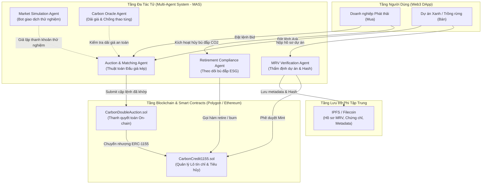

# Kiến trúc Hệ thống Giao dịch Tín chỉ Carbon (Multi-Agent System on Blockchain)

## 1. Mô hình Kiến trúc Tổng thể (Architecture Overview)

Hệ thống được thiết kế theo mô hình lai **Off-chain Intelligence, On-chain Trust**:
- **Tầng Blockchain (Trust & Settlement Layer):** Đảm bảo tính minh bạch, bất biến, chống gian lận và chống trùng lặp tín chỉ (Double Counting) thông qua chuẩn ERC-1155.
- **Tầng Hệ Đa Tác Tử (Multi-Agent Layer):** Tối ưu hóa tính toán, định giá, thẩm tra hồ sơ và tự động khớp lệnh ngoài chuỗi nhằm giảm thiểu chi phí gas.
- **Tầng Lưu trữ Phi tập trung (Decentralized Storage Layer):** Sử dụng IPFS lưu trữ hồ sơ MRV, báo cáo kiểm kê phát thải ngoài chuỗi.

---

## 2. Luồng Vòng đời Tín chỉ Carbon (Lifecycle Workflow)

1. **Đăng ký & Thẩm định (Verification):**
   - Chủ dự án gửi dữ liệu đo đạc (MRV).
   - `MRV Agent` kiểm tra tính hợp lệ, tính toán SHA-256 hash và đưa tài liệu lên `IPFS`.
   - Admin kích hoạt hàm `mintCarbonCredit()` trên `CarbonCredit1155.sol` với IPFS URI tương ứng.

2. **Chào mua / Chào bán & Kiểm tra Dải giá:**
   - Các bên ký chữ ký điện tử cho lệnh `BID` hoặc `ASK`.
   - `Oracle Agent` kiểm tra giá đặt có vi phạm dải giá an toàn (Floor/Ceiling) hay không.

3. **Khớp lệnh Đấu giá kép (Double Auction Matching):**
   - `Matching Agent` thu thập sổ lệnh theo từng chu kỳ (Periodic Auction).
   - Áp dụng thuật toán $k$-Double Auction ($k=0.5$ mid-price) để tìm các cặp giá thoả mãn $P_{bid} \ge P_{ask}$.
   - Sinh bằng chứng giao dịch và gửi lên `CarbonDoubleAuction.sol`.

4. **Thanh quyết toán On-chain:**
   - Hợp đồng `CarbonDoubleAuction.sol` nhận lệnh, kiểm tra tính duy nhất (tránh replay attack) và chuyển giao token an toàn.

5. **Tiêu hủy để Bù đắp Phát thải (Retirement / Burning):**
   - Khi doanh nghiệp cần đáp ứng báo cáo kiểm kê ESG, `Retirement Agent` hỗ trợ gọi hàm `retireCarbonCredit()`.
   - Tín chỉ được chuyển vào địa chỉ `0x00...00` (đốt vĩnh viễn), loại bỏ hoàn toàn khả năng bán lại.
