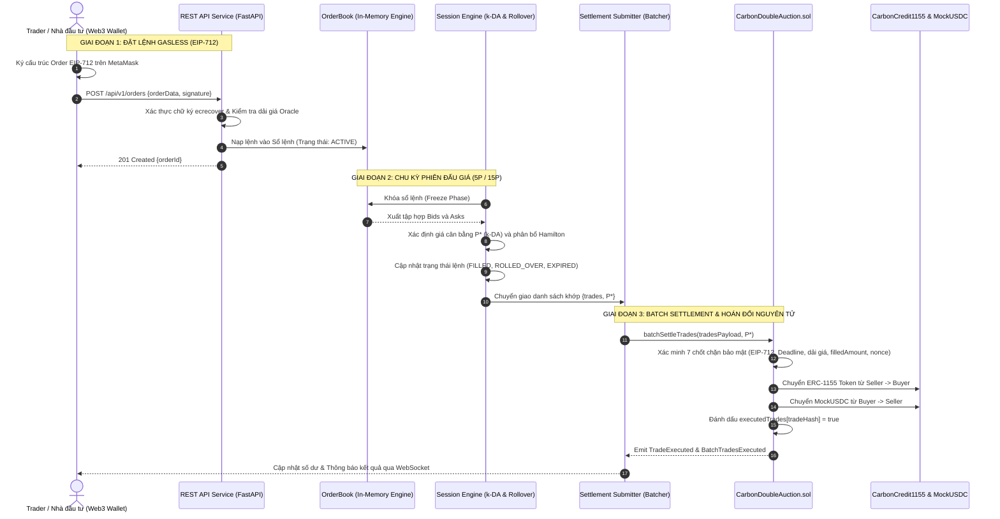

# Kiến trúc Hệ thống Giao dịch Tín chỉ Carbon (Multi-Agent System on Blockchain)
## Phiên bản 2.0 (Cập nhật Kiến trúc Khớp lệnh Đấu giá kép Định kỳ & Batch Settlement)

---

## 1. Mô hình Kiến trúc Tổng thể (Architecture Overview)

Hệ thống được thiết kế theo mô hình lai **Off-chain Intelligence, On-chain Trust**:
- **Tầng Blockchain (Trust & Settlement Layer):** Đảm bảo tính minh bạch, bất biến, chống gian lận và chống trùng lặp tín chỉ (Double Counting) thông qua chuẩn ERC-1155 kết hợp thanh toán nguyên tử (Atomic Swap) với đồng stablecoin MockUSDC (6 decimals).
- **Tầng Hệ Đa Tác Tử (Multi-Agent Layer - MAS):** Tối ưu hóa tính toán, định giá, thẩm tra hồ sơ và tự động khớp lệnh ngoài chuỗi nhằm giảm thiểu chi phí gas thông qua cơ chế Đấu giá kép định kỳ (Periodic Double Auction - PDA).
- **Tầng Lưu trữ Phi tập trung (Decentralized Storage Layer):** Sử dụng IPFS (thông qua Pinata Gateway) lưu trữ hồ sơ PDD, báo cáo MRV và siêu dữ liệu (Metadata JSON) ngoài chuỗi.

```mermaid
graph TD
    subgraph UI ["Tầng Người Dùng (Web3 DApp & MetaMask)"]
        A1["Doanh nghiệp Phát thải (Trader Mua)"]
        A2["Chủ Dự án Xanh (Trader Bán)"]
        A3["Kiểm toán viên (VVB Verifier)"]
    end

    subgraph MAS ["Tầng Đa Tác Tử (Multi-Agent System - MAS Engine)"]
        API["REST API Service<br/>(FastAPI - Tiếp nhận lệnh EIP-712)"]
        OB["Sổ Lệnh Kép (OrderBook)<br/>(Bids & Asks In-Memory/DB)"]
        SE["Session Engine<br/>(k-DA Uniform Price & Hamilton Prorata)"]
        SS["Settlement Submitter<br/>(Batcher & Proof Generator)"]
        MRV["MRV Verification Agent<br/>(Thẩm định dự án & Hash SHA-256)"]
        ORA["Carbon Oracle Agent<br/>(Dải giá ±20% & Chống thao túng)"]
        RET["Retirement Compliance Agent<br/>(Theo dõi & Xác thực bù đắp ESG)"]
    end

    subgraph Storage ["Tầng Lưu trữ Phân tán"]
        IPFS["IPFS / Pinata Gateway<br/>(Hồ sơ MRV, PDD, Metadata CID)"]
    end

    subgraph Blockchain ["Tầng Blockchain & Smart Contracts (Polygon Amoy Testnet)"]
        C1["CarbonCredit1155.sol<br/>(Quản lý Lô tín chỉ & Buffer Pool Vault)"]
        C2["CarbonDoubleAuction.sol<br/>(Batch Settlement & 7 Lớp Bảo mật)"]
        USDC["MockUSDC.sol<br/>(ERC-20 Stablecoin 6 decimals)"]
    end

    A1 -->|Ký EIP-712 Gasless (Bid)| API
    A2 -->|Ký EIP-712 Gasless (Ask)| API
    A2 -->|Nộp hồ sơ dự án| MRV
    A3 -->|Thẩm định & Ký duyệt on-chain| C1
    MRV -->|Lưu metadata & Hash| IPFS
    ORA -.->|Kiểm tra dải giá an toàn| API
    API -->|Nạp lệnh hợp lệ| OB
    OB -->|Freeze & Xuất sổ lệnh| SE
    SE -->|Lô giao dịch khớp & Giá P*| SS
    SS -->|Gọi batchSettleTrades()| C2
    C2 -->|Chuyển nhượng ERC-1155| C1
    C2 -->|Chuyển tiền micro-USDC| USDC
    A1 -->|Kích hoạt hủy bù đắp CO2| RET
    RET -->|Gọi hàm retireCarbonCredit()| C1
```

---

## 2. Bốn Quyết định Kiến trúc Cốt lõi (Core Architectural Decisions - ADR-001)

Hệ thống tuân thủ nghiêm ngặt 4 quyết định kiến trúc đã được thống nhất tại cuộc họp Sprint Alignment:

1. **Chu kỳ phiên đấu giá định kỳ (Periodic Double Auction Session Duration):**
   - **Testnet Demo (Polygon Amoy):** $T = 5 \text{ phút}$ (Call Phase: 4m30s, Freeze/Match: 15s, Settle: 15s).
   - **Thực tế (Mainnet / Pilot):** $T = 15 \text{ phút}$ (Call Phase: 14m, Freeze/Match: 30s, Settle: 30s).
2. **Quy tắc phá hòa đa tiêu chí (`age_prorata` & Hamilton Largest Remainder):**
   - Ưu tiên lệnh có thâm niên (lệnh chuyển tiếp từ các phiên trước).
   - Với các lệnh cùng tuổi, chia tỷ lệ Pro-rata khối lượng lý tưởng và dùng giải thuật phần dư lớn nhất (Hamilton method) để làm tròn số nguyên, bảo toàn chính xác 100% khối lượng khớp mà không thất thoát token.
3. **Quy tắc giá đồng nhất toàn phiên $k$-DA (`kda` Uniform Clearing Price):**
   - Xóa bỏ triệt để cơ chế khớp theo cặp (`pair`).
   - Mọi cặp lệnh được khớp trong phiên đều thanh toán tại duy nhất mức giá cân bằng:
     $$P^* = k \cdot b_M + (1 - k) \cdot s_M$$
     (với $k = 0.5$ mid-price, đảm bảo tốc độ hội tụ hiệu quả $O(1/m^2)$).
4. **Giới hạn chuyển tiếp lệnh (Rollover Limit) cho lệnh GTC:**
   - Cấu hình `MAX_ROLLOVER_SESSIONS = 3` phiên liên tiếp.
   - Khi vượt quá 3 phiên mà chưa khớp hết, phần dư của lệnh tự động chuyển sang trạng thái `EXPIRED` để bảo vệ an toàn vốn cho nhà đầu tư.

---

## 3. Luồng Tương tác 3 Bên Hoàn chỉnh (3-Party End-to-End Workflow)

Quá trình giao dịch được phân tách rõ ràng qua 3 thực thể: **Trader (Client)**, **Matching Agent Service (Off-chain Engine)** và **Smart Contract (On-chain Settlement)**:



---

## 4. Vòng đời Lệnh Toàn diện (Complete Order Lifecycle)

Trạng thái lệnh trong hệ thống tuân theo máy trạng thái hữu hạn (Finite State Machine):
- **`NEW`**: Lệnh được tạo trên frontend, người dùng chuẩn bị ký EIP-712.
- **`ACTIVE`**: Lệnh đã được xác thực chữ ký và dải giá Oracle thành công, sẵn sàng tham gia chu kỳ phiên đấu giá.
- **`PARTIALLY_FILLED`**: Lệnh đã được khớp một phần khối lượng trong phiên hiện tại.
- **`ROLLED_OVER`**: Lệnh GTC chưa khớp hết được chuyển tiếp sang phiên kế tiếp, tăng bộ đếm `rollover_count += 1` và bảo lưu độ tuổi thâm niên.
- **`FILLED`**: Lệnh đã khớp đủ 100% khối lượng, được chuyển sang hàng đợi thanh quyết toán on-chain.
- **`CANCELLED`**: Lệnh bị hủy chủ động bởi người dùng (Soft Cancel qua API hoặc Hard Cancel trên Smart Contract) hoặc lệnh IOC chưa khớp hết.
- **`EXPIRED`**: Lệnh vượt quá thời hạn hiệu lực (`block.timestamp > deadline`) hoặc vượt quá số phiên cho phép (`rollover_count >= MAX_ROLLOVER_SESSIONS`).

---

## 5. Quy chuẩn Dữ liệu & Đơn vị Đo lường

Nhằm loại bỏ hoàn toàn các xung đột kỹ thuật, toàn hệ thống thống nhất chuẩn dữ liệu sau:
- **Tín chỉ Carbon (Carbon Credit):**
  - Đơn vị tính: Tấn CO2 tương đương ($1 \text{ token} = 1 \text{ tCO}_2\text{e}$ với `decimals = 0`).
  - Kiểu dữ liệu on-chain: `uint128 amount`.
- **Tiền tệ Thanh toán (Settlement Currency):**
  - Đồng tiền sử dụng: `MockUSDC` theo chuẩn ERC-20 (`decimals = 6`).
  - Đơn vị tính: Micro-USDC ($1 \text{ USD} = 1,000,000 \text{ micro-USDC}$).
  - Kiểu dữ liệu on-chain: `uint128 pricePerUnit`.
  - Tuyệt đối cấm sử dụng thuật ngữ `wei USDC`.
- **Quỹ Dự phòng Rủi ro (Buffer Pool Vault):**
  - Tỷ lệ trích lập tự động: $10\% - 20\%$ tổng sản lượng đúc, khóa vĩnh viễn trên hợp đồng quản lý kho lưu ký để bảo hiểm rủi ro thiên tai/cháy rừng.
