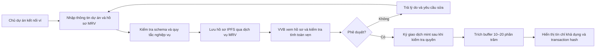
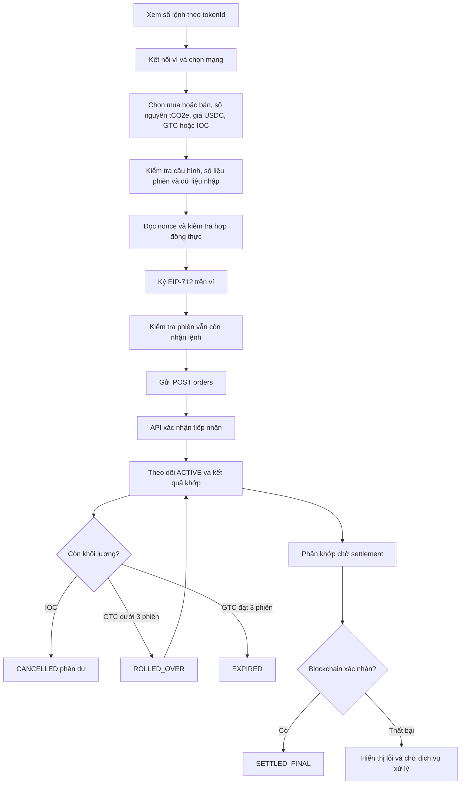
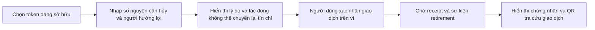

# Luồng người dùng CarbonChain

Tài liệu thiết kế phần giao diện của Ngô Văn Thắng. Trading Floor có mã triển khai; các cổng chủ dự án, VVB và ESG dưới đây là luồng thiết kế để đối soát trước khi dựng wireframe, chưa phải chức năng đã nghiệm thu.

## Chủ dự án và kiểm toán viên

Form dự án thu thập tên, vintage, vị trí, methodology, additionality, tiêu chuẩn và tỷ lệ buffer; SDGs bắt buộc cho Gold Standard. Dữ liệu không hợp lệ phải được sửa trước khi gửi. Xác nhận thành công chỉ sau khi dịch vụ lưu và giao dịch mint thực được xác nhận.

## Sàn giao dịch

Không tự gửi lại POST khi mất kết nối. Nếu chưa có ABI hoặc API, hiển thị lý do chưa sẵn sàng. Đơn vị giao diện là USDC/tCO2e, payload giá là micro-USDC. Cấp quyền ERC-20/ERC-1155 là điều kiện settlement riêng, có thể cần gas; việc ký lệnh không chuyển tài sản.

## Bù đắp phát thải ESG

Chứng nhận chỉ sinh từ bằng chứng retirement được xác nhận; lỗi hoặc giao dịch bị từ chối không được hiển thị là đã hủy thành công.
